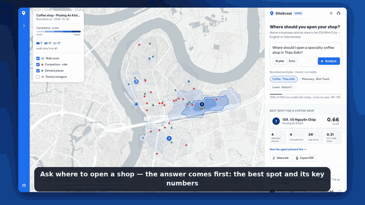
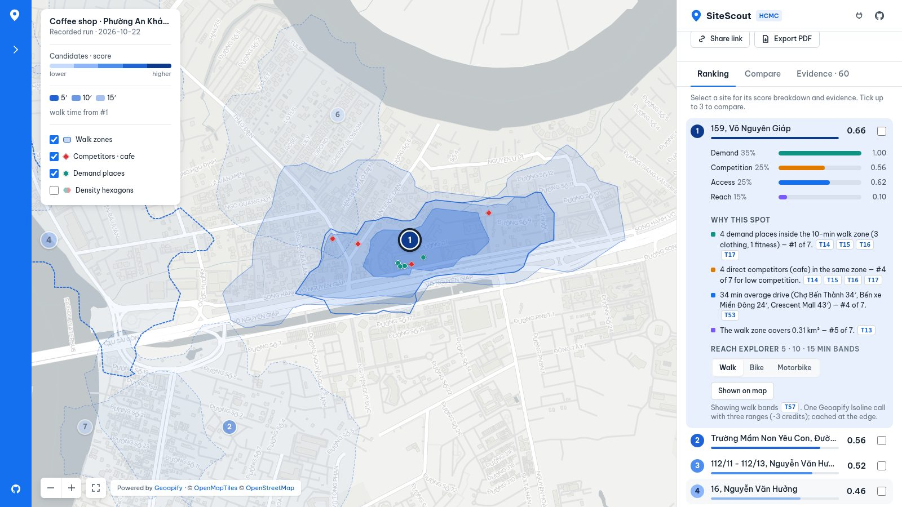

# 📍 SiteScout

SiteScout is an open-source agent for choosing small-business locations in Ho Chi Minh City. Ask a question in English or Vietnamese and it uses Geoapify to resolve the area, draw walking catchments, count competitors and demand places, measure drive access, and rank candidate sites. Each reported figure has a `[Tn]` reference to the request that produced it. You can use the same engine in the web demo, from the CLI, or through an MCP host.

**[▶ Live demo](https://sitescout.huynhthanh.workers.dev)** · [Docs](https://sitescout-docs.pages.dev/docs) · [Tutorial](docs/tutorial.md) · [Examples](examples/) · [Use it from Claude, Cursor, Codex, Kiro](agent/README.md) · [How we use the Geoapify MCP server](docs/mcp.md) · [Demo proxy: key, limits, cache](docs/demo-proxy.md) · [Feedback for Geoapify](docs/FEEDBACK.md)

[](https://github.com/ducvuathuduc/sitescout-agent/actions/workflows/ci.yml)
[](https://github.com/ducvuathuduc/sitescout-agent/releases)
[](LICENSE)
[](https://www.geoapify.com/)
[](agent/README.md)

<a href="https://sitescout.huynhthanh.workers.dev"></a>

Videos: [demo](https://github.com/ducvuathuduc/sitescout-agent/raw/media/sitescout-demo-16x9.mp4) · [tutorial](https://github.com/ducvuathuduc/sitescout-agent/raw/media/sitescout-tutorial.mp4) · [vertical demo](https://github.com/ducvuathuduc/sitescout-agent/raw/media/sitescout-demo-9x16.mp4).

## Features

- Walking catchments from Geoapify Isoline, with Places counts inside each polygon using `filter=geometry:<isoline id>`.
- Reports, maps and request traces; citations include the endpoint, status, latency and result summary without the key.
- A score breakdown and comparison of up to 3 sites; 5 / 10 / 15-minute reach bands for walking, cycling or motorbike travel. One set of bands is estimated at 6 credits ([tutorial](docs/tutorial.md), [credit rules](docs/demo-proxy.md#how-credits-are-counted)).
- Share links and PDF export ([sample report](docs/assets/sample-report.pdf)), competitor and demand layers, density hexagons and a mobile layout ([design notes](docs/design/DESIGN_SYSTEM.md)).
- Rule-based planning with an optional validated LLM planner; Vietnamese place resolution tested against reference coordinates ([benchmark](bench/hcmc-addresses/RESULTS.md)).

## Real results

These runs were recorded on 2026-10-22. Each row links to its report and API trace.

| Question | Resolved area | Top site | Score | Calls | Recorded credit estimate | Sources |
|---|---|---|---|---|---|---|
| Specialty coffee in Thảo Điền | Phường An Khánh | 159 Võ Nguyên Giáp | 0.66 | 57 | ~79 | [Report](examples/thaodien-coffee/report.md) · [trace](examples/thaodien-coffee/trace.jsonl) |
| Pharmacy in Bình Thạnh | Phường Thạnh Mỹ Tây (Hàng Xanh) | 113 Nguyễn Hữu Cảnh | 0.58 | 59 | ~79 | [Report](examples/binhthanh-pharmacy/report.md) · [trace](examples/binhthanh-pharmacy/trace.jsonl) |
| Office lunch in District 1 | Phường Sài Gòn | Nguyễn Thị Minh Khai, near the French Consulate | 0.82 | 59 | ~127 | [Report](examples/saigon-lunch/report.md) · [trace](examples/saigon-lunch/trace.jsonl) |

Each example also includes `report.html`, `map.jpg` and `result.json`.
Credit estimates in the recordings predate the 2026-10-31 corrections for isolines, boundary polygons and Place Details features. Applying the [corrected credit rules](docs/demo-proxy.md#how-credits-are-counted) to the linked traces gives ~91, ~90 and ~139 credits respectively.
Scores are normalized within a question and compare its candidates only.



## How it works

A planner produces a validated business, area, category list and travel settings. The engine resolves the area with Autocomplete, Geocoding and Boundaries, samples candidate points, draws walking isolines, counts places inside them, and measures drive times with Route Matrix. It then scores the candidates and writes the report and trace.

The score is `0.35 × demand density + 0.25 × (1 − competition) + 0.25 × access + 0.15 × walk reach`, with each factor min-max normalized across the candidates. Weights are versioned as `1.0.0-isoline` in [src/engine/scout.ts](src/engine/scout.ts). The recorded examples use 7 candidates and 10-minute walks ([example plan](examples/thaodien-coffee/report.md)). Read the [engine walkthrough](docs/tutorial.md#4-how-the-engine-answers-10-min) and [MCP versus REST explanation](docs/mcp.md).

## Quickstart

Install Node.js 20+ and get a free [Geoapify key](https://myprojects.geoapify.com). These are the [tutorial's CLI commands](docs/tutorial.md#3-install-and-run-it-yourself-5-min), with `YOUR_KEY` as the placeholder. Run them in Bash:

```sh
git clone https://github.com/ducvuathuduc/sitescout-agent.git && cd sitescout-agent
npm ci && npm run build
export GEOAPIFY_API_KEY=YOUR_KEY
node dist/cli.js scout "Where should I open a specialty coffee shop in Thảo Điền?" --id my-coffee
```

In PowerShell, run `npm ci` and `npm run build` separately, and replace the `export` line with `$env:GEOAPIFY_API_KEY = "YOUR_KEY"`.
Output goes to `examples/my-coffee/`: `report.md`, `report.html`, `map.jpg`, `result.json` and `trace.jsonl`.
The tutorial estimates 85–140 credits per run; `--credit-cap 300` is the CLI default. The documented free plan has 3,000 credits per day ([tutorial](docs/tutorial.md), [dated pricing notes](docs/demo-proxy.md)).

For planning options and environment variables, see the [tutorial](docs/tutorial.md). The CLI needs a key; the MCP server below can use the public demo proxy without one.

## Use it from your AI tool

SiteScout's stdio server runs as `node dist/mcp-server.js`. Its five tools are `plan_site_question`, `scout_site`, `resolve_place`, `walk_isochrone` and `get_evidence` ([source](src/mcp-server.ts)). Each guide includes the official Geoapify MCP server alongside it.

| Host | Guide | Config file |
|---|---|---|
| Claude Code | [Setup](agent/clients/claude-code.md) | Project `.mcp.json` |
| Cursor | [Setup](agent/clients/cursor.md) | `.cursor/mcp.json` or `~/.cursor/mcp.json` |
| Codex CLI | [Setup](agent/clients/codex.md) · [example](agent/clients/codex.config.example.toml) | `~/.codex/config.toml` |
| Kiro | [Setup](agent/clients/kiro.md) · [example](agent/clients/kiro.mcp.example.json) | `.kiro/settings/mcp.json` or `~/.kiro/settings/mcp.json` |
| Claude Desktop | [Setup](agent/clients/claude-desktop.md) | Windows `%APPDATA%\Claude\claude_desktop_config.json`; macOS `~/Library/Application Support/Claude/claude_desktop_config.json` |

Use SiteScout [next to the Geoapify MCP server](agent/clients/geoapify-mcp-side-by-side.md): SiteScout runs the analysis; Geoapify handles individual geocoding, places, routing and geometry follow-ups. SiteScout can use the HCMC proxy without a key; the direct Geoapify MCP connection requires an `x-api-key` header.

There are [10 recorded agent sessions](agent/README.md):

- **04b, Codex CLI with both MCP servers (2026-11-04).** The model called SiteScout `plan_site_question` and `scout_site`, then Geoapify MCP `search_places` for the cafés nearest the top site, then SiteScout `get_evidence` six times before citing numbers. Walk-through: [docs/mcp.md](docs/mcp.md#recorded-two-server-session-04b-codex-cli).
- **04a, the same question with web search on.** The model skipped SiteScout and answered from web pages. It is kept to show why the question names the tools.
- **01 to 03c, open-weight models on Workers AI** (Llama 3.3 70B, Llama 4 Scout, Mistral Small 3.1) through [agent/host.mjs](agent/host.mjs). Five of them failed, and each failure led to a server change, listed in the table.

Use the [system prompt](agent/SYSTEM_PROMPT.md) to guide citation and area checks.

## Geoapify APIs used

The web demo, `scout` CLI command and SiteScout MCP server call REST. The `ask` and `smoke` commands use Geoapify MCP. See [docs/mcp.md](docs/mcp.md) for the tool-by-tool comparison and the dated MCP tool surface.

| API | Use in SiteScout |
|---|---|
| [Address Autocomplete](https://apidocs.geoapify.com/docs/geocoding/address-autocomplete/) | Resolve study areas and origins |
| [Forward Geocoding](https://apidocs.geoapify.com/docs/geocoding/forward-geocoding/) | Cross-check place resolution |
| [Reverse Geocoding](https://apidocs.geoapify.com/docs/geocoding/reverse-geocoding/) | Label candidate points |
| [Boundaries](https://apidocs.geoapify.com/docs/boundaries/) | Identify the study area's ward |
| [Isoline](https://apidocs.geoapify.com/docs/isolines/) | Walking catchments and reach bands |
| [Places](https://apidocs.geoapify.com/docs/places/) | Competitors and demand places inside catchments |
| [Place Details](https://apidocs.geoapify.com/docs/place-details/) | Top-site details and a 5-minute drive area ([engine](src/engine/scout.ts)) |
| [Route Matrix](https://apidocs.geoapify.com/docs/route-matrix/) | Drive times from 3 origins to candidates ([example plan](examples/thaodien-coffee/report.md)) |
| [Routing](https://apidocs.geoapify.com/docs/routing/) | Route to the top candidate |
| [Static Maps](https://apidocs.geoapify.com/docs/maps/static/) | Report map image |
| [Map Tiles](https://apidocs.geoapify.com/docs/maps/map-tiles/) | Web demo basemap through the proxy |
| [Batch Geocoding](https://apidocs.geoapify.com/docs/geocoding/batch/) | Client helper for bulk lists; outside the default analysis |
| [MCP server](https://apidocs.geoapify.com/docs/mcp/) | The `ask` / `smoke` pipeline uses the 11 tools recorded in the [fixture](tests/fixtures/live/mcp_tools_list_2026-10-22.sse.txt); later tool additions are documented in [docs/mcp.md](docs/mcp.md) |

## Demo proxy

The Worker keeps the Geoapify key server-side and limits public requests to HCMC.
API calls and tiles share a 2,400-credit daily budget, with 180 live calls per visitor; API responses are cached for 24 hours and tiles for 30 days.
At a live quota limit, the web app offers a recorded run; see [docs/demo-proxy.md](docs/demo-proxy.md) for the source, dated measurements, credit estimates and known limits.

## Benchmark

The HCMC address benchmark ran on 2026-10-22 with 55 queries and independent Wikidata coordinates. The [full results](bench/hcmc-addresses/RESULTS.md) define tolerances and include every query:

| Strategy | Within tolerance | Old-ward addresses |
|---|---|---|
| Geocoding search, top result | 37/55 (67%) | 4/8 |
| Autocomplete, top result | 42/55 (76%) | 3/8 |
| SiteScout `resolvePlace` v1.1 | 48/55 (87%) | 6/8 |

This measures coordinate matching for the recorded dataset, not store performance. The [Geoapify feedback](docs/FEEDBACK.md) includes reproductions for address labels, old wards, category counts and boundaries. [VN-GeoBench](bench/vngeobench/EXPECTED.md) separately defines expected MCP tool behavior; it is not another measured accuracy result.

## Docs index

| Page | Repository source | Published docs |
|---|---|---|
| MCP integration | [mcp.md](docs/mcp.md) | [mcp](https://sitescout-docs.pages.dev/docs/mcp) |
| Demo proxy | [demo-proxy.md](docs/demo-proxy.md) | [demo-proxy](https://sitescout-docs.pages.dev/docs/demo-proxy) |
| Tutorial | [tutorial.md](docs/tutorial.md) | [tutorial](https://sitescout-docs.pages.dev/docs/tutorial) |
| MCP reference | [mcp-reference.md](docs/mcp-reference.md) | [mcp-reference](https://sitescout-docs.pages.dev/docs/mcp-reference) |
| Credits | [Credit rules](docs/demo-proxy.md#how-credits-are-counted) | [credits](https://sitescout-docs.pages.dev/docs/credits) |
| How it works | [Engine walkthrough](docs/tutorial.md#4-how-the-engine-answers-10-min) | [how-it-works](https://sitescout-docs.pages.dev/docs/how-it-works) |
| Provenance | [provenance.md](docs/provenance.md) | [provenance](https://sitescout-docs.pages.dev/docs/provenance) |
| Edge cases | [edge-cases.md](docs/edge-cases.md) | [edge-cases](https://sitescout-docs.pages.dev/docs/edge-cases) |
| Geoapify feedback | [FEEDBACK.md](docs/FEEDBACK.md) | [geoapify-feedback](https://sitescout-docs.pages.dev/docs/geoapify-feedback) |
| Agent | [agent/README.md](agent/README.md) | [agent](https://sitescout-docs.pages.dev/docs/agent) |
| Agent sessions | [Transcripts](agent/transcripts/) | [agent/sessions](https://sitescout-docs.pages.dev/docs/agent/sessions) |
| Claude Code | [Guide](agent/clients/claude-code.md) | [clients/claude-code](https://sitescout-docs.pages.dev/docs/clients/claude-code) |
| Cursor | [Guide](agent/clients/cursor.md) | [clients/cursor](https://sitescout-docs.pages.dev/docs/clients/cursor) |
| Codex CLI | [Guide](agent/clients/codex.md) | [clients/codex](https://sitescout-docs.pages.dev/docs/clients/codex) |
| Kiro | [Guide](agent/clients/kiro.md) | [clients/kiro](https://sitescout-docs.pages.dev/docs/clients/kiro) |
| Claude Desktop | [Guide](agent/clients/claude-desktop.md) | [clients/claude-desktop](https://sitescout-docs.pages.dev/docs/clients/claude-desktop) |
| Both MCP servers | [Guide](agent/clients/geoapify-mcp-side-by-side.md) | [clients/two-servers](https://sitescout-docs.pages.dev/docs/clients/two-servers) |
| Record a Claude Code session | [Guide](agent/clients/record-claude-code.md) | [clients/record-claude-code](https://sitescout-docs.pages.dev/docs/clients/record-claude-code) |
| HCMC addresses | [Results](bench/hcmc-addresses/RESULTS.md) | [benchmarks/hcmc-addresses](https://sitescout-docs.pages.dev/docs/benchmarks/hcmc-addresses) |
| VN-GeoBench | [Expected behavior](bench/vngeobench/EXPECTED.md) | [benchmarks/vngeobench](https://sitescout-docs.pages.dev/docs/benchmarks/vngeobench) |

## Development

Run from the repository root. Scripts are defined in [package.json](package.json).

| Command | Purpose |
|---|---|
| `npm run typecheck` | Check engine and web TypeScript |
| `npm run lint` | Lint source and tests |
| `npm test` | Run the tests |
| `npm run build` | Compile the CLI and MCP server |
| `npm run docs:build` | Build the docs site |
| `npm run docs:check` | Check the docs site |
| `npm run demo:dry-run` | Build the demo and run Wrangler's dry-run bundle check without uploading |

The [CI workflow](.github/workflows/ci.yml) runs typecheck, lint, tests and build. Docs scripts operate on `docs-site/`. The demo dry run invokes Wrangler and requires Node.js 22 with the pinned tool version ([demo setup](docs/demo-proxy.md#7-deploy-your-own-copy)).
See [CONTRIBUTING.md](CONTRIBUTING.md), [CODE_OF_CONDUCT.md](CODE_OF_CONDUCT.md) and [SECURITY.md](SECURITY.md).

## Limits

- The current question packs and public proxy cover Ho Chi Minh City. POI coverage varies by street and can miss businesses in alleys.
- SiteScout does not measure foot traffic, rent, revenue or reliable opening hours. Candidate points are places to investigate, not confirmed available premises.
- Scoring weights are heuristic and have not been calibrated against store outcomes. Scores compare candidates within a run.
- Geocoder labels can contain outdated administrative units. Models can damage Vietnamese text or cite the wrong request; check `areaCheck` and the evidence ([recorded failures](agent/README.md)).
- Geoapify MCP does not provide the isoline and polygon-filter workflow used by the engine; that path uses REST ([comparison](docs/mcp.md)).
- Proxy credit costs are estimates; caps are not atomic and caching is per data center ([proxy limits](docs/demo-proxy.md#8-known-limits)).

## Attribution

- [Powered by Geoapify](https://www.geoapify.com/): geocoding, places, isolines, routing, boundaries, maps and the MCP server, through the [Geoapify Open Geospatial Program](https://www.geoapify.com/open-geospatial-program/).
- Map data © [OpenStreetMap](https://www.openstreetmap.org/copyright) contributors (ODbL); basemap style © [OpenMapTiles](https://openmaptiles.org/).
- [Leaflet](https://leafletjs.com/) (BSD-2-Clause), Open Sans (OFL), and Be Vietnam Pro; third-party notes are in [docs/provenance.md](docs/provenance.md).
- UI layout modeled on CARTO Builder public maps as a reference; no CARTO code or assets are used. [Design notes](docs/design/DESIGN_SYSTEM.md).

SiteScout is an independent project; Geoapify and CARTO are trademarks of their owners.

## License

[MIT](LICENSE) © 2026 Thành Huỳnh Diệu ([@ducvuathuduc](https://github.com/ducvuathuduc))
