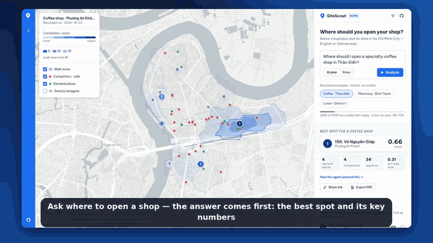
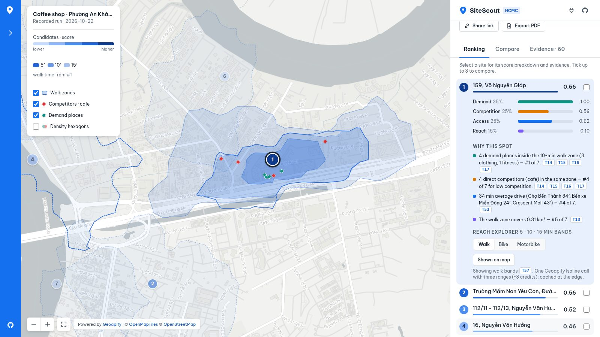
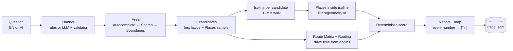
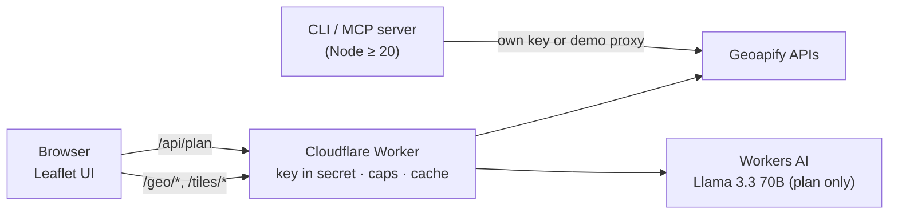

<div align="center">

# 📍 SiteScout

**Ask "where should I open my shop?" for Ho Chi Minh City. Get a ranked shortlist of real sites, where every number links to the Geoapify API call it came from.**

[](https://github.com/ducvuathuduc/sitescout-agent/actions/workflows/ci.yml)
[](https://github.com/ducvuathuduc/sitescout-agent/releases)
[](LICENSE)
[](https://www.geoapify.com/)
[](agent/README.md)

**[▶ Live demo](https://sitescout.huynhthanh.workers.dev)** · [Tutorial](docs/tutorial.md) · [Examples](examples/) · [Use it from Claude / Cursor](agent/README.md) · [Feedback for Geoapify](docs/FEEDBACK.md)

<a href="https://sitescout.huynhthanh.workers.dev"></a>

🎬 Videos: [demo (67 s)](https://github.com/ducvuathuduc/sitescout-agent/raw/media/sitescout-demo-16x9.mp4) · [full tutorial](https://github.com/ducvuathuduc/sitescout-agent/raw/media/sitescout-tutorial.mp4) · [vertical cut](https://github.com/ducvuathuduc/sitescout-agent/raw/media/sitescout-demo-9x16.mp4)

</div>

SiteScout is an open-source location-intelligence agent built for the
[Geoapify Open Geospatial Program](https://www.geoapify.com/open-geospatial-program/) (Batch #2, *AI × Geospatial*).
It turns a plain-language question — in English or Vietnamese — into a site-selection analysis on Geoapify:
it draws a **10-minute walking isochrone** around each candidate, counts competitors and demand
points **inside that polygon**, measures drive times from the places customers come from, and ranks the
candidates with a published formula. The report cites every figure as `[Tn]`, and `[Tn]` is one line in a
trace file holding the exact request (without the key), its status, latency and result.

> **Scope, stated plainly.** One city (Ho Chi Minh City), three sample questions, deterministic scoring.
> SiteScout does not know foot traffic, rents or revenue. It is decision support built on open map data
> ([OpenStreetMap](https://www.openstreetmap.org/copyright) via Geoapify), and it says so in every report.

---

## ✨ Features

- **Isoline-first catchments.** Real walking (or motorbike/drive) isochrones from the Geoapify Isoline API, not circles.
  POIs are counted with `filter=geometry:<isoline id>`, so "inside a 10-minute walk" means exactly that.
- **Evidence trace for every number.** `trace.jsonl` holds one line per API call; `[Tn]` in the report points at it.
- **Vietnamese-address aware.** Handles diacritics, damaged diacritics and the July-2025 ward reform
  (old *Phường 12, Quận 5* vs new ward names) — measured on a 55-query benchmark, not assumed.
- **AI where it helps, engine where it matters.** An optional LLM turns free text into a plan; a validator and a
  deterministic engine do the geography. *AI proposes, engine verifies.*
- **Three ways to use it:** a [public web demo](https://sitescout.huynhthanh.workers.dev), a CLI, and an
  **MCP server** (5 tools) for Claude Code, Cursor and Claude Desktop.
- **Safe public demo.** The Geoapify key lives only in a Cloudflare Worker secret; per-IP and daily caps,
  edge caching, and recorded runs as a fallback when the cap is reached.

## 🧪 Real results (recorded 2026-10-22)

| Question | Resolved area | #1 site | Score | Calls · credits | Report |
|---|---|---|---|---|---|
| Where should I open a specialty coffee shop in Thảo Điền? | Phường An Khánh | 159 Võ Nguyên Giáp | 0.66 | 57 · ~79 | [report](examples/thaodien-coffee/report.md) · [trace](examples/thaodien-coffee/trace.jsonl) |
| Where should I open a pharmacy in Bình Thạnh? | Phường Thạnh Mỹ Tây (Hàng Xanh) | 113 Nguyễn Hữu Cảnh | 0.58 | 59 · ~79 | [report](examples/binhthanh-pharmacy/report.md) · [trace](examples/binhthanh-pharmacy/trace.jsonl) |
| Where should I open an office-lunch restaurant in District 1? | Phường Sài Gòn | Nguyễn Thị Minh Khai (near the French Consulate) | 0.82 | 59 · ~127 | [report](examples/saigon-lunch/report.md) · [trace](examples/saigon-lunch/trace.jsonl) |

Each folder also has `report.html` (interactive map), `map.jpg` (Geoapify Static Maps) and `result.json`.
Scores are min-max normalised within one question, so they compare candidates, not cities.



## 🧭 How it works



**Score** = 0.35·demand density + 0.25·(1 − competition) + 0.25·access + 0.15·walk reach,
each min-max normalised across the candidates (weights `1.0.0-isoline`, in `src/engine/scout.ts`).



## ⚡ Quickstart

```sh
git clone https://github.com/ducvuathuduc/sitescout-agent.git && cd sitescout-agent
npm ci && npm run build
export GEOAPIFY_API_KEY=your_key        # free at https://myprojects.geoapify.com
node dist/cli.js scout "Where should I open a specialty coffee shop in Thảo Điền?"
```

Output lands in `examples/<id>/`: `report.md`, `report.html`, `map.jpg`, `result.json`, `trace.jsonl`.
A run costs roughly 60–130 Geoapify credits; the free plan allows 3,000 per day.

## ⚙️ Configuration

| Variable | Required | Default | Purpose |
|---|---|---|---|
| `GEOAPIFY_API_KEY` | yes (CLI) | — | Sent as the `x-api-key` header. Never written to any output file. |
| `--credit-cap` (flag) | no | `300` | Stops a run before it exceeds this many estimated credits. |
| `--planner` (flag) | no | `heuristic` | `llm` uses the OpenAI-compatible endpoint below, validated, with rule fallback. |
| `SITESCOUT_LLM_BASE_URL` | no | — | Any OpenAI-compatible API (Groq, Gemini, OpenAI, Workers AI). |
| `SITESCOUT_LLM_MODEL` | no | — | Model id for the planner. |
| `SITESCOUT_LLM_API_KEY` | no | — | Key for that endpoint. |

The MCP server also runs **without** a key: it then uses the public demo proxy
(`https://sitescout.huynhthanh.workers.dev/geo`, HCMC only, rate-limited).

## 🗺️ Geoapify APIs used

| API | Where in SiteScout |
|---|---|
| [Address Autocomplete](https://apidocs.geoapify.com/docs/geocoding/address-autocomplete/) | Resolve the study area and origins; most robust to messy Vietnamese |
| [Geocoding (forward)](https://apidocs.geoapify.com/docs/geocoding/forward-geocoding/) | Second opinion when autocomplete is weak |
| [Reverse Geocoding](https://apidocs.geoapify.com/docs/geocoding/reverse-geocoding/) | Human-readable label for each candidate |
| [Boundaries (part-of)](https://apidocs.geoapify.com/docs/boundaries/) | Name the post-2025 ward the analysis runs in |
| [Isoline](https://apidocs.geoapify.com/docs/isolines/) | 10-minute walking catchment per candidate |
| [Places](https://apidocs.geoapify.com/docs/places/) | Competitors and demand POIs inside each isoline (`filter=geometry:<id>`) |
| [Place Details](https://apidocs.geoapify.com/docs/place-details/) | Details + 5-minute drive area for the top site |
| [Route Matrix](https://apidocs.geoapify.com/docs/route-matrix/) | Drive time from 3 origins to every candidate |
| [Routing](https://apidocs.geoapify.com/docs/routing/) | Route geometry for the top site |
| [Static Maps](https://apidocs.geoapify.com/docs/maps/static/) | `map.jpg` in each report |
| [Map Tiles](https://apidocs.geoapify.com/docs/maps/map-tiles/) | Basemap in the web demo (proxied, cached) |
| [Batch Geocoding](https://apidocs.geoapify.com/docs/geocoding/batch/) | `batchGeocode()` client in `src/engine/geoapify.ts` for bulk lists (not used in the default run) |
| [MCP server](https://apidocs.geoapify.com/mcp/) | Legacy `ask` pipeline; fixtures in `tests/fixtures/live/` |

## 🤖 Use it from your AI tool

SiteScout ships its own MCP server (`dist/mcp-server.js`, stdio) with five tools:
`plan_site_question`, `scout_site`, `resolve_place`, `walk_isochrone`, `get_evidence`.

```sh
# Claude Code
claude mcp add sitescout -e GEOAPIFY_API_KEY=YOUR_KEY -- node "$PWD/dist/mcp-server.js"
```

Setup for [Claude Code](agent/clients/claude-code.md), [Cursor](agent/clients/cursor.md) and
[Claude Desktop](agent/clients/claude-desktop.md), plus a [system prompt](agent/SYSTEM_PROMPT.md).

**About the transcripts:** the 8 sessions in [`agent/transcripts/`](agent/transcripts/) were recorded with a small
MCP host ([`agent/host.mjs`](agent/host.mjs)) driving **open-weight models on Cloudflare Workers AI** (Llama 3.3 70B,
Llama 4 Scout, Mistral Small 3.1). They are not Claude or Cursor recordings. Five of the eight are failures we kept
on purpose, each with the server change it caused — see [agent/README.md](agent/README.md).

## 📊 Benchmark: Vietnamese addresses after the 2025 reform

55 HCMC queries, reference coordinates from Wikidata (independent of Geoapify), run 2026-10-22
([full results](bench/hcmc-addresses/RESULTS.md)):

| Strategy | Within tolerance | Old-ward addresses |
|---|---|---|
| Geocoding search, top-1 | 37/55 (67%) | 4/8 |
| Autocomplete, top-1 | 42/55 (76%) | 3/8 |
| SiteScout `resolvePlace` v1.1 | **48/55 (87%)** | **6/8** |

Findings that came out of this (city label, old-ward matching, search vs autocomplete, categories union,
boundaries gap) are written up with reproductions in [docs/FEEDBACK.md](docs/FEEDBACK.md).

## 🎨 Design

The web demo follows a measured reference — CARTO Builder public maps — rather than an invented UI.
Measurements, side-by-side screenshots and the remaining differences are in
[docs/design/REFERENCE_RESEARCH.md](docs/design/REFERENCE_RESEARCH.md).

## ✅ Can and cannot

**Can:** rank candidate sites in HCMC by walking catchment, competition, demand POIs and drive access; explain
every number; run from a browser, a terminal or an AI assistant; run free within Geoapify's free plan.

**Cannot:** see foot traffic, rents, revenue or opening hours reliably; guarantee a POI list is complete
(OSM coverage varies by street); cover cities other than HCMC in this release.

## 🛣️ Roadmap

- [x] Isoline-first engine, 3 HCMC examples, evidence trace
- [x] Public web demo with caps and recorded fallback
- [x] MCP server with 5 tools + client guides
- [x] HCMC address benchmark and Geoapify feedback
- [ ] Hanoi and Đà Nẵng question packs
- [ ] Rent and footfall layers from open sources where licences allow
- [ ] Compare two shortlists side by side in the web demo

## 🧑‍💻 Development

```sh
npm run typecheck && npm run lint && npm test && npm run build
node web/build.mjs                    # build the web demo assets
```

CI runs the same four steps on every push ([.github/workflows/ci.yml](.github/workflows/ci.yml)).
See [CONTRIBUTING.md](CONTRIBUTING.md), [CODE_OF_CONDUCT.md](CODE_OF_CONDUCT.md) and [SECURITY.md](SECURITY.md).

## 🙏 Attribution

- **[Powered by Geoapify](https://www.geoapify.com/)** — geocoding, places, isolines, routing, boundaries, maps and
  the MCP server, through the Geoapify Open Geospatial Program.
- Map data © [OpenStreetMap](https://www.openstreetmap.org/copyright) contributors (ODbL); basemap style ©
  [OpenMapTiles](https://openmaptiles.org/).
- [Leaflet](https://leafletjs.com/) (BSD-2-Clause), Open Sans (OFL). Third-party notes: [docs/provenance.md](docs/provenance.md).
- UI layout modelled on CARTO Builder public maps (reference only; no CARTO code or assets used).

SiteScout is an independent project; Geoapify and CARTO are trademarks of their owners.

## 📄 License

[MIT](LICENSE) © 2026 Thành Huỳnh Diệu ([@ducvuathuduc](https://github.com/ducvuathuduc))
