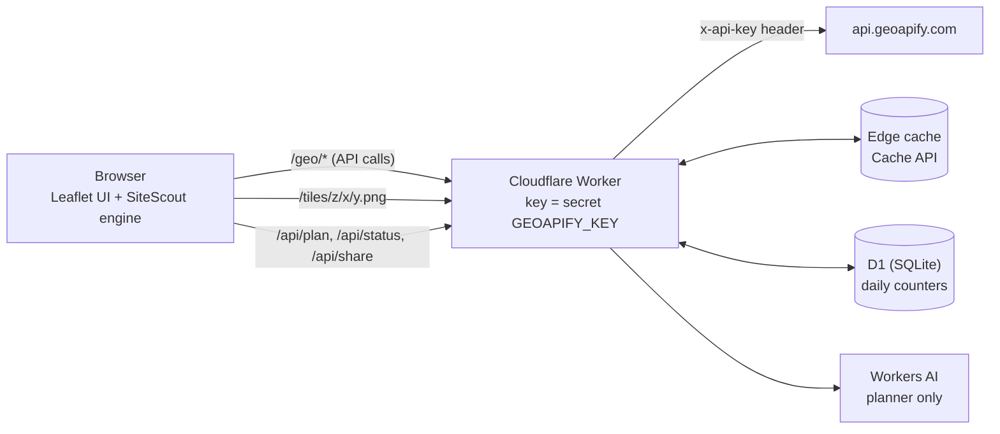

# Putting a Geoapify app online safely: the SiteScout demo proxy

The [public demo](https://sitescout.huynhthanh.workers.dev) runs live Geoapify analyses for anyone, with no sign-up
and no key in the page. One Cloudflare Worker on the free plan does this. It is two files:
[`web/worker/index.ts`](../web/worker/index.ts) (routes, proxy, counters, cache) and
[`web/worker/budget.ts`](../web/worker/budget.ts) (the credit rules, pure functions with unit tests in
[`tests/worker-budget.test.ts`](../tests/worker-budget.test.ts)).

This page covers the architecture, why the key stays secret, the limits, what a visitor sees when a limit is
reached, the cache and what it saves, the code, and how to deploy your own copy.

---

## 1. Architecture



The SiteScout engine runs **in the browser**. It is the same code as the CLI (`src/engine/`), pointed at the
Worker with `new GeoapifyApi({ baseUrl: \`${location.origin}/geo\` })` in [`web/src/app.ts`](../web/src/app.ts).
Every Geoapify request goes to the Worker on the same origin, so no CORS setup is needed.

| Route | What the Worker does | Geoapify credits |
|---|---|---|
| `/geo/<geoapify path>` | Checks the allow-list and the HCMC scope, answers from cache, or checks the caps, adds the key and forwards the call | per API (see §3) |
| `/tiles/z/x/y.png` | Geoapify `positron` raster tiles for the HCMC area, cached 30 days | 0.25 per tile |
| `/api/status` | Today's usage against the caps, plus cache statistics. The UI shows it as the quota bar | 0 |
| `/api/plan` | Optional LLM planner on Workers AI (Llama 3.3 70B). The browser validates its JSON before use | 0 |
| `/api/share` | Stores a finished run in D1 and returns a short link id | 0 |
| anything else | Static files of the web app, embedded in the Worker script by `web/build.mjs` | 0 |

## 2. Why the key never reaches the browser

1. **The key is a Worker secret.** It is set once with `wrangler secret put GEOAPIFY_KEY`. It is not in the
   repository, in `wrangler.toml`, or in the static files.
2. **Only the Worker adds it.** `proxyGeo()` and `proxyTile()` put it in an `x-api-key` request header on the call to
   `api.geoapify.com`. The browser only ever talks to `/geo/*` and `/tiles/*`.
3. **An allow-list limits what the key can be used for.** `ALLOW` names 9 Geoapify endpoints and their HTTP method.
   Anything else gets a 404.
4. **A scope check limits where.** `scopeError()` rejects coordinates outside a Greater Ho Chi Minh City bounding box,
   Places requests without a filter or with more than 3 categories, isolines longer than 30 minutes or with more than
   3 ranges, route matrices larger than 5 × 10, and so on. A stolen proxy URL can only run small HCMC queries.
5. **The trace never contains it.** The engine sends its key (CLI) in a header too, so the endpoints in `trace.jsonl`
   and in the demo's Evidence tab are safe to show. `tests/engine.test.ts` checks that no `apiKey=` reaches a trace.

**Check it yourself:** open the demo, open DevTools → Network and run an analysis. Requests go to
`sitescout.huynhthanh.workers.dev/geo/...`, and no URL or header contains a key.

If an app must call Geoapify from the browser directly, Geoapify lets you restrict a key by HTTP referrer, origin or
IP address in MyProjects ([Geoapify MCP docs, Quick start](https://apidocs.geoapify.com/docs/mcp/)). A proxy avoids
putting any key in the page.

## 3. Limits and daily counters

### The limits

| Limit | Value | Where |
|---|---|---|
| Daily budget, live API calls **and** map tiles together | **2,400 credits** (`DAILY_CREDIT_CAP`) | `checkCaps()` in `budget.ts` |
| Map tiles inside that budget | 2,500 tiles a day (`TILE_CAP`) = 625 credits | `proxyTile()` |
| Live calls per visitor | 180 a day (`PER_IP_CALL_CAP`); cache hits do not count | `checkCaps()` |
| AI planner | 300 plans a day for the whole demo | `plan()` |
| Share links | 20 per visitor a day, 1.5 MB per run | `share()` |
| One live run in the browser | stops at 250 credits | `creditCap: 250` in `web/src/app.ts` |

**Why 2,400.** The Geoapify free plan gives 3,000 credits a day ([pricing](https://www.geoapify.com/pricing/)).
The plan belongs to the account, so other work on the same account (for us: the CLI and the address benchmark)
uses the same credits. 2,400 is 80 %. The other 600 credits are headroom for that work and for the few calls that
can pass the cap check at the same moment (see §8).

**Why tiles are in the same budget.** Geoapify counts a map tile request as 0.25 credit (4 tiles = 1 credit,
[pricing details](https://www.geoapify.com/pricing-details/)). Before this change the demo had a 1,500-credit API
cap and a separate 2,500-tile cap: 1,500 + 2,500 × 0.25 = 2,125 credits on paper, but two numbers that nobody could
read as one budget. Now one number covers both: `spent = credits + tiles × 0.25`.

### How credits are counted

The Worker estimates the cost of each successful call with Geoapify's published rules
([pricing details](https://www.geoapify.com/pricing-details/), [MCP pricing](https://apidocs.geoapify.com/docs/mcp/),
read 2026-10-31). The browser engine uses the same rules (`estimateCredits()` in
[`src/engine/geoapify.ts`](../src/engine/geoapify.ts)), and a test checks that both agree.

| Request | Credits |
|---|---|
| Places | max(1, ⌈features ÷ 20⌉) |
| Route Matrix | max(sources, targets) × min(sources, targets, 10) |
| Isoline (time) | 1 for each 5 minutes; several ranges are added up (5/10/15 min = 1 + 2 + 3 = 6) |
| Boundaries (part-of) | max(1, ⌈results ÷ 20⌉), plus 1 per result when polygons are returned (SiteScout asks for them) |
| Map tile | 0.25 |
| Geocoding, autocomplete, reverse, routing | 1 |
| Place Details | 1, plus 1 for each 5 minutes of an isochrone feature such as `drive_5` |

Three rules were corrected on 2026-10-31: isolines, boundaries with polygons, and Place Details features. Before,
the demo counted each of these calls as 1 credit (a 10-minute walk is really 2). Adding up the ranges of a
multi-range isoline request is our cautious reading of the rule. The Geoapify dashboard is the final word on what a
key really spent.

### The counters (D1)

[`web/worker/schema.sql`](../web/worker/schema.sql):

```sql
CREATE TABLE IF NOT EXISTS totals (day TEXT PRIMARY KEY, credits INTEGER NOT NULL DEFAULT 0, tiles INTEGER NOT NULL DEFAULT 0, plans INTEGER NOT NULL DEFAULT 0, calls INTEGER NOT NULL DEFAULT 0);
CREATE TABLE IF NOT EXISTS ip_usage (day TEXT NOT NULL, ip TEXT NOT NULL, calls INTEGER NOT NULL DEFAULT 0, PRIMARY KEY (day, ip));
CREATE TABLE IF NOT EXISTS cache_stats (day TEXT PRIMARY KEY, hits INTEGER NOT NULL DEFAULT 0, tile_hits INTEGER NOT NULL DEFAULT 0, saved REAL NOT NULL DEFAULT 0);
```

- **One row per day.** `day` is the UTC date (`new Date().toISOString().slice(0, 10)`), so the limits reset at
  00:00 UTC, which is 07:00 in Vietnam.
- **No raw IP is stored.** `visitor()` stores `sha256(ip | day | "sitescout")`, cut to 24 hex characters. The salt
  includes the day, so the same visitor gets a new id every day and ids cannot be linked across days.
- **Per call:** a cache miss reads both counters (`usage()`), compares them with the caps (`checkCaps()`), forwards
  the call, then adds the call and its credits in one D1 batch after the response is sent (`ctx.waitUntil(bump(…))`).
  A cache hit touches neither counter. It only adds to `cache_stats`, which lives in its own table so that a
  statistics problem can never break the caps.

## 4. What the visitor sees when a limit is reached

The Worker answers HTTP 429 with a body the UI understands and a marker header:

```http
HTTP/1.1 429 Too Many Requests
content-type: application/json
x-sitescout-fallback: quota

{"error":"daily live quota reached","fallback":true,"used":2400,"cap":2400}
```

The per-visitor limit gives `"error":"per-visitor daily limit reached"` with `used`/`cap` of 180. The engine does
not retry a 429 that carries `x-sitescout-fallback` (it retries ordinary 429s from Geoapify up to 3 times).

In the app ([`web/src/app.ts`](../web/src/app.ts)):

- **Before a run**, the quota bar under the examples shows *"N of 2400 live credits left today · a live run uses
  ~85–140"*. N comes from `/api/status`.
- **When a cap stops a live question**, an amber banner explains which limit was hit, and the closest of the three
  recorded runs opens instead, so the visitor still gets a full analysis:
  - daily budget: *"Today's shared live budget is used up, so this question could not run live. Showing the closest
    recorded run instead — live runs reset at 07:00 (UTC+7)."*
  - per visitor: *"You have used today's live-call limit for one visitor, so this question could not run live.
    Showing the closest recorded run instead — the limit resets at 07:00 (UTC+7)."*
- **Reach explorer** (5/10/15-minute bands): a toast says *"Live quota used up — bands unavailable today"*.
- **Map tiles**: tiles already in the edge cache keep loading. New tiles get a 429, and a toast says *"Map tiles are
  paused: today's shared demo budget is used up. Recorded runs still work."*
- **Cached answers keep working after the cap**, because the cache is checked before the caps.


## 5. Caching

| What | Cache key | Kept for | Why |
|---|---|---|---|
| API answers (`/geo/*`, status 200 only) | the upstream URL without the key; for the one POST (Route Matrix) the URL + `#` + SHA-256 of the body | 24 h (`cache-control: public, max-age=86400`) | POIs and addresses change slowly; the same question within a day costs nothing |
| Map tiles | the upstream tile URL | 30 days (`max-age=2592000`) | Basemap tiles barely change |
| Static app files | — | 5 min; fonts, icons and examples 1 day | Normal web caching |

The Worker uses the [Cache API](https://developers.cloudflare.com/workers/runtime-apis/cache/) (`caches.default`).
Its content stays in the Cloudflare data center that served the request and is not copied to other data centers.
A visitor in another region starts with an empty cache.

A cache hit carries `x-sitescout-cache: HIT`, `x-sitescout-credits: 0` and `x-sitescout-saved: <credits the original
call cost>`. A miss carries `x-sitescout-cache: MISS` and its estimated credits.

### What it saves: measured

We ran the same live question twice through the public proxy on 2026-10-31 with
[`scripts/measure-cache.mjs`](../scripts/measure-cache.mjs). Raw per-call results:
[`docs/demo-proxy/cache-test-2026-10-31.json`](demo-proxy/cache-test-2026-10-31.json).

| *"Where should I open a pharmacy in Bình Thạnh?"* | Run 1 | Run 2, right after |
|---|---|---|
| Geoapify calls in the analysis | 56 | 56 |
| Answered by Geoapify (MISS) | 53 | 0 |
| Answered from the edge cache (HIT) | 3 | 56 |
| Credits spent (SiteScout estimate) | 84 | **0** |
| Time | 54 s | **4 s** |

- A repeated question within 24 hours, served by the same data center, costs no credits and runs about 13 times
  faster.
- Different questions share work too. The 3 hits in run 1 are the geocodes of the drive-time origins (Chợ Bến Thành,
  Bến xe Miền Đông, Crescent Mall), which an earlier coffee-shop run that day had already fetched. That saved
  3 credits on a question nobody had asked before.
- The three example questions on the start screen are pre-recorded and never call Geoapify.

During this test the deployed Worker's counter went from 77 to 150 credits (+73). That Worker still used the old
estimate. With the corrected rules (§3) the same 53 calls are 84 credits: +7 for the 7 walking isolines, +3 for
the 3 boundary polygons, +1 for the drive-time feature of Place Details.

For tiles, Geoapify's own estimate is about 14 tiles per map view and 50 per session
([pricing details](https://www.geoapify.com/pricing-details/)). That is about 12.5 credits for a session that misses
the cache. A tile already in the cache costs nothing for 30 days.

**Ongoing numbers.** `/api/status` now returns `cache: {hits, tileHits, savedCredits}` for the current day. For
history:

```sh
npx wrangler d1 execute sitescout-demo --remote \
  --command "SELECT t.day, t.credits, t.tiles, s.hits, s.tile_hits, s.saved FROM totals t LEFT JOIN cache_stats s USING (day) ORDER BY t.day DESC LIMIT 14"
```

## 6. The code

Allow-list and scope (from [`web/worker/index.ts`](../web/worker/index.ts), shortened):

```ts
const ALLOW: Record<string, "GET" | "POST"> = {
  "/v1/geocode/search": "GET",
  "/v1/geocode/autocomplete": "GET",
  "/v1/geocode/reverse": "GET",
  "/v2/places": "GET",
  "/v2/place-details": "GET",
  "/v1/isoline": "GET",
  "/v1/routing": "GET",
  "/v1/boundaries/part-of": "GET",
  "/v1/routematrix": "POST",
};
// Greater Ho Chi Minh City
const BBOX = { minLat: 10.35, maxLat: 11.2, minLon: 106.35, maxLon: 107.05 };

/** Reject requests that would use the key outside the demo's scope. */
function scopeError(path: string, q: URLSearchParams, body: unknown): string | null {
  const num = (k: string): number => Number(q.get(k));
  if (q.has("lat") && q.has("lon") && !inHcmc(num("lat"), num("lon"))) return "coordinates outside Ho Chi Minh City";
  // … per-endpoint rules for places, isoline, routing, routematrix, geocoding text length
  return null;
}
```

One budget for API calls and tiles (from [`web/worker/budget.ts`](../web/worker/budget.ts)):

```ts
export const TILE_CREDITS = 0.25;

/** Credits spent today, API calls and tiles together. */
export function spent(u: { credits: number; tiles: number }): number {
  return u.credits + u.tiles * TILE_CREDITS;
}

/** May one more live API call start? Tiles only check the daily budget (pass ipCalls = 0). */
export function checkCaps(
  u: { credits: number; tiles: number; ipCalls: number },
  caps: { daily: number; perIp: number },
): CapDecision {
  const s = spent(u);
  if (s >= caps.daily) return { ok: false, reason: "daily", used: s, cap: caps.daily };
  if (u.ipCalls >= caps.perIp) return { ok: false, reason: "visitor", used: u.ipCalls, cap: caps.perIp };
  return { ok: true };
}
```

Cache first, then caps, then Geoapify (`proxyGeo()`, shortened):

```ts
  const upstream = `${UPSTREAM}${path}${url.search}`;
  const cacheKey = new Request(method === "GET" ? upstream : `${upstream}#${await sha(JSON.stringify(body))}`, { method: "GET" });
  const cache = caches.default;
  const hit = await cache.match(cacheKey);
  if (hit) {
    // A hit costs no Geoapify credit; the stored header holds what the original call cost.
    const saved = Number(hit.headers.get("x-sitescout-credits") ?? 0);
    ctx.waitUntil(bumpStats(env, { hits: 1, saved }));
    return new Response(hit.body, { status: hit.status, headers: { ...Object.fromEntries(hit.headers), "x-sitescout-cache": "HIT", "x-sitescout-credits": "0", "x-sitescout-saved": String(saved) } });
  }

  const ip = await visitor(req);
  const u = await usage(env, ip);
  const c0 = caps(env);
  const gate = checkCaps(u, c0);
  if (!gate.ok) return capped(gate.reason === "daily" ? "daily live quota reached" : "per-visitor daily limit reached", gate.used, gate.cap);

  const res = await fetch(upstream, {
    method,
    headers: { "x-api-key": env.GEOAPIFY_KEY, accept: "application/json", ...(body ? { "content-type": "application/json" } : {}) },
    body: body ? JSON.stringify(body) : undefined,
  });
  // … count credits, then:
  const out = new Response(text, { status: res.status, headers: { "content-type": "application/json", "cache-control": "public, max-age=86400", "x-sitescout-cache": "MISS", "x-sitescout-credits": String(c) } });
  if (res.status === 200) ctx.waitUntil(cache.put(cacheKey, out.clone()));
  return out;
```

Map tiles (`proxyTile()`, shortened):

```ts
  if (!tileInHcmc(z, x, y)) return new Response(null, { status: 204 });
  const upstream = `${UPSTREAM}/v1/tile/positron/${z}/${x}/${y}${m[4] ?? ""}.png`;
  const cache = caches.default;
  const key = new Request(upstream);
  const hit = await cache.match(key);
  if (hit) {
    ctx.waitUntil(bumpStats(env, { tileHits: 1, saved: TILE_CREDITS }));
    return hit;
  }
  // Tiles draw from the same daily credit budget as API calls (0.25 credit each),
  // plus their own ceiling so a map-browsing spike cannot starve live analyses.
  const u = await usage(env, "tiles");
  const c0 = caps(env);
  if (!checkCaps({ ...u, ipCalls: 0 }, c0).ok || u.tiles >= c0.tiles) return new Response(null, { status: 429, headers: { "x-sitescout-fallback": "tiles" } });
  const res = await fetch(upstream, { headers: { "x-api-key": env.GEOAPIFY_KEY } });
  if (!res.ok) return new Response(null, { status: res.status });
  const out = new Response(res.body, { headers: { "content-type": "image/png", "cache-control": "public, max-age=2592000" } });
  ctx.waitUntil(cache.put(key, out.clone()));
  ctx.waitUntil(bump(env, "tiles", { tiles: 1 }));
  return out;
```

In the browser, the tile layer is a plain Leaflet layer on the Worker route:
`L.tileLayer("/tiles/{z}/{x}/{y}{r}.png", { maxZoom: 18, minZoom: 10, tileSize: 256 })`.

## 7. Deploy your own copy

You need a free [Cloudflare](https://dash.cloudflare.com/sign-up) account, a free
[Geoapify key](https://myprojects.geoapify.com) and Node.js 20+.

```sh
git clone https://github.com/ducvuathuduc/sitescout-agent.git && cd sitescout-agent
npm ci
cd web
npx wrangler login
npx wrangler d1 create sitescout-demo        # prints a database_id: put it in wrangler.toml
npx wrangler d1 execute sitescout-demo --remote --file worker/schema.sql
npx wrangler secret put GEOAPIFY_KEY         # paste your key; it is stored encrypted, never in a file
node build.mjs                               # bundles the app and embeds it into worker/assets.gen.ts
npx wrangler deploy                          # prints https://sitescout.<your-subdomain>.workers.dev
```

Then edit [`web/wrangler.toml`](../web/wrangler.toml) to make it yours:

- `name`: the Worker name, which is part of the URL.
- `database_id`: the id from `d1 create`.
- `[vars]`: `DAILY_CREDIT_CAP`, `PER_IP_CALL_CAP`, `TILE_CAP`. Keep `DAILY_CREDIT_CAP` below your Geoapify plan's
  daily credits, minus what you use yourself with the same account.
- Remove the `[ai]` block if you do not want the LLM planner; the app then uses the rule-based planner.

To serve another city, change `BBOX` in `web/worker/index.ts` (and the map's start view in `web/src/app.ts`).
To allow another Geoapify API, add its path to `ALLOW` and a rule to `scopeError()`.

`npx wrangler deploy --dry-run --outdir .dist/dry` builds everything without uploading; we checked it with wrangler
4.156.0 on 2026-10-31. [`web/deploy.sh`](../web/deploy.sh) is an alternative that uploads through the Cloudflare
API without wrangler (for CI); it keeps the `GEOAPIFY_KEY` secret from the previous deployment.

**Free-plan limits that matter here** (Cloudflare [Workers limits](https://developers.cloudflare.com/workers/platform/limits/),
[D1 pricing](https://developers.cloudflare.com/d1/platform/pricing/), read 2026-10-31):

| Resource | Free limit | Demo use |
|---|---|---|
| Worker requests | 100,000 a day | 1 per API call, tile, static file |
| D1 rows written | 100,000 a day | 2 per cache miss (`totals` + `ip_usage`), 1 per cache hit (`cache_stats`) |
| D1 rows read | 5 million a day | 2 per cache miss |
| Geoapify (free) | 3,000 credits a day, 5 requests a second | capped at 2,400 credits |

## 8. Known limits

- **The cap check is not atomic.** Counters are read before a call and written after it. When several calls run at
  the same moment near the cap, a few can pass. The 600-credit headroom covers this.
- **The cache is per data center** (see §5).
- **Credits are estimates** from the published rules. Check real usage in the Geoapify dashboard.
- **The proxy does not enforce Geoapify's 5 requests a second.** One live run sends its calls one after another
  (`runScout()` in `src/engine/scout.ts` awaits each call), but several visitors at once could go over. Geoapify's
  limits are soft ([pricing FAQ](https://www.geoapify.com/pricing/)), and the engine retries a Geoapify 429 with
  backoff.
- **Tiles outside the HCMC box return 204** (empty), so the map is blank outside the demo area.
