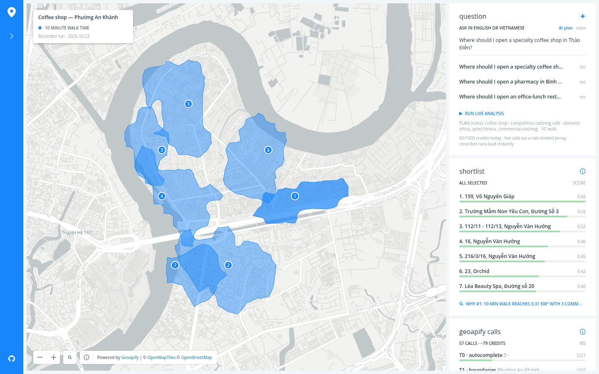
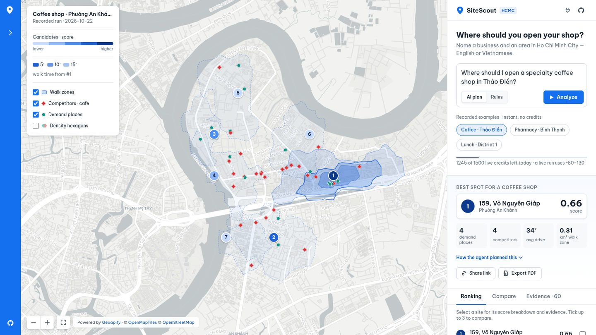
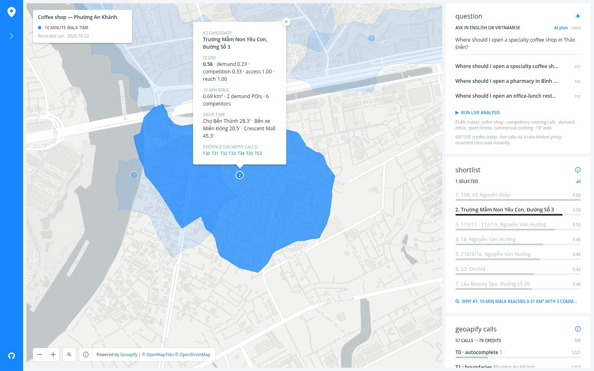
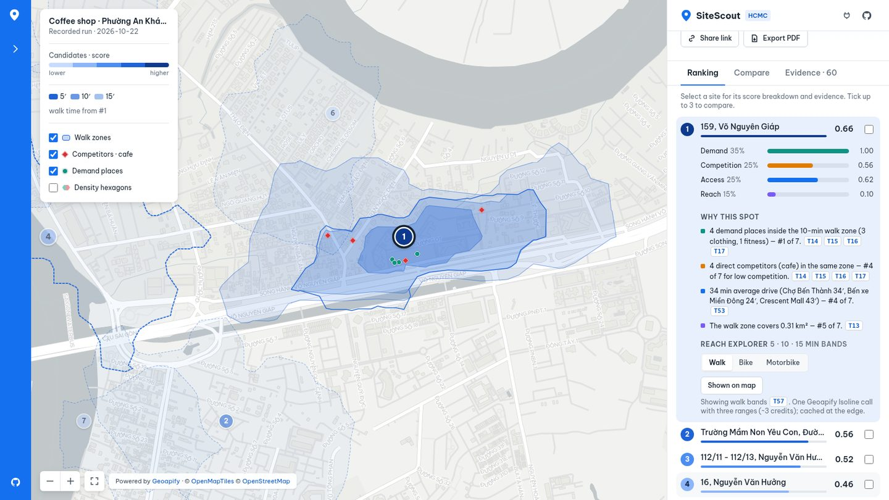
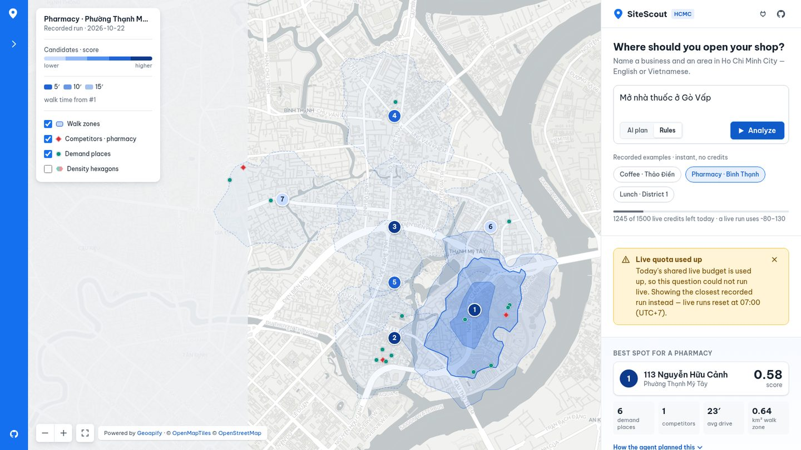

# SiteScout web demo: design system v2 (2026-10-23)

v1 copied the CARTO Builder embed closely (see [REFERENCE_RESEARCH.md](REFERENCE_RESEARCH.md)). It looked tidy, but
everything had the same weight. The question, the ranking and the API log were three equal boxes. The score was one
number and a thin bar, and non-Latin place names showed up as boxes. v2 keeps the CARTO-inspired frame (blue rail,
floating legend, right-hand panel) and rebuilds what sits inside it.

Live: <https://sitescout.huynhthanh.workers.dev> · code: [`web/src/app.ts`](../../web/src/app.ts), [`web/src/style.css`](../../web/src/style.css)

## Before and after

| | Before (v1) | After (v2) |
|---|---|---|
| Default |  |  |
| A candidate |  |  |
| Quota used up |  |  |

More v2 states: [running](overhaul/after-running.jpg) · [compare](overhaul/after-compare.jpg) ·
[evidence](overhaul/after-evidence.jpg) · [density hexagons](overhaul/after-hex.jpg) ·
[reach explorer, motorbike](overhaul/after-reach.jpg) · [PDF report](overhaul/after-pdf.jpg) ·
[MCP setup](overhaul/after-mcp.jpg) · [mobile](overhaul/after-mobile.jpg) / [mobile, sheet open](overhaul/after-mobile-full.jpg)

## Principles applied

1. **One primary action.** The question box is the only filled button on screen ("Analyze"). Recorded examples are
   secondary chips, and the AI/Rules planner is a small segmented control.
2. **Summary first, details on demand.** After a run the panel shows the best spot, its score and four KPIs (demand
   places, competitors, average drive, walk-zone area). The ranking comes next. A site's score breakdown, "why this
   spot", the reach explorer and the raw Geoapify calls open only when you ask for them (progressive disclosure:
   row expand, tabs, `
`).
3. **Every number is traceable.** `[Tn]` chips sit next to each claim. Clicking one opens the Evidence tab at that
   call, with its endpoint, status, latency and credits.
4. **The map and the list are one view.** Hovering a row highlights its pin and walk zone. Hovering a pin highlights
   the row. Selecting either one does both and zooms the map.
5. **Honest states.** Running shows the agent plan as steps (plan → area → boundary → places → candidates → walk
   zones per site → drive times → rank) with a live call counter. There is a designed empty state. A used-up quota
   gets an amber banner that says what happened and when it resets. An error gets a red banner with Retry and
   "Retry with rules planner".

## Tokens

| Token | Values |
|---|---|
| Spacing (4/8 grid) | 4 · 8 · 12 · 16 · 24 · 32 · 48 px |
| Type scale | 12 · 14 (body) · 16 · 20 · 24 px; weights 400/500/600/700 |
| Font | **Be Vietnam Pro** (OFL, self-hosted woff2: latin, latin-ext, vietnamese), then a system chain: `system-ui, Segoe UI, Roboto, Noto Sans, Noto Sans CJK SC, PingFang SC, Hiragino Sans, Noto Sans Thai`. POI names in Chinese/Japanese (e.g. "IDECAF … 鍋") fall back to a system CJK font instead of rendering as boxes |
| Radius | 6 (controls) · 10 (cards) · 14 (sheet, dialog) |
| Elevation | e1 `0 1px 2px / 0 1px 3px` (cards, chips) · e2 `0 4px 12px / 0 2px 4px` (map overlays, toasts) |
| Focus | 3 px ring `rgba(21,112,239,.35)` on every interactive element (`:focus-visible`) |

### Colour (WCAG AA, measured)

| Role | Colour | Contrast |
|---|---|---|
| Text / secondary / meta | `#15212E` / `#44515F` / `#66727F` | 16.3 / 8.1 / 4.9 on white |
| Brand (primary button, rail) | `#1570EF` | white text 4.57 |
| Link | `#0F5BC9` | 6.25 on white |
| Candidate score ramp (low → high) | `#C7DBFF` `#8DB5FA` `#4C8DF0` `#1F63D6` `#0D3A8C` | rank digits 11.6 / 7.8 / 4.9 (dark text) · 5.5 / 10.5 (white text) |
| Competitors (red diamonds) / demand (teal dots) | `#D93036` / `#0E9384` | shape differs as well as colour |
| Score factors | demand `#0E9384` · competition `#E07B00` · access `#1570EF` · reach `#7A5AF8` | |
| Warning / error banners | `#7A4D00` on `#FFF4D6` · `#A4161A` on `#FDECEC` | 6.6 · 6.8 |

## Map encoding

- **Walk zones.** Every candidate's 10-min isochrone is a dashed outline. The focused site (the selected one, or #1)
  is filled.
- **5 / 10 / 15-min bands.** These are soft fills (opacity .30 / .20 / .12) with a legend, from one Isoline call with
  `range=300,600,900`. The top 3 sites of each recorded example come with pre-recorded walking bands
  (`examples/*/bands.json`, 9 calls). The **reach explorer** fetches walk, bike or motorbike bands for any site live
  (~3 credits per site and mode, cached at the edge).
- **Candidates.** Numbered pins in the score ramp, z-ordered by rank. The selected pin gets a dark ring and the others
  dim.
- **POIs.** Competitors are red diamonds and demand places are teal dots. Each has a tooltip with its name and category.
- **Density hexagons** (toggle). Hexes are 120 m across and binned in the browser from POIs already fetched, so they
  cost no extra credits. A hex is red where competitors make up half or more of its POIs and teal otherwise, and
  opacity follows the count.

## Responsive

From 960 px up, the layout is the rail, the map and a 400 px panel. Below 960 px the panel becomes a **bottom sheet**
with a drag handle and three snap points (148 px / 55 vh / 92 vh). The legend keeps only the layer toggles and the zoom
controls move top-right. `prefers-reduced-motion` turns off transitions.

## Accessibility checklist

Skip link to the question · labelled landmarks · `role=tablist` with arrow-key navigation · `aria-expanded` on rows
and calls · `aria-live` on progress and toasts · checkboxes for compare and layers (native, keyboard-operable) ·
Esc clears the selection and closes the rail or dialog · primary touch targets ≥ 32 px (inline `[Tn]` chips are 18 px).

## What is not claimed

The frame is *inspired by* CARTO Builder and is not a pixel copy. No CARTO assets are used. The basemap is Geoapify
`positron` raster tiles through the Worker.
