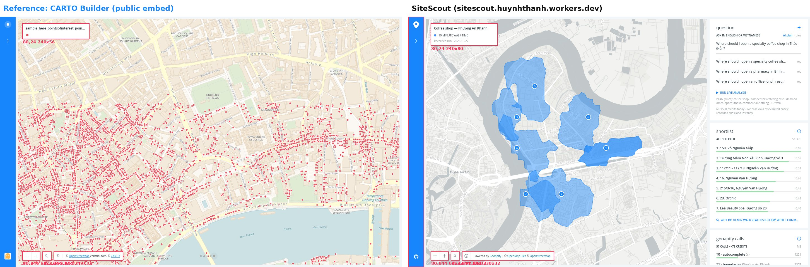
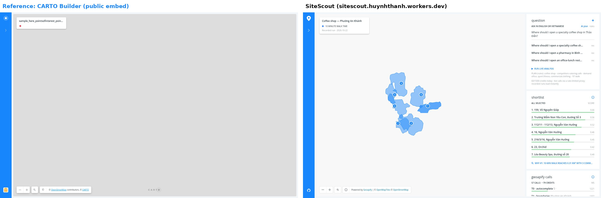
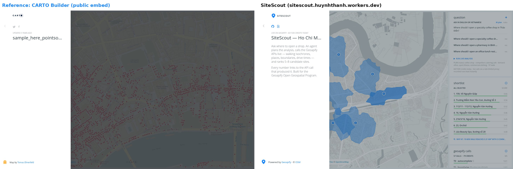
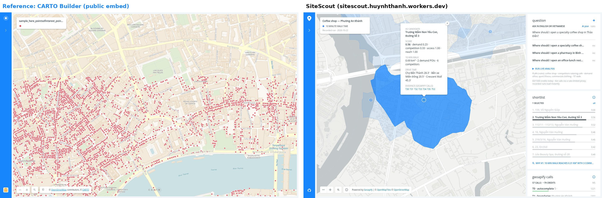

# Design reference research

**Rule we follow:** no invented UI. We looked at real location-intelligence products, picked one reference
whose public pages we could open and measure, and rebuilt its layout with our own branding, OFL fonts and
Geoapify data. This file holds the measurements, the side-by-side screenshots and the differences that remain.

## Products considered

| Product | What it is | Why it was or wasn't the reference |
|---|---|---|
| **CARTO Builder** (public maps) | Web map builder; public embeds expose a left rail, a legend card and map controls | ✅ **Chosen.** Public embeds load without an account, so every box could be measured in a browser (below). The layout fits "map first, evidence on the side". |
| Esri Business Analyst | ArcGIS site-selection and drive-time analysis | Closest in purpose (drive-time rings, site reports), but the app sits behind an ArcGIS login, so we could not measure it. Not cloned. |
| Placer.ai | Foot-traffic analytics | Data we don't have (mobile panels). Marketing screenshots only; not measured. |
| SiteZeus | Site-selection SaaS for franchises | Behind a sales demo; not measured. |
| Targomo | Isochrone-based location intelligence | Same core idea (reachability polygons). Public pages are marketing; the app needs an account. Not measured. |
| Felt | Collaborative web maps | Clean UI, but a general map editor, not an analysis report. Not measured. |
| Kepler.gl | Open-source geospatial visualisation (Uber/Foursquare) | Good for big point layers; its dark side-panel editor is a tool for analysts, not for a shop owner reading a shortlist. Not measured. |

"Not measured" means we did not take screenshots or computed styles of that product, so we make no claim about matching it.

## Reference measurements (CARTO Builder public embed, 1440×900, computed styles)

Captured with Playwright from a public Builder embed (`tehrenfeld.carto.com/builder/…/embed`) and a newer
public map (`clausa.app.carto.com/map/…`), 2026-10-22. Raw boxes: `dom-boxes.json` in the working folder;
excerpts below.

| Element | Reference (CARTO) | SiteScout | Match |
|---|---|---|---|
| Left rail | x 0, w **56 px**, full height, colour **#1785FB** | x 0, w 56 px, #1785FB | ✅ same |
| Legend card | (80, 24), w **240**, h 56, radius **4 px**, shadow `0 2px 4px rgba(0,0,0,.24)` | (80, 24), w 240, **h 80**, radius 4 px, same shadow | ⚠️ taller: we show the walk time and run date under the title |
| Zoom control | (80, 844), 64×32, radius 4 px | (80, 844), 64×32, radius 4 px | ✅ same |
| Search control | (152, 844), 32×32 | (152, 844), 32×32 | ✅ same |
| Control shadow | `0 0 2px rgba(0,0,0,.24), 0 4px 8px rgba(0,0,0,.16)` | same (fixed and deployed 2026-10-22; earlier build had only the first layer) | ✅ same |
| Attribution bar | (192, 844), **w 249**, h 32 | (192, 844), **w 330**, h 32 | ⚠️ wider: Geoapify + OpenMapTiles + OSM credits are longer than CARTO + OSM |
| Font | system sans-serif on most elements, Open Sans in the attribution | **Open Sans** everywhere (OFL, self-hosted) | ⚠️ different on purpose: one licensed font for Vietnamese diacritics |
| Basemap | CARTO Voyager / Positron | Geoapify `positron` raster tiles via our proxy | ⚠️ different provider (required: Geoapify program) |
| Right panel | Builder widget panel (newer maps); not present in the classic embed we measured | 352 px widget column: question, shortlist with score bars, Geoapify calls | ⚠️ ours; modelled on Builder widgets but not measured box-by-box |

## Side-by-side screenshots

Left: CARTO reference. Right: SiteScout live demo. Same 1440×900 viewport. Red boxes on the first image are the
measured element boxes with their coordinates.

| Screen | Image |
|---|---|
| Default view |  |
| Loading |  |
| Rail opened |  |
| Candidate detail vs reference popup |  |

## Honest verdict

- **Pixel-identical** (same position, size, radius and shadow in computed styles): left rail, legend position
  and width, zoom and search controls, control shadow.
- **Close but different:** legend height, attribution width, font family, basemap.
- **Not a clone:** the right analysis panel and the candidate detail card. In our capture the reference popup did
  not open (the "popup" screenshot on the left shows the default state), so there is no measured target for it.
  We therefore do **not** claim pixel-perfect for those parts.
