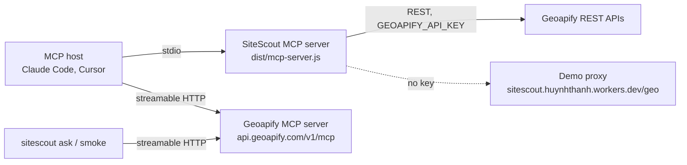

# Geoapify MCP: how SiteScout uses it

SiteScout talks to Geoapify in two ways. The product path uses REST. The agent path uses the Geoapify MCP
server. This page says which steps use which, and why.

Every number here comes from a file in this repository, a command that was run, or a dated Geoapify page.
Sources are linked where the number appears.

## 1. Two ways SiteScout talks to Geoapify

- **Product path: REST.** The web demo, `sitescout scout`, and SiteScout's own MCP server call the Geoapify REST
  APIs through `GeoapifyApi` in [src/engine/geoapify.ts](../src/engine/geoapify.ts). [src/mcp-server.ts](../src/mcp-server.ts)
  builds that client in `makeApi`. Without a key, it uses the public HCMC demo proxy,
  `https://sitescout.huynhthanh.workers.dev/geo` (same file, line 33).
- **Agent path: MCP.** `sitescout ask` and `sitescout smoke` call the Geoapify MCP server at
  `https://api.geoapify.com/v1/mcp`. [src/cli.ts](../src/cli.ts) creates a `GeoapifyMcpClient` in `cmdAsk`.
  [src/agent/run.ts](../src/agent/run.ts) plans and runs the tool calls for each question.

The first version (v0.1) used MCP for everything. The product moved isolines to REST, because the MCP server
has no isoline tool. See [FEEDBACK.md](FEEDBACK.md) item #1.

## 2. Which MCP tools, at which step

`sitescout ask` runs the phases below in order. The phase numbers come from `src/agent/run.ts`.

| Step (run.ts) | MCP tool and main arguments | Why | Credits |
|---|---|---|---|
| 1. Geocode seeds and origins | `geocode_address` (`query`, `lang: "vi"`, `limit: 3`, `country_codes: ["vn"]`) | Turns each area name into a point. | geocoding rule |
| 1, last resort | `geocode_structured_address` (`name`, `country: "Vietnam"`) | Runs only when the free-text geocode finds nothing (line 274). | geocoding rule |
| 1b. Check categories | `list_place_categories` | Reads the live category list. A v0.1 run sent invented categories, and the server answered 400 (comment at the phase 1b call). | see [credit rules](mcp-reference.md#credit-rules) |
| 1c. Cross-check | `geocode_structured_address` (`street`, `city`, `country`) | Compares the structured result with the free-text result for the first seed. Errors are ignored. | geocoding rule |
| 1d. Label candidates | `reverse_geocode_coordinates` (`lat`, `lon`, `limit: 1`) | Names each candidate point. Each seed gives seven candidates on a hexagonal ring. | see [credit rules](mcp-reference.md#credit-rules) |
| 2. Catchment | `transform_geometry` (`operation: "buffer"`, `units: "kilometers"`) | Draws the catchment circle around each candidate. | see [credit rules](mcp-reference.md#credit-rules) |
| 2. Catchment check | `measure_geometry` (`area`), `evaluate_spatial_relation` (`valid`, `contains`) | Measures the circle and checks that it is valid and contains the candidate. | see [credit rules](mcp-reference.md#credit-rules) |
| 2. Competitors and demand | `search_places` (`category`, `lat`, `lon`, `radius_meters`; competitors use `limit: 100`) | Counts competitor and demand places in each circle. | places rule |
| 2b. Drive times | `calculate_route_matrix` (`sources`, `targets`, `mode: "drive"`, `traffic: "approximated"`) | Drive time from each demand origin to each candidate. | see [credit rules](mcp-reference.md#credit-rules) |
| 2c. Coverage | `combine_geometries` (`operation: "union"`), then `measure_geometry` (`area`) | Area covered by all candidate catchments together. | see [credit rules](mcp-reference.md#credit-rules) |
| 3b. Route to the winner | `calculate_route` (`waypoints`, `mode: "drive"`) | Route from the first demand origin to the top candidate, for the report. | see [credit rules](mcp-reference.md#credit-rules) |

**Tool count.** The pipeline uses all 11 tools that `tools/list` returned when we recorded it on 2026-10-22
([tests/fixtures/live/mcp_tools_list_2026-10-22.sse.txt](../tests/fixtures/live/mcp_tools_list_2026-10-22.sse.txt)).
On 2026-10-31 Geoapify's machine-readable tool index
([tools/index.json](https://apidocs.geoapify.com/assets/openapi/specs/mcp/tools/index.json)) lists a twelfth tool,
`get_timezone`, while the docs page still says "eleven tools". SiteScout does not need time zones. There is still
no isoline tool. `assertToolSurface` only fails when one of our 11 tools is missing, so a new tool does not break
`sitescout smoke`.

The meetup playbook (`runMeetup`, line 770) uses four tools: `search_places`, `calculate_route_matrix`,
`calculate_route`, and `reverse_geocode_coordinates`.

Credit rules from the Geoapify MCP docs (https://apidocs.geoapify.com/docs/mcp/, read 2026-10-31):
`initialize`, `tools/list`, and `notifications/*` cost 0 credits. A `tools/call` costs what its underlying API
costs. Geocoding and places calls cost `max(1, ceil(features / 20))` credits.

## 3. Where MCP, where REST, and why

| Need | Geoapify MCP | SiteScout uses | Reason |
|---|---|---|---|
| Free-text place name to a point | `geocode_address` | REST `/v1/geocode/autocomplete` and `/v1/geocode/search` in an autocomplete-first chain (`resolvePlace`, [src/engine/scout.ts](../src/engine/scout.ts) line 117) | In our benchmark, autocomplete got 42/55 (76%) top-1 matches on Vietnamese queries, and search got 37/55 (67%) ([bench/hcmc-addresses/RESULTS.md](../bench/hcmc-addresses/RESULTS.md), run 2026-10-22). That benchmark used REST endpoints. It did not test `geocode_address`. |
| Point to address | `reverse_geocode_coordinates` | REST `/v1/geocode/reverse` (`reverse()` in [src/engine/geoapify.ts](../src/engine/geoapify.ts)) | The product path is REST end to end (section 1). |
| Walk-time catchment (isoline) | None | REST `/v1/isoline` (`isoline()` in `geoapify.ts`) | No isoline tool in the 11-tool list ([tests/fixtures/live/mcp_tools_list_2026-10-22.sse.txt](../tests/fixtures/live/mcp_tools_list_2026-10-22.sse.txt)). See [FEEDBACK.md](FEEDBACK.md) item #1. |
| Places inside a walk catchment | `search_places` takes one category and a circle | REST `/v2/places` with `filter=geometry:<isoline id>`, or a 600 m circle if the isoline fails (`scout.ts` line 301) | `search_places` accepts one `category`, one point, `radius_meters`, and `limit` up to 100 ([src/mcp/schemas.ts](../src/mcp/schemas.ts)). It has no geometry filter. |
| Drive-time matrix | `calculate_route_matrix` | REST `/v1/routematrix` (`routeMatrix()` in `geoapify.ts`) | The product path uses REST throughout (section 1). |
| Route to one point | `calculate_route` | REST `/v1/routing` (`routing()` in `geoapify.ts`) | The product path uses REST throughout (section 1). |
| Buffer, area, union, contains | `transform_geometry`, `measure_geometry`, `combine_geometries`, `evaluate_spatial_relation` | Local code: `geometryAreaM2` and `pointInGeometry` in [src/geo/grid.ts](../src/geo/grid.ts) | The engine computes these locally, so they need no API call. |
| Category check | `list_place_categories` | Bundled catalog, [src/engine/categories.ts](../src/engine/categories.ts), read by `plan_site_question` ([agent/README.md](../agent/README.md)) | The agent path also calls `list_place_categories` at phase 1b, against the live list. |
| Browser demo | Not used | A Cloudflare Worker ([web/worker](../web/worker)); the demo proxy URL is in [src/mcp-server.ts](../src/mcp-server.ts) | The Geoapify MCP docs say browser clients should omit the `MCP-Protocol-Version` header, because the CORS preflight does not allow it (docs read 2026-10-31). |

Why the product uses REST for isolines: the REST isoline returns an `id`, and `/v2/places` accepts that id as
`filter=geometry:<id>`. That counts places inside the walk area, not inside a circle. A circle over-counts across
rivers and highways. [FEEDBACK.md](FEEDBACK.md) item #1 has the example.

## 4. One real call

### Handshake

The client in [src/mcp/client.ts](../src/mcp/client.ts) does four steps:

1. `initialize` with `protocolVersion: "2025-06-18"`. The client stops if the server answers with another version.
2. `notifications/initialized`. The server answers with HTTP 202 and no body.
3. `tools/list`. The `assertToolSurface` check, which `sitescout smoke` runs, confirms that all 11 tools are present before any credit is spent.
4. `tools/call`.

Every request sends `x-api-key`, `MCP-Protocol-Version: 2025-06-18`, and `accept: application/json, text/event-stream`.
After `initialize`, the client sends back the `Mcp-Session-Id` header that the server returned.

### tools/call

Request body. The arguments are the ones the recorded response echoes: the category, the coordinates, and the
radius. The fixture does not echo `limit`, so this request leaves it out.

```json
{
  "jsonrpc": "2.0",
  "id": 3,
  "method": "tools/call",
  "params": {
    "name": "search_places",
    "arguments": {
      "category": "catering.cafe",
      "lat": 10.8034834,
      "lon": 106.7375412,
      "radius_meters": 800
    }
  }
}
```

Result, shortened to 2 of 27 places. This is the `structuredContent` part of the recorded response:

```json
{
  "category": "catering.cafe",
  "radius_meters": 800,
  "count": 27,
  "results": [
    {
      "name": "Starbucks",
      "lat": 10.8031005,
      "lon": 106.7376209,
      "formatted": "Starbucks, Nguyen Duy Dieu, Phường An Khánh, Thủ Đức, 71108, Vietnam",
      "categories": ["catering", "catering.cafe", "catering.cafe.coffee", "catering.cafe.coffee_shop"],
      "distance": 43
    },
    {
      "name": "Cà Phê Chez Nous",
      "lat": 10.804076,
      "lon": 106.7366554,
      "formatted": "Cà Phê Chez Nous, Xuân Thủy, Phường An Khánh, Thủ Đức, 71108, Vietnam",
      "categories": ["catering", "catering.cafe"],
      "distance": 117
    }
  ]
}
```

Provenance: [tests/fixtures/live/search_places_cafe.json](../tests/fixtures/live/search_places_cafe.json),
recorded 2026-10-22. The request is reconstructed from the echoed arguments, so the `id` is illustrative. The
full example is in [docs/mcp/example-search_places.json](mcp/example-search_places.json). No key appears in the
recorded data.

### Run it yourself

[scripts/mcp-example.mjs](../scripts/mcp-example.mjs) runs the handshake and the same `search_places` call, with
`limit: 5`. It reads the key from `GEOAPIFY_API_KEY` and never prints it.

```bash
GEOAPIFY_API_KEY=YOUR_KEY node scripts/mcp-example.mjs
```

The `tools/call` costs credits. With no key set, the script exits before it sends anything.

A bare `curl` call needs the session header from `initialize` first:

```bash
curl -s -X POST https://api.geoapify.com/v1/mcp \
  -H "x-api-key: YOUR_KEY" \
  -H "content-type: application/json" \
  -H "accept: application/json, text/event-stream" \
  -H "MCP-Protocol-Version: 2025-06-18" \
  -H "Mcp-Session-Id: <from the initialize response>" \
  -d '{"jsonrpc":"2.0","id":3,"method":"tools/call","params":{"name":"search_places","arguments":{"category":"catering.cafe","lat":10.8034834,"lon":106.7375412,"radius_meters":800,"limit":5}}}'
```

A bad category does not return an HTTP error. The server sends a text block with `statusCode: 400` and
`isError: false`. [src/mcp/client.ts](../src/mcp/client.ts) turns that into an error with `upstreamError()`.

## 5. SiteScout's MCP server and Geoapify's MCP server

SiteScout's MCP server ([src/mcp-server.ts](../src/mcp-server.ts), `dist/mcp-server.js`, stdio) runs the analysis.
It calls the Geoapify REST APIs itself. The model in the host only plans the question and explains the answer.
The Geoapify MCP server exposes lower-level tools for geocoding, search, routing, and geometry (11 on 2026-10-22,
plus `get_timezone` in the 2026-10-31 index).



### SiteScout's five tools

From [agent/README.md](../agent/README.md):

| Tool | What it does | Geoapify APIs behind it | Credits |
|---|---|---|---|
| `plan_site_question` | question → validated plan (business, categories, area, walk minutes, origins) | none (category catalog is bundled) | 0 |
| `scout_site` | full analysis → ranked shortlist, isochrones, `[Tn]` citations, `areaCheck`, `topCandidateCalls` | Autocomplete, Geocoding, Reverse, Boundaries, Isoline, Places, Route Matrix, Routing, Place Details | ~85–140 |
| `resolve_place` | Vietnamese place text → best match + confidence | Autocomplete, Geocoding | 1–3 |
| `walk_isochrone` | point + minutes → isoline polygon | Isoline | 1 per 5 minutes (10 min = 2) |
| `get_evidence` | `[Tn]` → the exact request (no key), status, summary | none (reads the last run) | 0 |

### Two servers in one host

The config is in [agent/clients/mcp.two-servers.example.json](../agent/clients/mcp.two-servers.example.json):

```json
{
  "mcpServers": {
    "sitescout": {
      "command": "node",
      "args": ["/ABSOLUTE/PATH/TO/sitescout-agent/dist/mcp-server.js"],
      "env": { "GEOAPIFY_API_KEY": "YOUR_KEY" }
    },
    "geoapify": {
      "type": "http",
      "url": "https://api.geoapify.com/v1/mcp",
      "headers": { "x-api-key": "YOUR_KEY" }
    }
  }
}
```

Steps to record a real session with this config are in [agent/clients/record-claude-code.md](../agent/clients/record-claude-code.md).
The same two servers in a side-by-side setup are described in [geoapify-mcp-side-by-side.md](../agent/clients/geoapify-mcp-side-by-side.md).

### Recorded session (03c)

[agent/transcripts/03c-saigon-lunch-evidence-en.jsonl](../agent/transcripts/03c-saigon-lunch-evidence-en.jsonl).

- **Host and model:** `agent/host.mjs`, with `@cf/mistralai/mistral-small-3.1-24b-instruct` on Cloudflare Workers AI.
  This is an open-weight model. It is not a Claude Code or Cursor session.
- **Server:** SiteScout MCP server, version 1.0.0 (from the session line in the transcript). The current
  `src/mcp-server.ts` reports 1.1.0.
- **Recorded:** 2026-10-22.

Question: "I run an office-lunch restaurant and want a second branch in Phường Sài Gòn (old District 1). Office
workers only walk about 7 minutes at lunch. Rank sites, then show me the exact Geoapify call behind the #1 site's
competitor count."

| # | Tool | Main arguments | Short result |
|---|---|---|---|
| 1 | `plan_site_question` | the question text | `competitorCategory` `catering.restaurant`; demand categories `office`, `education.university`, `commercial.shopping_mall`; planner `walkMinutes` 10 |
| 2 | `scout_site` | `creditCap` 250; `plan.area` `Phường Sài Gòn, Quận 1, Hồ Chí Minh`; `plan.walkMinutes` 7 | `areaCheck` ok; 7 candidates ranked; #1 Tổng Lãnh sự quán Pháp, Đường Nguyễn Thị Minh Khai: 12 competitors, 19 demand places, 0.286 km² walk area, 19.5 min mean drive; `calls` 56; `creditsEstimated` 100 (the estimate at recording time, before the 2026-10-31 isoline correction in [demo-proxy.md](demo-proxy.md#how-credits-are-counted)) |

The model changed the walk time from 10 to 7 minutes, as the user asked. It did not call `get_evidence`. The request it
quoted came from `topCandidateCalls` in the `scout_site` result (ref 14):

```
GET /v2/places?categories=catering.restaurant&filter=geometry%3Aa43d1a61f7a71c0bb42d998827a53ac9&limit=150&lang=vi
```

That is a REST call made by the engine. It is not a Geoapify MCP `tools/call`. The MCP server does not expose the
isoline or the geometry filter.

The same result shows the city problem in [FEEDBACK.md](FEEDBACK.md) item #2. The `resolvedAnchor` reads
"…, Phường Sài Gòn, Thành phố Thủ Đức, 71006, Việt Nam". [FEEDBACK.md](FEEDBACK.md) item #2 says the Thủ Đức city
was dissolved, so this city name is wrong for central HCMC.

### Expected two-server session (not yet recorded)

Expected, not yet recorded. The question below is the one in the Claude Code guide, with a follow-up added.
The model may choose different calls.

Question: "Where should I open a specialty coffee shop in Thảo Điền? Cite every number. Then list the nearest cafés
to the top site from Geoapify."

Expected calls:

1. SiteScout `plan_site_question`
2. SiteScout `scout_site`
3. Geoapify `search_places` with `category: "catering.cafe"`, the top site's `lat` and `lon`, `radius_meters: 800`, and `limit: 5`

## 6. What worked well and what we had to fix

**Worked well**

- Arguments are checked against per-tool schemas before any credit is spent ([src/mcp/schemas.ts](../src/mcp/schemas.ts)).
- `npm run smoke` checks the tool list before it runs a search, so a changed tool surface stops the run early
  (`assertToolSurface` in [src/mcp/client.ts](../src/mcp/client.ts), called from `cmdSmoke`).
- Results carry `structuredContent` with `[Tn]` refs, so each number in an answer can point to its call
  ([agent/README.md](../agent/README.md), "What worked").

**Fixed**

- v0.1 returned a bare `content` array, and every parser rejected it. The client now keeps the whole result ([src/mcp/client.ts](../src/mcp/client.ts), `callTool`).
- Upstream 4xx errors arrive with `isError: false`. `upstreamError()` now treats them as errors ([src/mcp/client.ts](../src/mcp/client.ts)).
- HTTP 401 fails at once. HTTP 429 and 5xx are retried with backoff ([src/mcp/client.ts](../src/mcp/client.ts), `isRetryable`).
- v0.1 sent invented categories. The run now checks them against the live list first ([src/agent/run.ts](../src/agent/run.ts), phase 1b).
- A comma-separated category list gave fewer places than its parts. The product sends one request per category ([FEEDBACK.md](FEEDBACK.md) item #5).
- A model garbled "Bình Thạnh" and the run analysed another ward. `areaCheck` now flags a mismatch ([agent/README.md](../agent/README.md), transcript 02a).
- A model wrote a Places URL from memory. `scout_site` now returns the real calls in `topCandidateCalls` ([agent/README.md](../agent/README.md), transcript 03b).

**Still open**

- No isoline tool on the MCP server ([FEEDBACK.md](FEEDBACK.md) item #1).
- `search_places` only searches a circle ([src/mcp/schemas.ts](../src/mcp/schemas.ts)).
- The city field says "Thành phố Thủ Đức" for central HCMC ([FEEDBACK.md](FEEDBACK.md) item #2).

## 7. Reproduce

```bash
npm ci && npm run build

# 1. Handshake, tool list, and one search_places call (costs credits for the call)
GEOAPIFY_API_KEY=YOUR_KEY node scripts/mcp-example.mjs

# 2. Surface check, then one full site-selection run (costs credits)
GEOAPIFY_API_KEY=YOUR_KEY npm run smoke

# 3. One question, with its report and trace
GEOAPIFY_API_KEY=YOUR_KEY npm run ask -- --question thaodien-coffee
```

`npm run smoke` runs `assertToolSurface` first, which costs nothing. It then runs a full question, which costs the
usual credits. See [src/cli.ts](../src/cli.ts), `cmdSmoke`.

Without a key, SiteScout's MCP server uses the demo proxy, and the scripts above need a key. The transcripts in
[agent/transcripts/](../agent/transcripts/) were recorded with [agent/host.mjs](../agent/host.mjs), not with these scripts.
