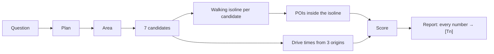
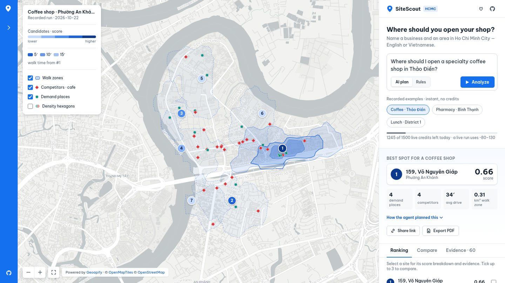
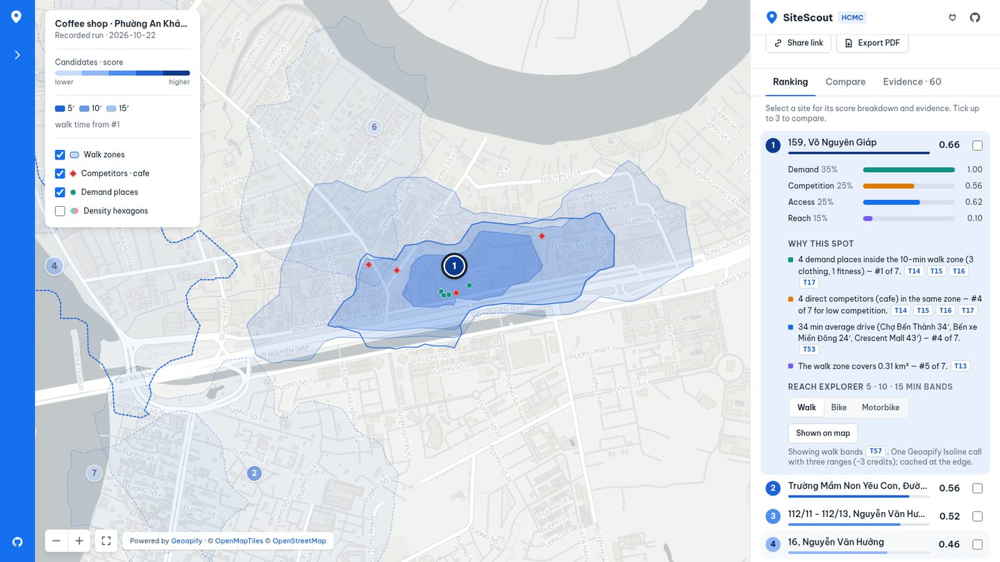
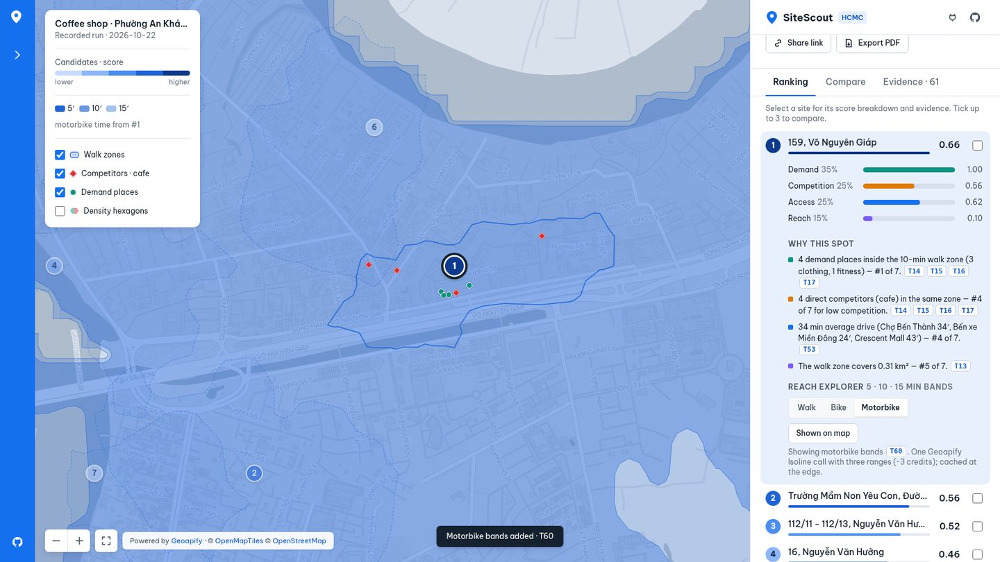
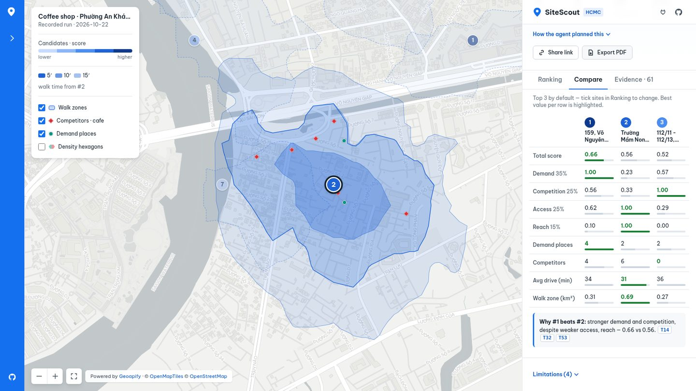
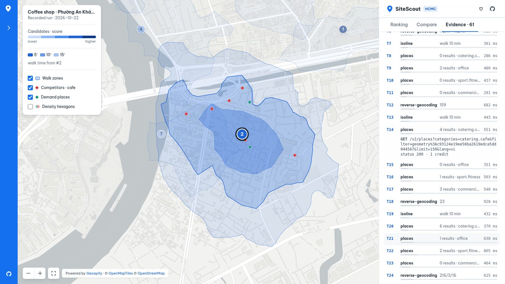
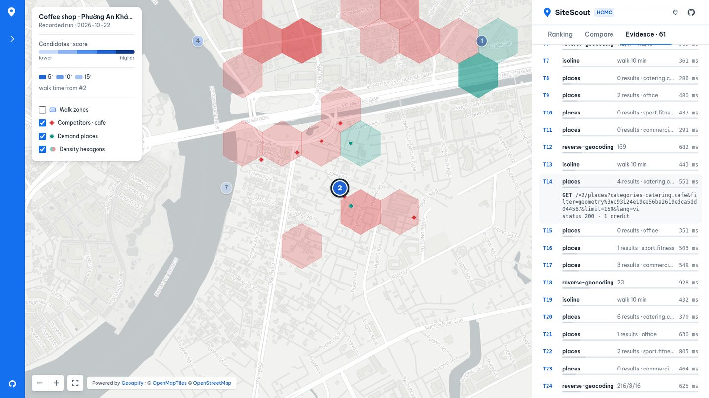
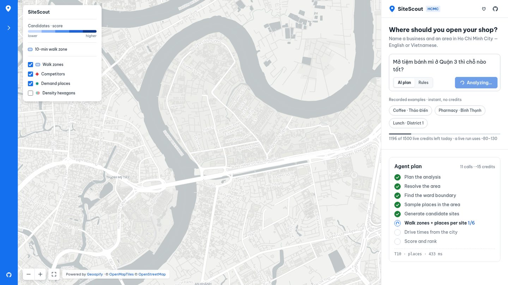
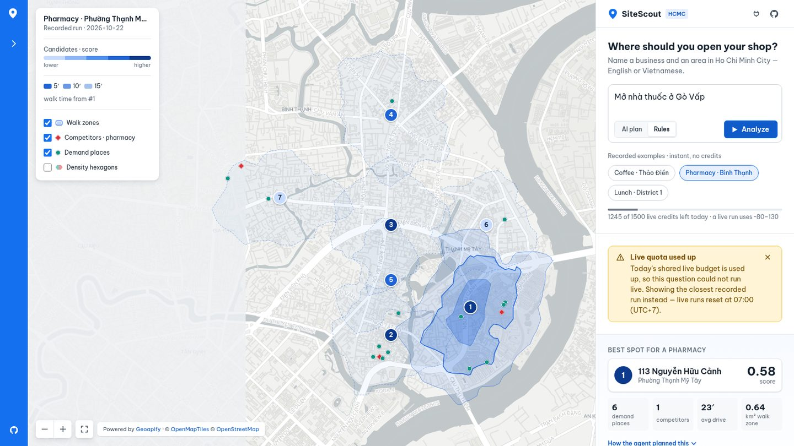
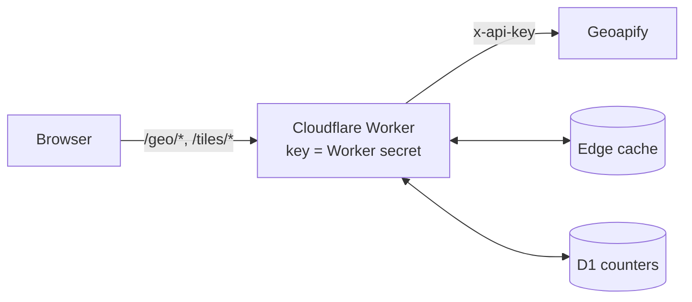

# Tutorial: build an evidence-traced site-selection agent on Geoapify

Built on the [Geoapify APIs](https://www.geoapify.com/).

**Time:** allow about 40 minutes · **Level:** you know some TypeScript and a terminal.

By the end you will have asked SiteScout *"Where should I open a specialty coffee shop in Thảo Điền?"*,
read the ranked shortlist, followed one number back to the exact Geoapify request that produced it,
connected the same engine to an AI assistant through MCP, seen where SiteScout uses the Geoapify MCP server and
where it uses the REST APIs, and seen how the public demo keeps its Geoapify key secret.

The scope is one city: Ho Chi Minh City. The three recorded example questions are specialty coffee in
[Thảo Điền](../examples/thaodien-coffee/report.md), a pharmacy in
[Bình Thạnh](../examples/binhthanh-pharmacy/report.md), and office lunch in
[District 1](../examples/saigon-lunch/report.md). You will build and run the existing TypeScript agent locally,
then inspect its reports and request traces. Reading the committed examples works without a key;
running a new analysis spends Geoapify credits.

The example analyses were recorded on 2026-10-22 and committed in [`examples/`](../examples/),
alongside a live web recording from 2026-10-23 and the two-server MCP session from 2026-11-04 linked in step 8.
Screenshots show the web layout described in the [design notes](design/DESIGN_SYSTEM.md).

> Video version: [sitescout-tutorial.mp4](https://github.com/ducvuathuduc/sitescout-agent/raw/media/sitescout-tutorial.mp4) follows these same chapters.

---

## 1. What you'll build



The key idea: a shop's catchment is **where people can walk in 10 minutes**, not a circle. Geoapify's
Isoline API draws that area, and its Places API can count POIs *inside* it by id. Everything else is
bookkeeping — and the bookkeeping is what makes the answer trustworthy.

## 2. Try it in the browser first (5 min)

Open **https://sitescout.huynhthanh.workers.dev**. On a laptop the screen has three parts: a blue **rail** on the left
(about, GitHub, tutorial, MCP setup), the **map** with a floating legend, and the **panel** on the right. On a phone the
panel turns into a bottom sheet. Drag or tap its handle to resize it.



### 2.1 Read the answer first

The map opens on a **recorded run** (instant, no credits): *a specialty coffee shop in Thảo Điền*. Under the question
box, **Best spot for a coffee shop** gives the answer straight away: site **#1, 159 Võ Nguyên Giáp, score 0.66**,
with four numbers. In this run they are 4 demand places, 4 competitors, a 34′ average drive and a 0.31 km² walk zone.
**How the agent planned this** opens the plan: area, planner, competitor category, demand categories, walk minutes
and origins.

On the map, each candidate is a numbered pin. Its colour is its score, from light (lower) to dark blue (higher). Each
candidate's 10-minute walk zone is a dashed outline. Site #1 is filled with **5 / 10 / 15-minute walking bands**,
explained in the legend.

### 2.2 Ranking and "why this spot"

The **Ranking** tab lists all 7 sites with a score bar. Hover a row and its pin and walk zone light up on the map.
Hover a pin and the row lights up. Click a row (or a pin) to open it:

- **Score breakdown:** four bars with their weights. Demand 35 %, competition 25 %, access 25 %, reach 15 %.
- **Why this spot:** one sentence per factor, each with its rank among the 7 sites and the `[Tn]` calls behind it.
  For example: *"4 direct competitors (cafe) in the same zone — #4 of 7 for low competition. [T14] [T15] [T16] [T17]"*.



### 2.3 Reach explorer: walk, bike, motorbike

Inside an open site, **Reach explorer** draws 5 / 10 / 15-minute bands for **Walk**, **Bike** or **Motorbike**. Each
press is one live Geoapify Isoline call with three ranges (`range=300,600,900`, counted as 6 credits: 1 per 5 minutes of each band). It shows up as a new
`[Tn]` in Evidence. The walking bands for the top 3 sites of each example are pre-recorded, so they cost nothing.



### 2.4 Compare

The **Compare** tab puts the top 3 side by side by default. To choose your own, tick up to 3 checkboxes in Ranking.
The best value in each row is green. Below the table, **Why #1 beats #2** names the factors that decide it, with
evidence chips.



### 2.5 Evidence: follow any number

Click any `[Tn]` chip. The **Evidence** tab opens at that call and shows the method, the endpoint (no key: requests go
through the demo proxy), the status, the latency and the credits. The tab lists every Geoapify call in the run. The
recorded coffee run has 57, plus 3 for the pre-recorded bands.



### 2.6 Map layers

The legend has toggles for **Walk zones**, **Competitors** (red diamonds), **Demand places** (teal dots) and
**Density hexagons**. The hexagons are 120 m bins of the places already fetched, so they use no extra credits. A hex
is red where competitors make up half or more of its places. Hover a hexagon or a place for its counts or name.



### 2.7 Ask your own question (live)

Type a question in English or Vietnamese, for example *"Mở tiệm bánh mì ở Quận 3 thì chỗ nào tốt?"*. Choose **AI plan**
(an LLM on Cloudflare Workers AI writes the plan, which is checked against the Geoapify category list) or **Rules**
(keyword rules). Then press **Analyze**. The panel shows the **agent plan** as steps, ticking each one as it finishes,
with a live count of calls and credits. Each walk zone appears on the map as soon as its call returns.



In our recorded live run (2026-10-23, 48 calls, roughly 40 s) the model picked `catering.cafe` as the competitor for a
bakery and `Phường 6, Quận 3` as the area. The engine replaced both with the known-good values
(`commercial.food_and_drink.bakery`, and the verified geocode text for District 3) and wrote the change into **Notes**
under *How the agent planned this*. Costs depend on the question and returned places; see the recorded estimates in
[the local setup](#3-install-and-run-it-yourself-5-min). The quota bar under the examples shows how
much of the demo's shared daily budget (2,400 credits, live calls and map tiles together) is left.

### 2.8 Share and export

- **Share link** copies a URL that opens the same analysis, including the selected site and tab. Recorded runs get a
  `#ex=…` link. A live run is stored once (no extra Geoapify calls) and gets a short `#r=…` link, for example
  <https://sitescout.huynhthanh.workers.dev/#r=2vz43hp5>.
- **Export PDF** prints an A4 report: the map, the ranking table, "why this spot" for the top 3 with `[Tn]`
  references, the full call list and the limitations. Example: [sample-report.pdf](assets/sample-report.pdf).

### 2.9 When the live budget is used up

The Worker caps the demo at 2,400 credits a day for live calls and map tiles together (a tile is 0.25 credit), and
at 180 live calls per visitor. When a cap is hit, an amber banner says which one, shows the closest recorded run
instead, and says when live runs reset (07:00 UTC+7). Any other failure gets a red banner with **Retry** and
**Retry with rules planner**. How the proxy, the limits and the cache work is in [§9](#9-put-it-online-safely-the-demo-proxy-5-min).



## 3. Install and run it yourself (5 min)

### Prerequisites

Install Git, **Node.js 20+** and npm. The local steps work in Bash or PowerShell; run commands from the
repository root after cloning. To make live requests, get a Geoapify key from
<https://myprojects.geoapify.com>. The free plan is documented as 3,000 credits/day in the
[dated pricing notes](demo-proxy.md#how-credits-are-counted); check your account's allowance before running.
An AI account is optional: the default planner uses rules.

### Install, build and check help

1. Download the public repository:

   ```sh
   git clone https://github.com/ducvuathuduc/sitescout-agent.git
   ```

   Expected: Git creates a `sitescout-agent` directory.

2. Enter it:

   ```sh
   cd sitescout-agent
   ```

   Expected: your terminal's working directory is now the repository root; this command prints no output.

3. Install the locked dependencies:

   ```sh
   npm ci
   ```

   Expected: npm completes installation and exits successfully. Its package and audit counts can vary.

4. Compile the TypeScript agent:

   ```sh
   npm run build
   ```

   Expected: npm runs `tsc -p tsconfig.json` and creates `dist/cli.js` and `dist/mcp-server.js` without errors.

5. Check the CLI without making API requests:

   ```sh
   node dist/cli.js --help
   ```

   Expected: usage for `ask`, `smoke`, `trace validate`, `report`, `bench run` and `static`, plus question IDs.
   This older help text omits `scout`. There is no `scout --help`: it reports that a question is required.

### Set the environment variable and run a live analysis

In Bash:

```sh
export GEOAPIFY_API_KEY=YOUR_KEY
```

In PowerShell, use this instead:

```powershell
$env:GEOAPIFY_API_KEY = "YOUR_KEY"
```

Replace `YOUR_KEY` with your own key in your terminal. Expected: no output; the variable is set for that shell.
Alternatively, use [.env.local.example](../.env.local.example) as the template for a local `.env.local`
file containing `GEOAPIFY_API_KEY=YOUR_KEY`, then replace the placeholder locally. The CLI loads `.env.local`
from its working directory. An existing shell variable takes precedence. The file is gitignored;
keep the key out of source code and shared transcripts.

The next command makes live requests and spends credits. Use a new ID for each run you want to keep:

```sh
node dist/cli.js scout "Where should I open a specialty coffee shop in Thảo Điền?" --id my-coffee
```

Expected: the terminal prints the plan, one line per API call, a ranked shortlist and the output directory.
The following excerpt comes from the recorded coffee run; new results and timings can differ:

```
[plan:heuristic] {"business":"coffee shop","competitors":["catering.cafe"],"demand":["office","sport.fitness","commercial.clothing"],...}
  [T0] autocomplete      200  1221 ms  {"count":5,"top":"Phở Bùi Gia Thảo Điền, 56, Xuân Thủy, Phường An Khánh, ..."}
  [T1] boundaries        200  1307 ms  {"levels":"Khu phố 18 ⊂ Phường An Khánh ⊂ Thành phố Hồ Chí Minh ⊂ Việt Nam"}
  [T2] places            200  1011 ms  {"count":51,"categories":"catering.cafe"}
  ...
```

Output in `examples/my-coffee/`:

| File | What it is |
|---|---|
| `report.md` / `report.html` | Ranked shortlist, reasons and evidence table; HTML includes the static map image |
| `map.jpg` | Shortlist map, if the Geoapify Static Maps request succeeds |
| `result.json` | Everything, machine-readable |
| `trace.jsonl` | One line per API call — the evidence |

The recorded traces estimate about 91, 90 and 139 credits under the
[corrected credit rules](demo-proxy.md#how-credits-are-counted), rather than the older totals stored in their reports.
New runs vary. The CLI defaults to `--credit-cap 300`. It checks the accumulated estimate before each request;
the request that crosses the cap can still complete, so this is not a strict spending ceiling.

These are the options implemented in [the scout command](../src/scout-cli.ts):

| Option | Behavior |
|---|---|
| `--id my-coffee` | Names the output folder under `examples/`; defaults to a slug of the question |
| `--out path` | Overrides the output directory; existing output files can be overwritten |
| `--planner heuristic` | Default rules planner; `--planner llm` uses an optional model |
| `--credit-cap 300` | Sets the run's estimated-credit threshold |

For the optional LLM planner, set `SITESCOUT_LLM_BASE_URL`, `SITESCOUT_LLM_MODEL` and
`SITESCOUT_LLM_API_KEY` in the environment. Use `YOUR_KEY` as the placeholder for that provider's key too.
The plan is validated and can fall back to rules; see [the planner source](../src/engine/plan.ts).

## 4. How the engine answers (10 min)

The engine is `src/engine/scout.ts`; the Geoapify client is `src/engine/geoapify.ts`.

### 4.1 Plan

`heuristicPlan()` (`src/engine/plan.ts`) maps keywords in English or Vietnamese to a business, competitor and
demand categories. For coffee: competitors `catering.cafe`; demand `office`, `sport.fitness`,
`commercial.clothing`. With `--planner llm` an LLM writes the plan instead, but its output is validated
against the Geoapify category list and falls back to the rules if it is wrong.

### 4.2 Find the area

Autocomplete first (it is the most tolerant of Vietnamese spelling), then forward geocoding as a second opinion,
then **Boundaries part-of** to name the post-2025 ward:

```
GET /v1/geocode/autocomplete?text=Xuân Thủy, Thảo Điền&lang=vi&filter=countrycode:vn&bias=proximity:106.7009,10.7769
GET /v1/boundaries/part-of?lat=10.8030828&lon=106.7318264&lang=vi
→ Khu phố 18 ⊂ Phường An Khánh ⊂ Thành phố Hồ Chí Minh ⊂ Việt Nam
```

(Thảo Điền is now part of Phường An Khánh after the July-2025 reform — the report says so.)

### 4.3 Candidates

Seven points on a hex lattice inside the study area, pre-ranked on one Places sample of the whole area
(`filter=rect:…`). Each candidate gets a readable label from Reverse Geocoding.

### 4.4 The catchment: isoline → places inside it

For each candidate:

```
GET /v1/isoline?lat=10.803087&lon=106.740537&type=time&mode=walk&range=600
→ { "id": "<isoline id>", geometry: MultiPolygon }

GET /v2/places?categories=catering.cafe&filter=geometry:<isoline id>&limit=150
GET /v2/places?categories=office&filter=geometry:<isoline id>&limit=150
...
```

No polygon upload and no point-in-polygon code: the isoline id *is* the filter. One request per category.

### 4.5 Access

One **Route Matrix** call: drive time from three origins (Chợ Bến Thành, Bến xe Miền Đông, Crescent Mall) to all
seven candidates. **Routing** and **Place Details** then add the route and a 5-minute drive area for the top site.

### 4.6 Score

```
score = 0.35·demand density + 0.25·(1 − competition) + 0.25·access + 0.15·walk reach
```

Each part is min-max normalised across the seven candidates, so a score compares sites within one question.
Real result for the coffee question:

| # | Candidate | Score | Demand POIs | Competitors | Walk area | Mean drive |
|---|---|---|---|---|---|---|
| 1 | 159, Võ Nguyên Giáp | 0.66 | 4 | 4 | 0.31 km² | 33.6 min |
| 2 | Trường Mầm Non Yêu Con, Đường Số 3 | 0.56 | 2 | 6 | 0.69 km² | 31.3 min |
| 3 | 112/11 - 112/13, Nguyễn Văn Hưởng | 0.52 | 2 | 0 | 0.27 km² | 35.5 min |

## 5. Follow a number back to its source (3 min)

The [coffee report](../examples/thaodien-coffee/report.md) says candidate #1 has **4 competing cafés** and
cites `[T12] … [T17]`. Open the [committed trace](../examples/thaodien-coffee/trace.jsonl).
Here is a real line, shortened only by abbreviating the endpoint and omitting the timestamp:

```json
{"seq":0,"api":"autocomplete","method":"GET","endpoint":"/v1/geocode/autocomplete?text=…","status":200,"durationMs":1221,"summary":{"count":5,"top":"Phở Bùi Gia Thảo Điền, 56, Xuân Thủy, Phường An Khánh, Thành phố Hồ Chí Minh, 71108, Việt Nam"},"credits":1}
```

Each `scout` trace line records the sequence (`[T0]` means `seq: 0`), API, method, endpoint without a key,
HTTP status, duration in milliseconds, response summary, estimated credits and timestamp (`ts`). POST calls
can also include a body; failed requests can include `error`. In this trace, `[T14]` is the café request:
its summary is `{"count":4,"categories":"catering.cafe"}`.

To inspect that evidence offline in Bash or PowerShell:

```sh
node -p "require('node:fs').readFileSync('examples/thaodien-coffee/trace.jsonl', 'utf8').trim().split(/\r?\n/).find(line => JSON.parse(line).seq === 14)"
```

Expected: the JSON line for `seq: 14`, `api: "places"`, `status: 200` and the four-café summary.
This reads a committed file and makes no API requests.

### Where traces and logs are written

Paths are relative to the working directory:

| Command | Trace and supporting files |
|---|---|
| `scout` | `examples/<id>/trace.jsonl`, alongside the reports and `result.json`; `--out` changes this folder |
| `ask` / `smoke` | `logs/<question-id>.jsonl`; cached results and `run.json` are under `logs/results/<question-id>/` |

The `logs/` trace files and result cache are gitignored by [.gitignore](../.gitignore).
Committed sample traces live in [examples/](../examples/), so they remain available without an API key.
The older MCP trace format records `tool`, `args`, `resultDigest` and `resultSummary` rather than the REST
fields above; `trace validate` checks that older format, not the `scout` format. See
[the trace implementation](../src/agent/trace.ts) and [scout output writer](../src/scout-cli.ts).

The [Geoapify feedback](FEEDBACK.md) collects observations, reproductions and suggested changes. If a report
figure has no matching trace evidence, please open an issue with the report and the relevant trace lines.

## 6. Vietnamese addresses: the hard part (3 min)

Since 1 July 2025 HCMC has no districts and new ward names. People still type the old ones
("Phường 12, Quận 5"), and the data mixes both. We measured it: 55 HCMC queries against Wikidata coordinates
([`bench/hcmc-addresses/RESULTS.md`](../bench/hcmc-addresses/RESULTS.md)).

| Strategy | Within tolerance |
|---|---|
| Geocoding search top-1 | 37/55 (67%) |
| Autocomplete top-1 | 42/55 (76%) |
| `resolvePlace` v1.1 (drops pre-2025 units, whole-word matching) | 48/55 (87%) |

The biggest win was on old-ward street addresses (2/8 → 6/8). What we could not fix on our side is in
[`docs/FEEDBACK.md`](FEEDBACK.md) with reproductions.

## 7. Use it from an AI assistant (5 min)

SiteScout includes an MCP server with five tools: `plan_site_question`, `scout_site`, `resolve_place`,
`walk_isochrone`, `get_evidence`. In the web demo, the plug icon at the top of the panel (or **Use from Claude / Cursor**
in the rail) opens these setup commands, with copy buttons.

Follow the host-specific setup: [Claude Code](../agent/clients/claude-code.md) ·
[Cursor](../agent/clients/cursor.md) · [Codex CLI](../agent/clients/codex.md) ·
[Claude Desktop](../agent/clients/claude-desktop.md). The server entry point is `node dist/mcp-server.js`;
it reads the host's `GEOAPIFY_API_KEY` environment variable, or uses the public HCMC proxy when no key is set.
Expected after setup: the host lists the five SiteScout tools. Put [`agent/SYSTEM_PROMPT.md`](../agent/SYSTEM_PROMPT.md) in
your project instructions, then ask: *"Where should I open a specialty coffee shop in Thảo Điền? Cite every number."*

The [recorded sessions](../agent/README.md) include open-weight models on Cloudflare Workers AI and Codex CLI.
The [two-server session 04b](mcp.md#recorded-two-server-session-04b-codex-cli) shows a model using SiteScout
and Geoapify MCP in the same conversation. The failures are kept: a model that garbled
"Bình Thạnh" sent the analysis to the wrong ward, so `scout_site` now returns an `areaCheck`; a model that
invented a Places URL led us to return the real requests (`topCandidateCalls`) in every result.

## 8. How SiteScout uses the Geoapify MCP server (5 min)

Full write-up, with the tool-by-tool table, a real call and the agent sessions: **[MCP integration](mcp.md)**
([published page](https://sitescout-docs.pages.dev/docs/mcp)). The
[recorded two-server session 04b](mcp.md#recorded-two-server-session-04b-codex-cli) includes SiteScout planning
and analysis, a Geoapify `search_places` follow-up, and evidence lookups before the final answer.

SiteScout talks to Geoapify in two ways:

| Command / surface | Talks to Geoapify through | Code |
|---|---|---|
| `node dist/cli.js ask`, `node dist/cli.js smoke` | the **Geoapify MCP server** (`https://api.geoapify.com/v1/mcp`), the 11 tools in the recorded fixture | [MCP client](../src/mcp/client.ts), [agent](../src/agent/run.ts) |
| `node dist/cli.js scout`, the web demo, SiteScout's own MCP server | the **Geoapify REST APIs** | [REST client](../src/engine/geoapify.ts), [engine](../src/engine/scout.ts) |

The `ask` pipeline was the first version. It geocodes the seeds (`geocode_address`), checks the categories against
`list_place_categories`, labels candidates with `reverse_geocode_coordinates`, draws an 800 m catchment with
`transform_geometry`, measures and checks it with `measure_geometry` and `evaluate_spatial_relation`, counts POIs
with `search_places`, gets drive times with `calculate_route_matrix`, unions the catchments with
`combine_geometries` and routes to the winner with `calculate_route`.

The product path moved to REST for one reason: **walking time**. The MCP server has no isoline tool, and its
`search_places` searches a circle (`radius_meters`). The REST Isoline API returns the real 10-minute walk area, and
REST Places can count POIs inside it with `filter=geometry:<isoline id>`. A circle counts places across the river
that nobody walks to. Autocomplete and Boundaries (needed for Vietnamese addresses and post-2025 ward names) are also
REST-only.

SiteScout's own MCP server sits one level up. Its five tools (`plan_site_question`, `scout_site`, `resolve_place`,
`walk_isochrone`, `get_evidence`) run a whole analysis and return cited results. In Claude Code or Cursor you can
register both servers: SiteScout for the analysis, the Geoapify MCP server for follow-up questions such as a single
route or a nearby search. [docs/mcp.md](mcp.md) shows the configuration and walks through a recorded session.

## 9. Put it online safely: the demo proxy (5 min)

Full write-up, with code and complete deployment steps: **[Demo proxy](demo-proxy.md)**
([published page](https://sitescout-docs.pages.dev/docs/demo-proxy)). The
[public demo](https://sitescout.huynhthanh.workers.dev) has a server-side live key: visitors can run real
analyses within the daily caps, without supplying their own key.



- **The key never reaches the browser.** It is a Worker secret. Only the Worker adds it, as a header. An allow-list
  of 9 endpoints and an HCMC-only scope check limit what a visitor can do with the proxy.
- **One daily budget.** Live API calls and map tiles share 2,400 credits a day (a tile is 0.25 credit), 80 % of the
  free plan. Each visitor also gets 180 live calls a day. The counters live in D1, keyed by the UTC day and a
  daily-rotating hash of the IP (no raw IPs).
- **At a limit**, the Worker answers 429 with `fallback: true`. The app shows an amber banner and opens the closest
  recorded run.
- **Caching.** API answers are cached at the edge for 24 h, tiles for 30 days. Measured on 2026-10-31 with the
  pharmacy question asked twice: the first run sent 53 of its 56 calls to Geoapify (84 credits, 54 s); the second
  run got all 56 from the cache (0 credits, 4 s).
- **Your own copy:** follow the [complete deployment guide](demo-proxy.md#7-deploy-your-own-copy), including
  the account, database and secret setup. The local CLI build above does not publish a website.

## 10. Make it yours (2 min)

- **New business type:** add a rule to `BUSINESS_RULES` in `src/engine/plan.ts` (keywords, competitor category,
  demand categories). Use only categories from the Geoapify Places list.
- **Different walk time:** edit `walkMinutes` in the `plan` passed to the MCP `scout_site` tool.
- **Different weights:** edit the weights in `src/engine/scout.ts` and bump the weights version so old reports stay
  comparable.

Then run the offline tests:

```sh
npm test
```

Expected: Vitest reports the passing tests and exits successfully. No Geoapify key is needed.

### Troubleshooting

| Symptom | What to check |
|---|---|
| `dist/cli.js` cannot be found | Run `npm run build` from the repository root before invoking the CLI |
| `BLOCKED: missing GEOAPIFY_API_KEY` | Set the variable in the shell running the CLI, or check `.env.local` in that working directory |
| HTTP 401 | Check the key in your Geoapify account and update the local environment; keep it out of issue reports |
| `scout --help` says a question is required | Use the options table in step 3; only top-level `--help` is implemented |
| Credit-cap error or HTTP 429 | Check the run estimate and account quota; the public demo offers a recorded run when its daily caps are reached |
| Wrong ward or outdated district label | Inspect the resolved area, report limitations and trace before trusting the ranking; see [Geoapify feedback](FEEDBACK.md) |
| `map.jpg` is missing | The Static Maps request failed; inspect the terminal warning and trace. The CLI can still write the other output files |
| `trace validate` rejects a `scout` trace | The validator accepts the older MCP trace format; inspect `scout` JSON lines as shown in step 5 |

## 11. Limits and lessons

- POIs come from OpenStreetMap via Geoapify. Coverage is good on main streets and thinner in alleys; counts are a
  lower bound.
- No foot traffic, rent or revenue data. The score ranks *catchment structure*, not profit.
- Small open models damage Vietnamese diacritics in tool arguments; always check `areaCheck`.
- The most useful Geoapify primitive was `filter=geometry:<isoline id>`. The biggest gap for agents: the MCP
  server has no isoline tool yet (FEEDBACK #1).

---

Built with [Geoapify](https://www.geoapify.com/) · Map data © OpenStreetMap contributors.
