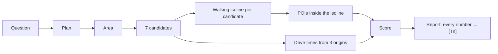

# Tutorial: build an evidence-traced site-selection agent on Geoapify

**Time:** ~30 minutes · **Level:** you know some TypeScript and a terminal · **Cost:** $0 (Geoapify free plan)

By the end you will have asked SiteScout *"Where should I open a specialty coffee shop in Thảo Điền?"*,
read the ranked shortlist, followed one number back to the exact Geoapify request that produced it, and
connected the same engine to an AI assistant through MCP.

Everything shown here comes from real runs recorded on 2026-10-22 and committed in [`examples/`](../examples/).

> Video version: the full tutorial video follows these same chapters (see the v1.0.0 release assets).

---

## 1. What you'll build



The key idea: a shop's catchment is **where people can walk in 10 minutes**, not a circle. Geoapify's
Isoline API draws that area, and its Places API can count POIs *inside* it by id. Everything else is
bookkeeping — and the bookkeeping is what makes the answer trustworthy.

## 2. Try it in the browser first (2 min)

Open **https://sitescout.huynhthanh.workers.dev**.

1. The map opens on a **recorded run** (instant, costs nothing): 7 blue walking isochrones in Thảo Điền and a
   shortlist on the right.
2. Click candidate **#2** on the map or in the list. The card shows the score breakdown, the 10-minute walk
   area, drive times, and **Evidence (Geoapify calls)** — the `[Tn]` refs behind each number.
3. Pick another question (pharmacy in Bình Thạnh, office lunch in District 1) or type your own, then press
   **Run live analysis**. Live runs go through a Cloudflare Worker that holds the Geoapify key, with per-visitor
   and daily caps. When the daily cap is reached, the demo says so and falls back to recorded runs.
4. The **Geoapify calls** panel lists every request of the run, with latency.


## 3. Install and run it yourself (5 min)

You need **Node.js 20+** and a free Geoapify key from <https://myprojects.geoapify.com> (3,000 credits/day,
no card).

```sh
git clone https://github.com/ducvuathuduc/sitescout-agent.git && cd sitescout-agent
npm ci && npm run build
export GEOAPIFY_API_KEY=your_key
node dist/cli.js scout "Where should I open a specialty coffee shop in Thảo Điền?" --id my-coffee
```

The terminal prints the plan, then one line per API call:

```
[plan:heuristic] {"business":"coffee shop","competitors":["catering.cafe"],"demand":["office","sport.fitness","commercial.clothing"],...}
  [T0] autocomplete      200  1221 ms  {"count":5,"top":"Phở Bùi Gia Thảo Điền, 56, Xuân Thủy, Phường An Khánh, ..."}
  [T1] boundaries        200  1307 ms  {"levels":"Khu phố 18 ⊂ Phường An Khánh ⊂ Thành phố Hồ Chí Minh ⊂ Việt Nam"}
  [T2] places            200  1011 ms  {"count":51,"categories":"catering.cafe"}
  ...
```

Output in `examples/my-coffee/`:

| File | What it is |
|---|---|
| `report.md` / `report.html` | Ranked shortlist, reasons, evidence table (HTML has an interactive map) |
| `map.jpg` | Shortlist map from the Geoapify Static Maps API |
| `result.json` | Everything, machine-readable |
| `trace.jsonl` | One line per API call — the evidence |

A run uses about 60–130 credits. `--credit-cap 300` (the default) stops a run before it goes over.

## 4. How the engine answers (10 min)

The engine is `src/engine/scout.ts`; the Geoapify client is `src/engine/geoapify.ts`.

### 4.1 Plan

`heuristicPlan()` (`src/engine/plan.ts`) maps keywords in English or Vietnamese to a business, competitor and
demand categories. For coffee: competitors `catering.cafe`; demand `office`, `sport.fitness`,
`commercial.clothing`. With `--planner llm` an LLM writes the plan instead, but its output is validated
against the Geoapify category list and falls back to the rules if it is wrong.

### 4.2 Find the area

Autocomplete first (it is the most tolerant of Vietnamese spelling), then forward geocoding as a second opinion,
then **Boundaries part-of** to name the post-2025 ward:

```
GET /v1/geocode/autocomplete?text=Xuân Thủy, Thảo Điền&lang=vi&filter=countrycode:vn&bias=proximity:106.7009,10.7769
GET /v1/boundaries/part-of?lat=10.8030828&lon=106.7318264&lang=vi
→ Khu phố 18 ⊂ Phường An Khánh ⊂ Thành phố Hồ Chí Minh ⊂ Việt Nam
```

(Thảo Điền is now part of Phường An Khánh after the July-2025 reform — the report says so.)

### 4.3 Candidates

Seven points on a hex lattice inside the study area, pre-ranked on one Places sample of the whole area
(`filter=rect:…`). Each candidate gets a readable label from Reverse Geocoding.

### 4.4 The catchment: isoline → places inside it

For each candidate:

```
GET /v1/isoline?lat=10.803087&lon=106.740537&type=time&mode=walk&range=600
→ { "id": "<isoline id>", geometry: MultiPolygon }

GET /v2/places?categories=catering.cafe&filter=geometry:<isoline id>&limit=150
GET /v2/places?categories=office&filter=geometry:<isoline id>&limit=150
...
```

No polygon upload and no point-in-polygon code: the isoline id *is* the filter. One request per category.

### 4.5 Access

One **Route Matrix** call: drive time from three origins (Chợ Bến Thành, Bến xe Miền Đông, Crescent Mall) to all
seven candidates. **Routing** and **Place Details** then add the route and a 5-minute drive area for the top site.

### 4.6 Score

```
score = 0.35·demand density + 0.25·(1 − competition) + 0.25·access + 0.15·walk reach
```

Each part is min-max normalised across the seven candidates, so a score compares sites within one question.
Real result for the coffee question:

| # | Candidate | Score | Demand POIs | Competitors | Walk area | Mean drive |
|---|---|---|---|---|---|---|
| 1 | 159, Võ Nguyên Giáp | 0.66 | 4 | 4 | 0.31 km² | 33.6 min |
| 2 | Trường Mầm Non Yêu Con, Đường Số 3 | 0.56 | 2 | 6 | 0.69 km² | 31.3 min |
| 3 | 112/11 - 112/13, Nguyễn Văn Hưởng | 0.52 | 2 | 0 | 0.27 km² | 35.5 min |

## 5. Follow a number back to its source (3 min)

The report says candidate #1 has **4 competing cafés** and cites `[T12] … [T17]`. Open the trace:

```sh
grep '"seq":1[2-7],' examples/thaodien-coffee/trace.jsonl
```

Each line has `api`, `endpoint` (the request **without** the key), `status`, `durationMs`, a `summary`
(`{"count":4,"categories":"catering.cafe"}`) and `credits`. If a number in a report has no matching line,
it is a bug — please open an issue.

## 6. Vietnamese addresses: the hard part (3 min)

Since 1 July 2025 HCMC has no districts and new ward names. People still type the old ones
("Phường 12, Quận 5"), and the data mixes both. We measured it: 55 HCMC queries against Wikidata coordinates
([`bench/hcmc-addresses/RESULTS.md`](../bench/hcmc-addresses/RESULTS.md)).

| Strategy | Within tolerance |
|---|---|
| Geocoding search top-1 | 37/55 (67%) |
| Autocomplete top-1 | 42/55 (76%) |
| `resolvePlace` v1.1 (drops pre-2025 units, whole-word matching) | 48/55 (87%) |

The biggest win was on old-ward street addresses (2/8 → 6/8). What we could not fix on our side is in
[`docs/FEEDBACK.md`](FEEDBACK.md) with reproductions.

## 7. Use it from an AI assistant (5 min)

SiteScout includes an MCP server with five tools: `plan_site_question`, `scout_site`, `resolve_place`,
`walk_isochrone`, `get_evidence`.

```sh
# Claude Code
claude mcp add sitescout -e GEOAPIFY_API_KEY=YOUR_KEY -- node "$PWD/dist/mcp-server.js"
```

Guides: [Claude Code](../agent/clients/claude-code.md) · [Cursor](../agent/clients/cursor.md) ·
[Claude Desktop](../agent/clients/claude-desktop.md). Put [`agent/SYSTEM_PROMPT.md`](../agent/SYSTEM_PROMPT.md) in
your project instructions, then ask: *"Where should I open a specialty coffee shop in Thảo Điền? Cite every number."*

The recorded sessions in [`agent/transcripts/`](../agent/transcripts/) use open-weight models on Cloudflare
Workers AI through a small host script, not Claude or Cursor. The failures are kept: a model that garbled
"Bình Thạnh" sent the analysis to the wrong ward, so `scout_site` now returns an `areaCheck`; a model that
invented a Places URL led us to return the real requests (`topCandidateCalls`) in every result.

## 8. Make it yours (2 min)

- **New business type:** add a rule to `BUSINESS_RULES` in `src/engine/plan.ts` (keywords, competitor category,
  demand categories). Use only categories from the Geoapify Places list.
- **Different walk time:** the plan's `walkMinutes` (the MCP `scout_site` tool accepts it as an override).
- **Different weights:** edit the weights in `src/engine/scout.ts` and bump the weights version so old reports stay
  comparable.

Then run `npm test` — the tests run offline on recorded fixtures.

## 9. Limits and lessons

- POIs come from OpenStreetMap via Geoapify. Coverage is good on main streets and thinner in alleys; counts are a
  lower bound.
- No foot traffic, rent or revenue data. The score ranks *catchment structure*, not profit.
- Small open models damage Vietnamese diacritics in tool arguments; always check `areaCheck`.
- The most useful Geoapify primitive was `filter=geometry:<isoline id>`. The biggest gap for agents: the MCP
  server has no isoline tool yet (FEEDBACK #1).

---

Built with [Geoapify](https://www.geoapify.com/) · Map data © OpenStreetMap contributors.
