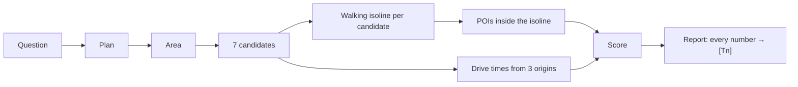
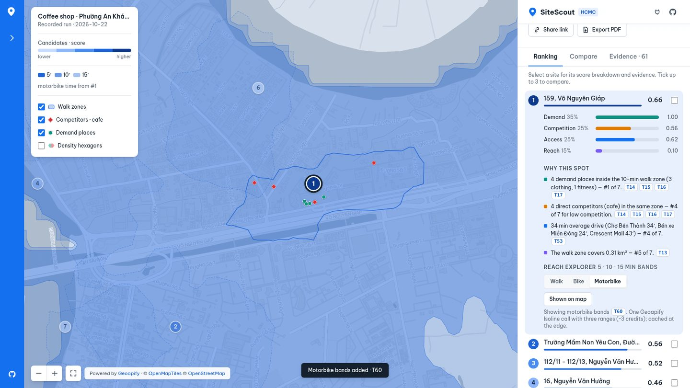
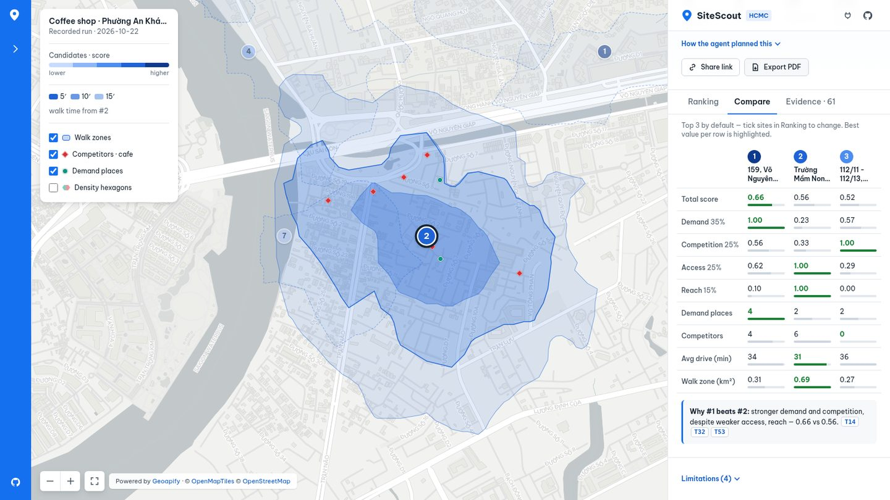
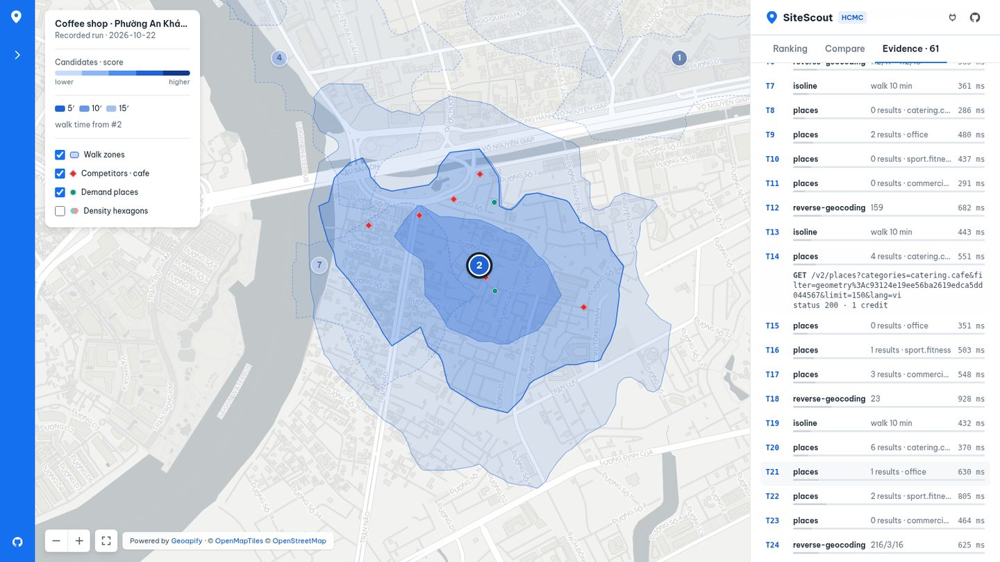
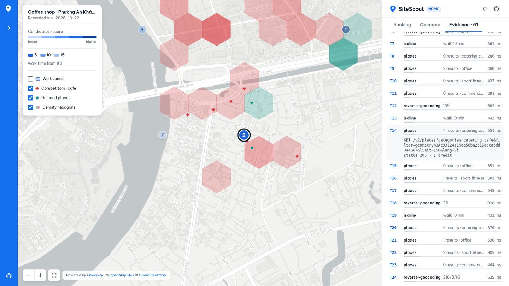
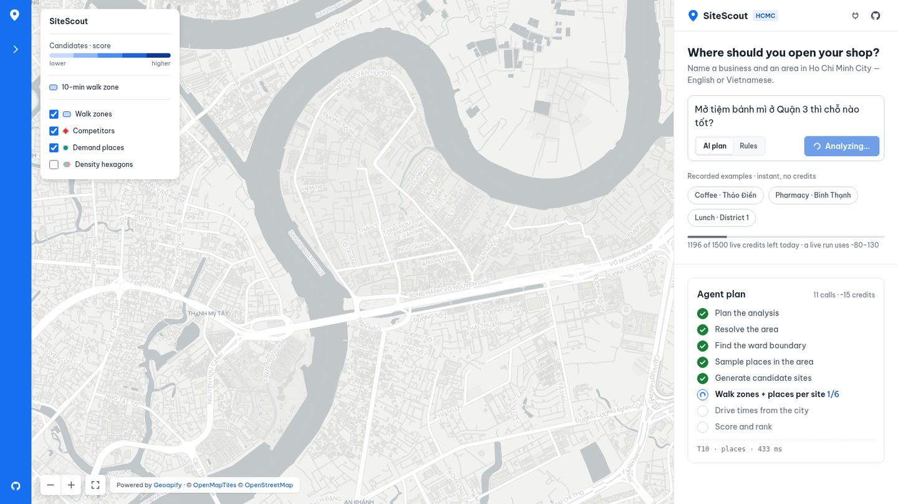
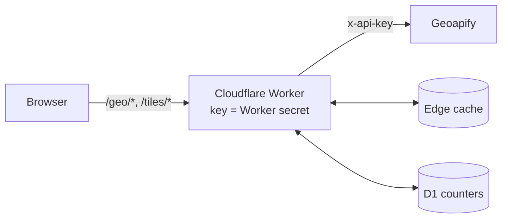

# Tutorial: build an evidence-traced site-selection agent on Geoapify

**Time:** ~40 minutes · **Level:** you know some TypeScript and a terminal · **Cost:** $0 (Geoapify free plan)

By the end you will have asked SiteScout *"Where should I open a specialty coffee shop in Thảo Điền?"*,
read the ranked shortlist, followed one number back to the exact Geoapify request that produced it,
connected the same engine to an AI assistant through MCP, seen where SiteScout uses the Geoapify MCP server and
where the REST APIs, and seen how the public demo keeps its Geoapify key secret.

Everything shown here comes from real runs, recorded on 2026-10-22 and committed in [`examples/`](../examples/),
plus one live web run recorded on 2026-10-23. The screenshots are of the current web demo (design v2, see
[docs/design/DESIGN_SYSTEM.md](design/DESIGN_SYSTEM.md)).

> Video version: [sitescout-tutorial.mp4](https://github.com/ducvuathuduc/sitescout-agent/raw/media/sitescout-tutorial.mp4) follows these same chapters.

---

## 1. What you'll build



The key idea: a shop's catchment is **where people can walk in 10 minutes**, not a circle. Geoapify's
Isoline API draws that area, and its Places API can count POIs *inside* it by id. Everything else is
bookkeeping — and the bookkeeping is what makes the answer trustworthy.

## 2. Try it in the browser first (5 min)

Open **https://sitescout.huynhthanh.workers.dev**. On a laptop the screen has three parts: a blue **rail** on the left
(about, GitHub, tutorial, MCP setup), the **map** with a floating legend, and the **panel** on the right. On a phone the
panel turns into a bottom sheet. Drag or tap its handle to resize it.


### 2.1 Read the answer first

The map opens on a **recorded run** (instant, no credits): *a specialty coffee shop in Thảo Điền*. Under the question
box, **Best spot for a coffee shop** gives the answer straight away: site **#1, 159 Võ Nguyên Giáp, score 0.66**,
with four numbers. In this run they are 4 demand places, 4 competitors, a 34′ average drive and a 0.31 km² walk zone.
**How the agent planned this** opens the plan: area, planner, competitor category, demand categories, walk minutes
and origins.

On the map, each candidate is a numbered pin. Its colour is its score, from light (lower) to dark blue (higher). Each
candidate's 10-minute walk zone is a dashed outline. Site #1 is filled with **5 / 10 / 15-minute walking bands**,
explained in the legend.

### 2.2 Ranking and "why this spot"

The **Ranking** tab lists all 7 sites with a score bar. Hover a row and its pin and walk zone light up on the map.
Hover a pin and the row lights up. Click a row (or a pin) to open it:

- **Score breakdown:** four bars with their weights. Demand 35 %, competition 25 %, access 25 %, reach 15 %.
- **Why this spot:** one sentence per factor, each with its rank among the 7 sites and the `[Tn]` calls behind it.
  For example: *"4 direct competitors (cafe) in the same zone — #4 of 7 for low competition. [T14] [T15] [T16] [T17]"*.


### 2.3 Reach explorer: walk, bike, motorbike

Inside an open site, **Reach explorer** draws 5 / 10 / 15-minute bands for **Walk**, **Bike** or **Motorbike**. Each
press is one live Geoapify Isoline call with three ranges (`range=300,600,900`, counted as 6 credits: 1 per 5 minutes of each band). It shows up as a new
`[Tn]` in Evidence. The walking bands for the top 3 sites of each example are pre-recorded, so they cost nothing.



### 2.4 Compare

The **Compare** tab puts the top 3 side by side by default. To choose your own, tick up to 3 checkboxes in Ranking.
The best value in each row is green. Below the table, **Why #1 beats #2** names the factors that decide it, with
evidence chips.



### 2.5 Evidence: follow any number

Click any `[Tn]` chip. The **Evidence** tab opens at that call and shows the method, the endpoint (no key: requests go
through the demo proxy), the status, the latency and the credits. The tab lists every Geoapify call in the run. The
recorded coffee run has 57, plus 3 for the pre-recorded bands.



### 2.6 Map layers

The legend has toggles for **Walk zones**, **Competitors** (red diamonds), **Demand places** (teal dots) and
**Density hexagons**. The hexagons are 120 m bins of the places already fetched, so they use no extra credits. A hex
is red where competitors make up half or more of its places. Hover a hexagon or a place for its counts or name.



### 2.7 Ask your own question (live)

Type a question in English or Vietnamese, for example *"Mở tiệm bánh mì ở Quận 3 thì chỗ nào tốt?"*. Choose **AI plan**
(an LLM on Cloudflare Workers AI writes the plan, which is checked against the Geoapify category list) or **Rules**
(keyword rules). Then press **Analyze**. The panel shows the **agent plan** as steps, ticking each one as it finishes,
with a live count of calls and credits. Each walk zone appears on the map as soon as its call returns.



In our recorded live run (2026-10-23, 48 calls, roughly 40 s) the model picked `catering.cafe` as the competitor for a
bakery and `Phường 6, Quận 3` as the area. The engine replaced both with the known-good values
(`commercial.food_and_drink.bakery`, and the verified geocode text for District 3) and wrote the change into **Notes**
under *How the agent planned this*. A live run uses about 85–140 credits. The quota bar under the examples shows how
much of the demo's shared daily budget (2,400 credits, live calls and map tiles together) is left.

### 2.8 Share and export

- **Share link** copies a URL that opens the same analysis, including the selected site and tab. Recorded runs get a
  `#ex=…` link. A live run is stored once (no extra Geoapify calls) and gets a short `#r=…` link, for example
  <https://sitescout.huynhthanh.workers.dev/#r=2vz43hp5>.
- **Export PDF** prints an A4 report: the map, the ranking table, "why this spot" for the top 3 with `[Tn]`
  references, the full call list and the limitations. Example: [sample-report.pdf](assets/sample-report.pdf).

### 2.9 When the live budget is used up

The Worker caps the demo at 2,400 credits a day for live calls and map tiles together (a tile is 0.25 credit), and
at 180 live calls per visitor. When a cap is hit, an amber banner says which one, shows the closest recorded run
instead, and says when live runs reset (07:00 UTC+7). Any other failure gets a red banner with **Retry** and
**Retry with rules planner**. How the proxy, the limits and the cache work is in [§9](#9-put-it-online-safely-the-demo-proxy-5-min).


## 3. Install and run it yourself (5 min)

You need **Node.js 20+** and a free Geoapify key from <https://myprojects.geoapify.com> (3,000 credits/day,
no card).

```sh
git clone https://github.com/ducvuathuduc/sitescout-agent.git && cd sitescout-agent
npm ci && npm run build
export GEOAPIFY_API_KEY=your_key
node dist/cli.js scout "Where should I open a specialty coffee shop in Thảo Điền?" --id my-coffee
```

The terminal prints the plan, then one line per API call:

```
[plan:heuristic] {"business":"coffee shop","competitors":["catering.cafe"],"demand":["office","sport.fitness","commercial.clothing"],...}
  [T0] autocomplete      200  1221 ms  {"count":5,"top":"Phở Bùi Gia Thảo Điền, 56, Xuân Thủy, Phường An Khánh, ..."}
  [T1] boundaries        200  1307 ms  {"levels":"Khu phố 18 ⊂ Phường An Khánh ⊂ Thành phố Hồ Chí Minh ⊂ Việt Nam"}
  [T2] places            200  1011 ms  {"count":51,"categories":"catering.cafe"}
  ...
```

Output in `examples/my-coffee/`:

| File | What it is |
|---|---|
| `report.md` / `report.html` | Ranked shortlist, reasons, evidence table (HTML has an interactive map) |
| `map.jpg` | Shortlist map from the Geoapify Static Maps API |
| `result.json` | Everything, machine-readable |
| `trace.jsonl` | One line per API call — the evidence |

A run uses about 85–140 credits. `--credit-cap 300` (the default) stops a run before it goes over.

## 4. How the engine answers (10 min)

The engine is `src/engine/scout.ts`; the Geoapify client is `src/engine/geoapify.ts`.

### 4.1 Plan

`heuristicPlan()` (`src/engine/plan.ts`) maps keywords in English or Vietnamese to a business, competitor and
demand categories. For coffee: competitors `catering.cafe`; demand `office`, `sport.fitness`,
`commercial.clothing`. With `--planner llm` an LLM writes the plan instead, but its output is validated
against the Geoapify category list and falls back to the rules if it is wrong.

### 4.2 Find the area

Autocomplete first (it is the most tolerant of Vietnamese spelling), then forward geocoding as a second opinion,
then **Boundaries part-of** to name the post-2025 ward:

```
GET /v1/geocode/autocomplete?text=Xuân Thủy, Thảo Điền&lang=vi&filter=countrycode:vn&bias=proximity:106.7009,10.7769
GET /v1/boundaries/part-of?lat=10.8030828&lon=106.7318264&lang=vi
→ Khu phố 18 ⊂ Phường An Khánh ⊂ Thành phố Hồ Chí Minh ⊂ Việt Nam
```

(Thảo Điền is now part of Phường An Khánh after the July-2025 reform — the report says so.)

### 4.3 Candidates

Seven points on a hex lattice inside the study area, pre-ranked on one Places sample of the whole area
(`filter=rect:…`). Each candidate gets a readable label from Reverse Geocoding.

### 4.4 The catchment: isoline → places inside it

For each candidate:

```
GET /v1/isoline?lat=10.803087&lon=106.740537&type=time&mode=walk&range=600
→ { "id": "<isoline id>", geometry: MultiPolygon }

GET /v2/places?categories=catering.cafe&filter=geometry:<isoline id>&limit=150
GET /v2/places?categories=office&filter=geometry:<isoline id>&limit=150
...
```

No polygon upload and no point-in-polygon code: the isoline id *is* the filter. One request per category.

### 4.5 Access

One **Route Matrix** call: drive time from three origins (Chợ Bến Thành, Bến xe Miền Đông, Crescent Mall) to all
seven candidates. **Routing** and **Place Details** then add the route and a 5-minute drive area for the top site.

### 4.6 Score

```
score = 0.35·demand density + 0.25·(1 − competition) + 0.25·access + 0.15·walk reach
```

Each part is min-max normalised across the seven candidates, so a score compares sites within one question.
Real result for the coffee question:

| # | Candidate | Score | Demand POIs | Competitors | Walk area | Mean drive |
|---|---|---|---|---|---|---|
| 1 | 159, Võ Nguyên Giáp | 0.66 | 4 | 4 | 0.31 km² | 33.6 min |
| 2 | Trường Mầm Non Yêu Con, Đường Số 3 | 0.56 | 2 | 6 | 0.69 km² | 31.3 min |
| 3 | 112/11 - 112/13, Nguyễn Văn Hưởng | 0.52 | 2 | 0 | 0.27 km² | 35.5 min |

## 5. Follow a number back to its source (3 min)

The report says candidate #1 has **4 competing cafés** and cites `[T12] … [T17]`. Open the trace:

```sh
grep '"seq":1[2-7],' examples/thaodien-coffee/trace.jsonl
```

Each line has `api`, `endpoint` (the request **without** the key), `status`, `durationMs`, a `summary`
(`{"count":4,"categories":"catering.cafe"}`) and `credits`. If a number in a report has no matching line,
it is a bug — please open an issue.

## 6. Vietnamese addresses: the hard part (3 min)

Since 1 July 2025 HCMC has no districts and new ward names. People still type the old ones
("Phường 12, Quận 5"), and the data mixes both. We measured it: 55 HCMC queries against Wikidata coordinates
([`bench/hcmc-addresses/RESULTS.md`](../bench/hcmc-addresses/RESULTS.md)).

| Strategy | Within tolerance |
|---|---|
| Geocoding search top-1 | 37/55 (67%) |
| Autocomplete top-1 | 42/55 (76%) |
| `resolvePlace` v1.1 (drops pre-2025 units, whole-word matching) | 48/55 (87%) |

The biggest win was on old-ward street addresses (2/8 → 6/8). What we could not fix on our side is in
[`docs/FEEDBACK.md`](FEEDBACK.md) with reproductions.

## 7. Use it from an AI assistant (5 min)

SiteScout includes an MCP server with five tools: `plan_site_question`, `scout_site`, `resolve_place`,
`walk_isochrone`, `get_evidence`. In the web demo, the plug icon at the top of the panel (or **Use from Claude / Cursor**
in the rail) opens these setup commands, with copy buttons.

```sh
# Claude Code
claude mcp add sitescout -e GEOAPIFY_API_KEY=YOUR_KEY -- node "$PWD/dist/mcp-server.js"
```

Guides: [Claude Code](../agent/clients/claude-code.md) · [Cursor](../agent/clients/cursor.md) ·
[Claude Desktop](../agent/clients/claude-desktop.md). Put [`agent/SYSTEM_PROMPT.md`](../agent/SYSTEM_PROMPT.md) in
your project instructions, then ask: *"Where should I open a specialty coffee shop in Thảo Điền? Cite every number."*

The recorded sessions in [`agent/transcripts/`](../agent/transcripts/) use open-weight models on Cloudflare
Workers AI through a small host script, not Claude or Cursor. The failures are kept: a model that garbled
"Bình Thạnh" sent the analysis to the wrong ward, so `scout_site` now returns an `areaCheck`; a model that
invented a Places URL led us to return the real requests (`topCandidateCalls`) in every result.

## 8. How SiteScout uses the Geoapify MCP server (5 min)

Full write-up, with the tool-by-tool table, a real call and the agent sessions: **[docs/mcp.md](mcp.md)**.

SiteScout talks to Geoapify in two ways:

| Command / surface | Talks to Geoapify through | Code |
|---|---|---|
| `sitescout ask`, `sitescout smoke` | the **Geoapify MCP server** (`https://api.geoapify.com/v1/mcp`), all 11 tools | `src/mcp/client.ts` → `src/agent/run.ts` |
| `sitescout scout`, the web demo, SiteScout's own MCP server | the **Geoapify REST APIs** | `src/engine/geoapify.ts` → `src/engine/scout.ts` |

The `ask` pipeline was the first version. It geocodes the seeds (`geocode_address`), checks the categories against
`list_place_categories`, labels candidates with `reverse_geocode_coordinates`, draws an 800 m catchment with
`transform_geometry`, measures and checks it with `measure_geometry` and `evaluate_spatial_relation`, counts POIs
with `search_places`, gets drive times with `calculate_route_matrix`, unions the catchments with
`combine_geometries` and routes to the winner with `calculate_route`.

The product path moved to REST for one reason: **walking time**. The MCP server has no isoline tool, and its
`search_places` searches a circle (`radius_meters`). The REST Isoline API returns the real 10-minute walk area, and
REST Places can count POIs inside it with `filter=geometry:<isoline id>`. A circle counts places across the river
that nobody walks to. Autocomplete and Boundaries (needed for Vietnamese addresses and post-2025 ward names) are also
REST-only.

SiteScout's own MCP server sits one level up. Its five tools (`plan_site_question`, `scout_site`, `resolve_place`,
`walk_isochrone`, `get_evidence`) run a whole analysis and return cited results. In Claude Code or Cursor you can
register both servers: SiteScout for the analysis, the Geoapify MCP server for follow-up questions such as a single
route or a nearby search. [docs/mcp.md](mcp.md) shows the configuration and walks through a recorded session.

## 9. Put it online safely: the demo proxy (5 min)

Full write-up, with code and deploy steps: **[docs/demo-proxy.md](demo-proxy.md)**.



- **The key never reaches the browser.** It is a Worker secret. Only the Worker adds it, as a header. An allow-list
  of 9 endpoints and an HCMC-only scope check limit what a visitor can do with the proxy.
- **One daily budget.** Live API calls and map tiles share 2,400 credits a day (a tile is 0.25 credit), 80 % of the
  free plan. Each visitor also gets 180 live calls a day. The counters live in D1, keyed by the UTC day and a
  daily-rotating hash of the IP (no raw IPs).
- **At a limit**, the Worker answers 429 with `fallback: true`. The app shows an amber banner and opens the closest
  recorded run.
- **Caching.** API answers are cached at the edge for 24 h, tiles for 30 days. Measured on 2026-10-31 with the
  pharmacy question asked twice: the first run sent 53 of its 56 calls to Geoapify (84 credits, 54 s); the second
  run got all 56 from the cache (0 credits, 4 s).
- **Your own copy:** `wrangler d1 create`, `wrangler secret put GEOAPIFY_KEY`, `node build.mjs`, `wrangler deploy`.

## 10. Make it yours (2 min)

- **New business type:** add a rule to `BUSINESS_RULES` in `src/engine/plan.ts` (keywords, competitor category,
  demand categories). Use only categories from the Geoapify Places list.
- **Different walk time:** the plan's `walkMinutes` (the MCP `scout_site` tool accepts it as an override).
- **Different weights:** edit the weights in `src/engine/scout.ts` and bump the weights version so old reports stay
  comparable.

Then run `npm test` — the tests run offline on recorded fixtures.

## 11. Limits and lessons

- POIs come from OpenStreetMap via Geoapify. Coverage is good on main streets and thinner in alleys; counts are a
  lower bound.
- No foot traffic, rent or revenue data. The score ranks *catchment structure*, not profit.
- Small open models damage Vietnamese diacritics in tool arguments; always check `areaCheck`.
- The most useful Geoapify primitive was `filter=geometry:<isoline id>`. The biggest gap for agents: the MCP
  server has no isoline tool yet (FEEDBACK #1).

---

Built with [Geoapify](https://www.geoapify.com/) · Map data © OpenStreetMap contributors.
