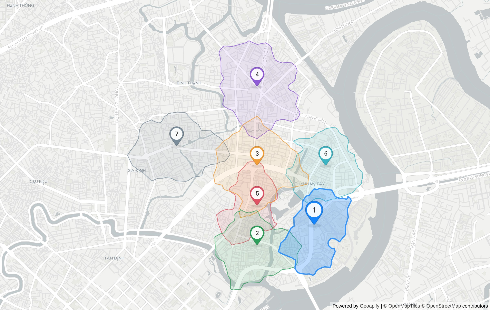

# SiteScout: pharmacy in Phường Thạnh Mỹ Tây

> **Question:** Where should I open a pharmacy in Bình Thạnh?
> Generated 2026-10-22T12:35:14.424Z · 59 Geoapify API calls · ~79 credits · 38.4 s · sitescout-engine@1.0.0 · weights `1.0.0-isoline` · planner: heuristic

## Plan

- Business: **pharmacy** · competitors `healthcare.pharmacy` · demand `healthcare.hospital`, `healthcare.clinic_or_praxis`, `commercial.supermarket`
- Area: "Ngã tư Hàng Xanh, Bình Thạnh, Hồ Chí Minh" → Ngã tư Hàng Xanh, Cầu vượt Hàng Xanh, Phường Thạnh Mỹ Tây, Thành phố Thủ Đức, 72308, Việt Nam (amenity, confidence 0.6666666666666667) [T0]
- Administrative unit (Geoapify Boundaries): **Phường Thạnh Mỹ Tây** — Khu phố 21 ⊂ Thành phố Hồ Chí Minh ⊂ Việt Nam [T1]
- Catchment: **10-minute walking isochrone** per candidate (Geoapify Isoline API)
- 7 candidates generated on a hex lattice inside the study area, pre-scored on an area POI sample [T2]

## Ranked shortlist

| # | Candidate | Score | Demand POIs (10-min walk) | Competitors | Walk area | Mean drive | Evidence |
|---|---|---|---|---|---|---|---|
| 1 | 113 Nguyễn Hữu Cảnh | **0.58** | 6 | 1 | 0.64 km² | 23 min | [T14] [T15] [T16] [T17] [T18] [T19] [T55] [T56] [T57] |
| 2 | Trường Trung học cơ sở Phú Mỹ, Ngô Tất Tố | **0.57** | 5 | 1 | 0.73 km² | 21.7 min | [T8] [T9] [T10] [T11] [T12] [T13] [T55] |
| 3 | Cầu vượt Hàng Xanh | **0.55** | 0 | 0 | 0.93 km² | 24 min | [T20] [T21] [T22] [T23] [T24] [T25] [T55] |
| 4 | Cửa Hàng Tuấn Thành Motor, Xô Viết Nghệ Tĩnh | **0.52** | 1 | 0 | 0.93 km² | 25.7 min | [T38] [T39] [T40] [T41] [T42] [T43] [T55] |
| 5 | 43, Hẻm 158 Xô Viết Nghệ Tĩnh | **0.50** | 0 | 0 | 0.52 km² | 21.3 min | [T26] [T27] [T28] [T29] [T30] [T31] [T55] |
| 6 | Hẻm 72 Nguyễn Văn Thương | **0.36** | 1 | 0 | 0.67 km² | 27.8 min | [T44] [T45] [T46] [T47] [T48] [T49] [T55] |
| 7 | 443c, Bạch Đằng | **0.33** | 2 | 1 | 0.80 km² | 24.3 min | [T32] [T33] [T34] [T35] [T36] [T37] [T55] |

Score = 0.35·demand density + 0.25·(1 − competition) + 0.25·access + 0.15·walk reach, each min-max normalised across these 7 candidates.

## Why each site ranks where it does

### 1. 113 Nguyễn Hữu Cảnh — 0.58

10-min walk reaches 0.64 km² with 5 commercial.supermarket, 1 healthcare.clinic_or_praxis and 1 competing healthcare.pharmacy; 23 min average drive from 3 origin(s). [T14] [T15] [T16] [T17] [T18] [T19] [T55] [T56] [T57]

- Sub-scores: demand 1.00 · competition 0.00 · access 0.74 · reach 0.29
- Demand mix: healthcare.hospital 0, healthcare.clinic_or_praxis 1, commercial.supermarket 5
- Drive time by origin: Chợ Bến Thành 19 min · Bến xe Miền Đông 14.1 min · Crescent Mall 35.8 min
- Coordinates: 10.794431, 106.718657

### 2. Trường Trung học cơ sở Phú Mỹ, Ngô Tất Tố — 0.57

10-min walk reaches 0.73 km² with 4 commercial.supermarket, 1 healthcare.clinic_or_praxis and 1 competing healthcare.pharmacy; 22 min average drive from 3 origin(s). [T8] [T9] [T10] [T11] [T12] [T13] [T55]

- Sub-scores: demand 0.73 · competition 0.00 · access 0.94 · reach 0.51
- Demand mix: healthcare.hospital 0, healthcare.clinic_or_praxis 1, commercial.supermarket 4
- Drive time by origin: Chợ Bến Thành 18.8 min · Bến xe Miền Đông 12 min · Crescent Mall 34.3 min
- Coordinates: 10.792094, 106.711791

### 3. Cầu vượt Hàng Xanh — 0.55

10-min walk reaches 0.93 km² with no demand POIs and 0 competing healthcare.pharmacy; 24 min average drive from 3 origin(s). [T20] [T21] [T22] [T23] [T24] [T25] [T55]

- Sub-scores: demand 0.00 · competition 1.00 · access 0.58 · reach 1.00
- Demand mix: healthcare.hospital 0, healthcare.clinic_or_praxis 0, commercial.supermarket 0
- Drive time by origin: Chợ Bến Thành 20.8 min · Bến xe Miền Đông 10 min · Crescent Mall 41.3 min
- Coordinates: 10.80144, 106.711791

### 4. Cửa Hàng Tuấn Thành Motor, Xô Viết Nghệ Tĩnh — 0.52

10-min walk reaches 0.93 km² with 1 commercial.supermarket and 0 competing healthcare.pharmacy; 26 min average drive from 3 origin(s). [T38] [T39] [T40] [T41] [T42] [T43] [T55]

- Sub-scores: demand 0.11 · competition 1.00 · access 0.33 · reach 1.00
- Demand mix: healthcare.hospital 0, healthcare.clinic_or_praxis 0, commercial.supermarket 1
- Drive time by origin: Chợ Bến Thành 27.2 min · Bến xe Miền Đông 2.7 min · Crescent Mall 47 min
- Coordinates: 10.810786, 106.711791

### 5. 43, Hẻm 158 Xô Viết Nghệ Tĩnh — 0.50

10-min walk reaches 0.52 km² with no demand POIs and 0 competing healthcare.pharmacy; 21 min average drive from 3 origin(s). [T26] [T27] [T28] [T29] [T30] [T31] [T55]

- Sub-scores: demand 0.00 · competition 1.00 · access 1.00 · reach 0.00
- Demand mix: healthcare.hospital 0, healthcare.clinic_or_praxis 0, commercial.supermarket 0
- Drive time by origin: Chợ Bến Thành 17.3 min · Bến xe Miền Đông 9.5 min · Crescent Mall 37.1 min
- Coordinates: 10.796767, 106.711791

### 6. Hẻm 72 Nguyễn Văn Thương — 0.36

10-min walk reaches 0.67 km² with 1 commercial.supermarket and 0 competing healthcare.pharmacy; 28 min average drive from 3 origin(s). [T44] [T45] [T46] [T47] [T48] [T49] [T55]

- Sub-scores: demand 0.16 · competition 1.00 · access 0.00 · reach 0.36
- Demand mix: healthcare.hospital 0, healthcare.clinic_or_praxis 0, commercial.supermarket 1
- Drive time by origin: Chợ Bến Thành 27.6 min · Bến xe Miền Đông 11.3 min · Crescent Mall 44.5 min
- Coordinates: 10.80144, 106.72003

### 7. 443c, Bạch Đằng — 0.33

10-min walk reaches 0.80 km² with 2 commercial.supermarket and 1 competing healthcare.pharmacy; 24 min average drive from 3 origin(s). [T32] [T33] [T34] [T35] [T36] [T37] [T55]

- Sub-scores: demand 0.27 · competition 0.00 · access 0.53 · reach 0.68
- Demand mix: healthcare.hospital 0, healthcare.clinic_or_praxis 0, commercial.supermarket 2
- Drive time by origin: Chợ Bến Thành 22.7 min · Bến xe Miền Đông 7.3 min · Crescent Mall 43.1 min
- Coordinates: 10.803777, 106.702178

**Route to #1:** from Chợ Bến Thành, Quận 1, Hồ Chí Minh, 19 min / 4.9 km by car [T56].

**5-minute drive zone around #1** (Place Details `drive_5`): 22.54 km² [T57].

## Limitations

- Geoapify Boundaries returned no ward-level unit for this point (levels: Khu phố 21 ⊂ Thành phố Hồ Chí Minh ⊂ Việt Nam); ward name taken from the geocoder ("Phường Thạnh Mỹ Tây") and candidates generated in a disk.
- POI counts come from Geoapify Places (OpenStreetMap-based); coverage of small Vietnamese shops is incomplete, so counts are relative signals, not market sizes.
- Drive times use Geoapify's approximated traffic at query time, not a specific hour.
- Weights (1.0.0-isoline) are heuristic and not calibrated against real store outcomes.
- Decision support only — visit the site before signing a lease.

## Evidence trace

Every `[Tn]` above is one real Geoapify request. The key is sent as a header, so these endpoints are reproducible as-is with your own key.

| T | API | Request | Status | ms | Result | Credits≈ |
|---|---|---|---|---|---|---|
| T0 | autocomplete | `GET /v1/geocode/autocomplete?text=Ng%C3%A3+t%C6%B0+H%C3%A0ng+Xanh%2C+B%C3%ACnh+Th%E1%BA%A1n…` | 200 | 3224 | {"count":5,"top":"Ngã tư Hàng Xanh, Cầu vượt Hàng Xanh, Phường Thạnh Mỹ Tây, Thà | 1 |
| T1 | geocoding | `GET /v1/geocode/search?text=Ng%C3%A3+t%C6%B0+H%C3%A0ng+Xanh%2C+B%C3%ACnh+Th%E1%BA%A1nh%2C+H…` | 200 | 1368 | {"count":0} | 1 |
| T2 | autocomplete | `GET /v1/geocode/autocomplete?text=Ng%C3%A3+t%C6%B0+H%C3%A0ng+Xanh&lang=vi&limit=5&filter=co…` | 200 | 604 | {"count":3,"top":"Ngã tư Hàng Xanh, Phường Thạnh Mỹ Tây, Thành phố Thủ Đức, 7230 | 1 |
| T3 | boundaries | `GET /v1/boundaries/part-of?lat=10.801436&lon=106.7113199&lang=vi&geometry=geometry_1000` | 200 | 1355 | {"levels":"Khu phố 21 ⊂ Thành phố Hồ Chí Minh ⊂ Việt Nam"} | 1 |
| T4 | places | `GET /v2/places?categories=healthcare.pharmacy&filter=rect%3A106.699431%2C10.813114%2C106.72…` | 200 | 426 | {"count":4,"categories":"healthcare.pharmacy"} | 1 |
| T5 | places | `GET /v2/places?categories=healthcare.hospital&filter=rect%3A106.699431%2C10.813114%2C106.72…` | 200 | 305 | {"count":0,"categories":"healthcare.hospital"} | 1 |
| T6 | places | `GET /v2/places?categories=healthcare.clinic_or_praxis&filter=rect%3A106.699431%2C10.813114%…` | 200 | 331 | {"count":2,"categories":"healthcare.clinic_or_praxis"} | 1 |
| T7 | places | `GET /v2/places?categories=commercial.supermarket&filter=rect%3A106.699431%2C10.813114%2C106…` | 200 | 483 | {"count":11,"categories":"commercial.supermarket"} | 1 |
| T8 | reverse-geocoding | `GET /v1/geocode/reverse?lat=10.792094&lon=106.711791&lang=vi&format=json` | 200 | 684 | {"top":"Trường Trung học cơ sở Phú Mỹ, 120B, Ngô Tất Tố, Phường Thạnh Mỹ Tây, Th | 1 |
| T9 | isoline | `GET /v1/isoline?lat=10.792094&lon=106.711791&type=time&mode=walk&range=600` | 200 | 321 | {"mode":"walk","range":600,"type":"time","id":"0a69743bc2f4d802701fb2f553c41706" | 1 |
| T10 | places | `GET /v2/places?categories=healthcare.pharmacy&filter=geometry%3A0a69743bc2f4d802701fb2f553c…` | 200 | 310 | {"count":1,"categories":"healthcare.pharmacy"} | 1 |
| T11 | places | `GET /v2/places?categories=healthcare.hospital&filter=geometry%3A0a69743bc2f4d802701fb2f553c…` | 200 | 370 | {"count":0,"categories":"healthcare.hospital"} | 1 |
| T12 | places | `GET /v2/places?categories=healthcare.clinic_or_praxis&filter=geometry%3A0a69743bc2f4d802701…` | 200 | 408 | {"count":1,"categories":"healthcare.clinic_or_praxis"} | 1 |
| T13 | places | `GET /v2/places?categories=commercial.supermarket&filter=geometry%3A0a69743bc2f4d802701fb2f5…` | 200 | 572 | {"count":4,"categories":"commercial.supermarket"} | 1 |
| T14 | reverse-geocoding | `GET /v1/geocode/reverse?lat=10.794431&lon=106.718657&lang=vi&format=json` | 200 | 766 | {"top":"113 Nguyễn Hữu Cảnh, Nguyễn Hữu Cảnh, Phường Thạnh Mỹ Tây, Thành phố Thủ | 1 |
| T15 | isoline | `GET /v1/isoline?lat=10.794431&lon=106.718657&type=time&mode=walk&range=600` | 200 | 477 | {"mode":"walk","range":600,"type":"time","id":"8de65ed5b918308cbd53a006ad49ca95" | 1 |
| T16 | places | `GET /v2/places?categories=healthcare.pharmacy&filter=geometry%3A8de65ed5b918308cbd53a006ad4…` | 200 | 469 | {"count":1,"categories":"healthcare.pharmacy"} | 1 |
| T17 | places | `GET /v2/places?categories=healthcare.hospital&filter=geometry%3A8de65ed5b918308cbd53a006ad4…` | 200 | 372 | {"count":0,"categories":"healthcare.hospital"} | 1 |
| T18 | places | `GET /v2/places?categories=healthcare.clinic_or_praxis&filter=geometry%3A8de65ed5b918308cbd5…` | 200 | 473 | {"count":1,"categories":"healthcare.clinic_or_praxis"} | 1 |
| T19 | places | `GET /v2/places?categories=commercial.supermarket&filter=geometry%3A8de65ed5b918308cbd53a006…` | 200 | 499 | {"count":5,"categories":"commercial.supermarket"} | 1 |
| T20 | reverse-geocoding | `GET /v1/geocode/reverse?lat=10.80144&lon=106.711791&lang=vi&format=json` | 200 | 544 | {"top":"Cầu vượt Hàng Xanh, Phường Thạnh Mỹ Tây, Thành phố Thủ Đức, 72308, Việt  | 1 |
| T21 | isoline | `GET /v1/isoline?lat=10.80144&lon=106.711791&type=time&mode=walk&range=600` | 200 | 655 | {"mode":"walk","range":600,"type":"time","id":"1ffbff7056cb020fe65102297e89278e" | 1 |
| T22 | places | `GET /v2/places?categories=healthcare.pharmacy&filter=geometry%3A1ffbff7056cb020fe65102297e8…` | 200 | 371 | {"count":0,"categories":"healthcare.pharmacy"} | 1 |
| T23 | places | `GET /v2/places?categories=healthcare.hospital&filter=geometry%3A1ffbff7056cb020fe65102297e8…` | 200 | 267 | {"count":0,"categories":"healthcare.hospital"} | 1 |
| T24 | places | `GET /v2/places?categories=healthcare.clinic_or_praxis&filter=geometry%3A1ffbff7056cb020fe65…` | 200 | 271 | {"count":0,"categories":"healthcare.clinic_or_praxis"} | 1 |
| T25 | places | `GET /v2/places?categories=commercial.supermarket&filter=geometry%3A1ffbff7056cb020fe6510229…` | 200 | 373 | {"count":0,"categories":"commercial.supermarket"} | 1 |
| T26 | reverse-geocoding | `GET /v1/geocode/reverse?lat=10.796767&lon=106.711791&lang=vi&format=json` | 200 | 729 | {"top":"43, Hẻm 158 Xô Viết Nghệ Tĩnh, Phường Thạnh Mỹ Tây, Thành phố Hồ Chí Min | 1 |
| T27 | isoline | `GET /v1/isoline?lat=10.796767&lon=106.711791&type=time&mode=walk&range=600` | 200 | 331 | {"mode":"walk","range":600,"type":"time","id":"d5c68fd3314fbda59d3161b913546690" | 1 |
| T28 | places | `GET /v2/places?categories=healthcare.pharmacy&filter=geometry%3Ad5c68fd3314fbda59d3161b9135…` | 200 | 423 | {"count":0,"categories":"healthcare.pharmacy"} | 1 |
| T29 | places | `GET /v2/places?categories=healthcare.hospital&filter=geometry%3Ad5c68fd3314fbda59d3161b9135…` | 200 | 348 | {"count":0,"categories":"healthcare.hospital"} | 1 |
| T30 | places | `GET /v2/places?categories=healthcare.clinic_or_praxis&filter=geometry%3Ad5c68fd3314fbda59d3…` | 200 | 386 | {"count":0,"categories":"healthcare.clinic_or_praxis"} | 1 |
| T31 | places | `GET /v2/places?categories=commercial.supermarket&filter=geometry%3Ad5c68fd3314fbda59d3161b9…` | 200 | 320 | {"count":0,"categories":"commercial.supermarket"} | 1 |
| T32 | reverse-geocoding | `GET /v1/geocode/reverse?lat=10.803777&lon=106.702178&lang=vi&format=json` | 200 | 802 | {"top":"443c, Bạch Đằng, Phường Gia Định, Thành phố Thủ Đức, HC 72317, Việt Nam" | 1 |
| T33 | isoline | `GET /v1/isoline?lat=10.803777&lon=106.702178&type=time&mode=walk&range=600` | 200 | 440 | {"mode":"walk","range":600,"type":"time","id":"3ebac0ee363b176b4804ac77ddff3415" | 1 |
| T34 | places | `GET /v2/places?categories=healthcare.pharmacy&filter=geometry%3A3ebac0ee363b176b4804ac77ddf…` | 200 | 366 | {"count":1,"categories":"healthcare.pharmacy"} | 1 |
| T35 | places | `GET /v2/places?categories=healthcare.hospital&filter=geometry%3A3ebac0ee363b176b4804ac77ddf…` | 200 | 310 | {"count":0,"categories":"healthcare.hospital"} | 1 |
| T36 | places | `GET /v2/places?categories=healthcare.clinic_or_praxis&filter=geometry%3A3ebac0ee363b176b480…` | 200 | 311 | {"count":0,"categories":"healthcare.clinic_or_praxis"} | 1 |
| T37 | places | `GET /v2/places?categories=commercial.supermarket&filter=geometry%3A3ebac0ee363b176b4804ac77…` | 200 | 354 | {"count":2,"categories":"commercial.supermarket"} | 1 |
| T38 | reverse-geocoding | `GET /v1/geocode/reverse?lat=10.810786&lon=106.711791&lang=vi&format=json` | 200 | 792 | {"top":"Cửa Hàng Tuấn Thành Motor, 555, Xô Viết Nghệ Tĩnh, Phường Bình Thạnh, Th | 1 |
| T39 | isoline | `GET /v1/isoline?lat=10.810786&lon=106.711791&type=time&mode=walk&range=600` | 200 | 445 | {"mode":"walk","range":600,"type":"time","id":"3f478556c9c4cb2dd6c9443ff4d81610" | 1 |
| T40 | places | `GET /v2/places?categories=healthcare.pharmacy&filter=geometry%3A3f478556c9c4cb2dd6c9443ff4d…` | 200 | 386 | {"count":0,"categories":"healthcare.pharmacy"} | 1 |
| T41 | places | `GET /v2/places?categories=healthcare.hospital&filter=geometry%3A3f478556c9c4cb2dd6c9443ff4d…` | 200 | 326 | {"count":0,"categories":"healthcare.hospital"} | 1 |
| T42 | places | `GET /v2/places?categories=healthcare.clinic_or_praxis&filter=geometry%3A3f478556c9c4cb2dd6c…` | 200 | 446 | {"count":0,"categories":"healthcare.clinic_or_praxis"} | 1 |
| T43 | places | `GET /v2/places?categories=commercial.supermarket&filter=geometry%3A3f478556c9c4cb2dd6c9443f…` | 200 | 386 | {"count":1,"categories":"commercial.supermarket"} | 1 |
| T44 | reverse-geocoding | `GET /v1/geocode/reverse?lat=10.80144&lon=106.72003&lang=vi&format=json` | 200 | 629 | {"top":"Hẻm 72 Nguyễn Văn Thương, Phường Thạnh Mỹ Tây, Thành phố Thủ Đức, 72308, | 1 |
| T45 | isoline | `GET /v1/isoline?lat=10.80144&lon=106.72003&type=time&mode=walk&range=600` | 200 | 449 | {"mode":"walk","range":600,"type":"time","id":"1ecab02f66dc5f4bd9874e25227b379f" | 1 |
| T46 | places | `GET /v2/places?categories=healthcare.pharmacy&filter=geometry%3A1ecab02f66dc5f4bd9874e25227…` | 200 | 359 | {"count":0,"categories":"healthcare.pharmacy"} | 1 |
| T47 | places | `GET /v2/places?categories=healthcare.hospital&filter=geometry%3A1ecab02f66dc5f4bd9874e25227…` | 200 | 289 | {"count":0,"categories":"healthcare.hospital"} | 1 |
| T48 | places | `GET /v2/places?categories=healthcare.clinic_or_praxis&filter=geometry%3A1ecab02f66dc5f4bd98…` | 200 | 554 | {"count":0,"categories":"healthcare.clinic_or_praxis"} | 1 |
| T49 | places | `GET /v2/places?categories=commercial.supermarket&filter=geometry%3A1ecab02f66dc5f4bd9874e25…` | 200 | 396 | {"count":1,"categories":"commercial.supermarket"} | 1 |
| T50 | autocomplete | `GET /v1/geocode/autocomplete?text=Ch%E1%BB%A3+B%E1%BA%BFn+Th%C3%A0nh%2C+Qu%E1%BA%ADn+1&lang…` | 200 | 2796 | {"count":5,"top":"bưu điện quận 1, 65, Lê Lợi, Phường Sài Gòn, Thành phố Thủ Đức | 1 |
| T51 | geocoding | `GET /v1/geocode/search?text=Ch%E1%BB%A3+B%E1%BA%BFn+Th%C3%A0nh%2C+Qu%E1%BA%ADn+1%2C+H%E1%BB…` | 200 | 2035 | {"count":5,"top":"Tòa nhà Đức Thành phố Hồ Chí Minh, 33, Lê Duẩn, Phường Sài Gòn | 1 |
| T52 | autocomplete | `GET /v1/geocode/autocomplete?text=Ch%E1%BB%A3+B%E1%BA%BFn+Th%C3%A0nh&lang=vi&limit=5&filter…` | 200 | 774 | {"count":5,"top":"Chợ Bến Thành, Lê Lợi, Phường Bến Thành, Thành phố Thủ Đức, 71 | 1 |
| T53 | autocomplete | `GET /v1/geocode/autocomplete?text=B%E1%BA%BFn+xe+Mi%E1%BB%81n+%C4%90%C3%B4ng%2C+B%C3%ACnh+T…` | 200 | 1073 | {"count":5,"top":"Bến xe Miền Đông, 292, Dinh Bo Linh, Phường Bình Thạnh, Ho Chi | 1 |
| T54 | autocomplete | `GET /v1/geocode/autocomplete?text=Crescent+Mall%2C+Qu%E1%BA%ADn+7&lang=vi&limit=5&filter=co…` | 200 | 1355 | {"count":5,"top":"Trạm Y Tế Phường 7 Quận Phú Nhuận, Phan Đăng Lưu, Phường Cầu K | 1 |
| T55 | route-matrix | `POST /v1/routematrix` | 200 | 734 | {"sources":3,"targets":7,"cells":21} | 21 |
| T56 | routing | `GET /v1/routing?waypoints=10.7726204%2C106.6992917%7C10.794431%2C106.718657&mode=drive&traf…` | 200 | 582 | {"timeS":1142.498,"distanceM":4884} | 1 |
| T57 | place-details | `GET /v2/place-details?id=51c43afa04f5ad5a40594698a25c1a972540f00103f901fb5b37e502000000c002…` | 200 | 2116 | {"features":"details,drive_5"} | 1 |
| T58 | static-maps | `POST /v1/staticmap` | 200 | 5383 | {"bytes":655519,"width":1200,"height":760} | 1 |

---
Powered by [Geoapify](https://www.geoapify.com/) · © [OpenStreetMap](https://www.openstreetmap.org/copyright) contributors
