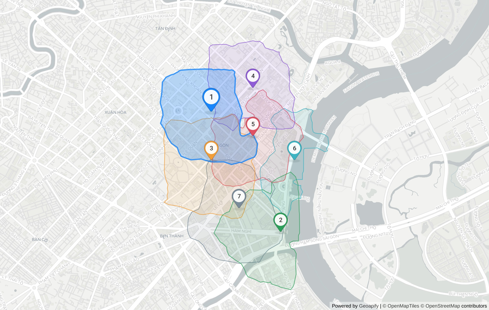

# SiteScout: restaurant in Phường Sài Gòn

> **Question:** Where should I open an office-lunch restaurant in District 1?
> Generated 2026-10-22T12:32:36.017Z · 59 Geoapify API calls · ~127 credits · 53.3 s · sitescout-engine@1.0.0 · weights `1.0.0-isoline` · planner: heuristic

## Plan

- Business: **restaurant** · competitors `catering.restaurant` · demand `office`, `education.university`, `commercial.shopping_mall`
- Area: "Phố đi bộ Nguyễn Huệ, Quận 1, Hồ Chí Minh" → Phố đi bộ Nguyễn Huệ, Lê Thánh Tôn, Phường Sài Gòn, Thành phố Thủ Đức, HC 71006, Việt Nam (amenity, confidence 1) [T0]
- Administrative unit (Geoapify Boundaries): **Phường Sài Gòn** — Khu phố 3 ⊂ Phường Sài Gòn ⊂ Thành phố Hồ Chí Minh ⊂ Việt Nam [T1]
- Catchment: **10-minute walking isochrone** per candidate (Geoapify Isoline API)
- 7 candidates generated on a hex lattice inside the study area, pre-scored on an area POI sample [T2]

## Ranked shortlist

| # | Candidate | Score | Demand POIs (10-min walk) | Competitors | Walk area | Mean drive | Evidence |
|---|---|---|---|---|---|---|---|
| 1 | Tổng Lãnh sự quán Pháp, Đường Nguyễn Thị Minh Khai | **0.82** | 47 | 69 | 0.81 km² | 18.7 min | [T14] [T15] [T16] [T17] [T18] [T19] [T55] [T56] [T57] |
| 2 | 2, Hàm Nghi | **0.67** | 27 | 78 | 0.76 km² | 18.3 min | [T32] [T33] [T34] [T35] [T36] [T37] [T55] |
| 3 | 168, Pasteur | **0.58** | 49 | 97 | 0.93 km² | 19.7 min | [T8] [T9] [T10] [T11] [T12] [T13] [T55] |
| 4 | 2 Ter, Lê Duẩn | **0.56** | 28 | 49 | 0.73 km² | 20 min | [T20] [T21] [T22] [T23] [T24] [T25] [T55] |
| 5 | IDECAF, Thái Văn Lung | **0.53** | 25 | 101 | 0.68 km² | 18.6 min | [T38] [T39] [T40] [T41] [T42] [T43] [T55] |
| 6 | Công viên Bến Bạch Đằng | **0.48** | 3 | 46 | 0.45 km² | 18.5 min | [T44] [T45] [T46] [T47] [T48] [T49] [T55] |
| 7 | Nhà Hàn 3T Quán Nướng, Tôn Thất Thiệp | **0.37** | 36 | 112 | 0.83 km² | 20.1 min | [T26] [T27] [T28] [T29] [T30] [T31] [T55] |

Score = 0.35·demand density + 0.25·(1 − competition) + 0.25·access + 0.15·walk reach, each min-max normalised across these 7 candidates.

## Why each site ranks where it does

### 1. Tổng Lãnh sự quán Pháp, Đường Nguyễn Thị Minh Khai — 0.82

10-min walk reaches 0.81 km² with 45 office, 2 education.university and 69 competing catering.restaurant; 19 min average drive from 3 origin(s). [T14] [T15] [T16] [T17] [T18] [T19] [T55] [T56] [T57]

- Sub-scores: demand 1.00 · competition 0.65 · access 0.78 · reach 0.76
- Demand mix: office 45, education.university 2, commercial.shopping_mall 0
- Drive time by origin: Chợ Bến Thành 9.3 min · Bến xe Miền Đông 17.6 min · Crescent Mall 29.2 min
- Coordinates: 10.782427, 106.699235

### 2. 2, Hàm Nghi — 0.67

10-min walk reaches 0.76 km² with 21 office, 4 commercial.shopping_mall, 2 education.university and 78 competing catering.restaurant; 18 min average drive from 3 origin(s). [T32] [T33] [T34] [T35] [T36] [T37] [T55]

- Sub-scores: demand 0.56 · competition 0.52 · access 1.00 · reach 0.66
- Demand mix: office 21, education.university 2, commercial.shopping_mall 4
- Drive time by origin: Chợ Bến Thành 5.1 min · Bến xe Miền Đông 22.3 min · Crescent Mall 27.5 min
- Coordinates: 10.770745, 106.706101

### 3. 168, Pasteur — 0.58

10-min walk reaches 0.93 km² with 42 office, 6 commercial.shopping_mall, 1 education.university and 97 competing catering.restaurant; 20 min average drive from 3 origin(s). [T8] [T9] [T10] [T11] [T12] [T13] [T55]

- Sub-scores: demand 0.90 · competition 0.23 · access 0.22 · reach 1.00
- Demand mix: office 42, education.university 1, commercial.shopping_mall 6
- Drive time by origin: Chợ Bến Thành 5.6 min · Bến xe Miền Đông 22.4 min · Crescent Mall 31.1 min
- Coordinates: 10.777754, 106.699235

### 4. 2 Ter, Lê Duẩn — 0.56

10-min walk reaches 0.73 km² with 25 office, 3 education.university and 49 competing catering.restaurant; 20 min average drive from 3 origin(s). [T20] [T21] [T22] [T23] [T24] [T25] [T55]

- Sub-scores: demand 0.62 · competition 0.95 · access 0.06 · reach 0.60
- Demand mix: office 25, education.university 3, commercial.shopping_mall 0
- Drive time by origin: Chợ Bến Thành 13 min · Bến xe Miền Đông 15.2 min · Crescent Mall 31.8 min
- Coordinates: 10.784764, 106.703355

### 5. IDECAF, Thái Văn Lung — 0.53

10-min walk reaches 0.68 km² with 25 office and 101 competing catering.restaurant; 19 min average drive from 3 origin(s). [T38] [T39] [T40] [T41] [T42] [T43] [T55]

- Sub-scores: demand 0.59 · competition 0.17 · access 0.85 · reach 0.49
- Demand mix: office 25, education.university 0, commercial.shopping_mall 0
- Drive time by origin: Chợ Bến Thành 8.1 min · Bến xe Miền Đông 18.8 min · Crescent Mall 28.9 min
- Coordinates: 10.780091, 106.703355

### 6. Công viên Bến Bạch Đằng — 0.48

10-min walk reaches 0.45 km² with 3 office and 46 competing catering.restaurant; 18 min average drive from 3 origin(s). [T44] [T45] [T46] [T47] [T48] [T49] [T55]

- Sub-scores: demand 0.00 · competition 1.00 · access 0.91 · reach 0.00
- Demand mix: office 3, education.university 0, commercial.shopping_mall 0
- Drive time by origin: Chợ Bến Thành 9 min · Bến xe Miền Đông 20.7 min · Crescent Mall 25.8 min
- Coordinates: 10.777754, 106.707474

### 7. Nhà Hàn 3T Quán Nướng, Tôn Thất Thiệp — 0.37

10-min walk reaches 0.83 km² with 26 office, 9 commercial.shopping_mall, 1 education.university and 112 competing catering.restaurant; 20 min average drive from 3 origin(s). [T26] [T27] [T28] [T29] [T30] [T31] [T55]

- Sub-scores: demand 0.72 · competition 0.00 · access 0.00 · reach 0.79
- Demand mix: office 26, education.university 1, commercial.shopping_mall 9
- Drive time by origin: Chợ Bến Thành 4.7 min · Bến xe Miền Đông 25.2 min · Crescent Mall 30.4 min
- Coordinates: 10.773081, 106.701982

**Route to #1:** from Chợ Bến Thành, Quận 1, Hồ Chí Minh, 9 min / 2.7 km by car [T56].

**5-minute drive zone around #1** (Place Details `drive_5`): 38.55 km² [T57].

## Limitations

- POI counts come from Geoapify Places (OpenStreetMap-based); coverage of small Vietnamese shops is incomplete, so counts are relative signals, not market sizes.
- Drive times use Geoapify's approximated traffic at query time, not a specific hour.
- Weights (1.0.0-isoline) are heuristic and not calibrated against real store outcomes.
- Decision support only — visit the site before signing a lease.

## Evidence trace

Every `[Tn]` above is one real Geoapify request. The key is sent as a header, so these endpoints are reproducible as-is with your own key.

| T | API | Request | Status | ms | Result | Credits≈ |
|---|---|---|---|---|---|---|
| T0 | autocomplete | `GET /v1/geocode/autocomplete?text=Ph%E1%BB%91+%C4%91i+b%E1%BB%99+Nguy%E1%BB%85n+Hu%E1%BB%87…` | 200 | 2357 | {"count":5,"top":"Bếp Bà Mập, M2-002, Hẻm 360D Bến Vân Đồn, Phường Vĩnh Hội, Thà | 1 |
| T1 | geocoding | `GET /v1/geocode/search?text=Ph%E1%BB%91+%C4%91i+b%E1%BB%99+Nguy%E1%BB%85n+Hu%E1%BB%87%2C+Qu…` | 200 | 2224 | {"count":5,"top":"416/1, Đường Lạc Long Quân, Phường Hòa Bình, Thành phố Thủ Đức | 1 |
| T2 | autocomplete | `GET /v1/geocode/autocomplete?text=Ph%E1%BB%91+%C4%91i+b%E1%BB%99+Nguy%E1%BB%85n+Hu%E1%BB%87…` | 200 | 1241 | {"count":1,"top":"Phố đi bộ Nguyễn Huệ, Lê Thánh Tôn, Phường Sài Gòn, Thành phố  | 1 |
| T3 | boundaries | `GET /v1/boundaries/part-of?lat=10.7754135&lon=106.7001378&lang=vi&geometry=geometry_1000` | 200 | 1306 | {"levels":"Khu phố 3 ⊂ Phường Sài Gòn ⊂ Thành phố Hồ Chí Minh ⊂ Việt Nam"} | 1 |
| T4 | places | `GET /v2/places?categories=catering.restaurant&filter=rect%3A106.68825%2C10.787092%2C106.712…` | 200 | 1968 | {"count":200,"categories":"catering.restaurant"} | 10 |
| T5 | places | `GET /v2/places?categories=office&filter=rect%3A106.68825%2C10.787092%2C106.712025%2C10.7637…` | 200 | 1993 | {"count":156,"categories":"office"} | 8 |
| T6 | places | `GET /v2/places?categories=education.university&filter=rect%3A106.68825%2C10.787092%2C106.71…` | 200 | 669 | {"count":12,"categories":"education.university"} | 1 |
| T7 | places | `GET /v2/places?categories=commercial.shopping_mall&filter=rect%3A106.68825%2C10.787092%2C10…` | 200 | 407 | {"count":11,"categories":"commercial.shopping_mall"} | 1 |
| T8 | reverse-geocoding | `GET /v1/geocode/reverse?lat=10.777754&lon=106.699235&lang=vi&format=json` | 200 | 1347 | {"top":"168, Pasteur, Thành phố Hồ Chí Minh, HC 71006, Việt Nam","type":"buildin | 1 |
| T9 | isoline | `GET /v1/isoline?lat=10.777754&lon=106.699235&type=time&mode=walk&range=600` | 200 | 397 | {"mode":"walk","range":600,"type":"time","id":"6a599c78c86e2c248f843aed64684c93" | 1 |
| T10 | places | `GET /v2/places?categories=catering.restaurant&filter=geometry%3A6a599c78c86e2c248f843aed646…` | 200 | 2019 | {"count":97,"categories":"catering.restaurant"} | 5 |
| T11 | places | `GET /v2/places?categories=office&filter=geometry%3A6a599c78c86e2c248f843aed64684c93&limit=1…` | 200 | 1079 | {"count":42,"categories":"office"} | 3 |
| T12 | places | `GET /v2/places?categories=education.university&filter=geometry%3A6a599c78c86e2c248f843aed64…` | 200 | 449 | {"count":1,"categories":"education.university"} | 1 |
| T13 | places | `GET /v2/places?categories=commercial.shopping_mall&filter=geometry%3A6a599c78c86e2c248f843a…` | 200 | 463 | {"count":6,"categories":"commercial.shopping_mall"} | 1 |
| T14 | reverse-geocoding | `GET /v1/geocode/reverse?lat=10.782427&lon=106.699235&lang=vi&format=json` | 200 | 539 | {"top":"Tổng Lãnh sự quán Pháp, 27, Đường Nguyễn Thị Minh Khai, Phường Sài Gòn,  | 1 |
| T15 | isoline | `GET /v1/isoline?lat=10.782427&lon=106.699235&type=time&mode=walk&range=600` | 200 | 402 | {"mode":"walk","range":600,"type":"time","id":"233e6757c6abc0c632b2d6a36db55fcc" | 1 |
| T16 | places | `GET /v2/places?categories=catering.restaurant&filter=geometry%3A233e6757c6abc0c632b2d6a36db…` | 200 | 1121 | {"count":69,"categories":"catering.restaurant"} | 4 |
| T17 | places | `GET /v2/places?categories=office&filter=geometry%3A233e6757c6abc0c632b2d6a36db55fcc&limit=1…` | 200 | 1031 | {"count":45,"categories":"office"} | 3 |
| T18 | places | `GET /v2/places?categories=education.university&filter=geometry%3A233e6757c6abc0c632b2d6a36d…` | 200 | 492 | {"count":2,"categories":"education.university"} | 1 |
| T19 | places | `GET /v2/places?categories=commercial.shopping_mall&filter=geometry%3A233e6757c6abc0c632b2d6…` | 200 | 322 | {"count":0,"categories":"commercial.shopping_mall"} | 1 |
| T20 | reverse-geocoding | `GET /v1/geocode/reverse?lat=10.784764&lon=106.703355&lang=vi&format=json` | 200 | 592 | {"top":"2 Ter, Lê Duẩn, Phường Sài Gòn, Thành phố Thủ Đức, HC 71006, Việt Nam"," | 1 |
| T21 | isoline | `GET /v1/isoline?lat=10.784764&lon=106.703355&type=time&mode=walk&range=600` | 200 | 381 | {"mode":"walk","range":600,"type":"time","id":"3cb451900f5155ea476ad38acc57865d" | 1 |
| T22 | places | `GET /v2/places?categories=catering.restaurant&filter=geometry%3A3cb451900f5155ea476ad38acc5…` | 200 | 1053 | {"count":49,"categories":"catering.restaurant"} | 3 |
| T23 | places | `GET /v2/places?categories=office&filter=geometry%3A3cb451900f5155ea476ad38acc57865d&limit=1…` | 200 | 921 | {"count":25,"categories":"office"} | 2 |
| T24 | places | `GET /v2/places?categories=education.university&filter=geometry%3A3cb451900f5155ea476ad38acc…` | 200 | 502 | {"count":3,"categories":"education.university"} | 1 |
| T25 | places | `GET /v2/places?categories=commercial.shopping_mall&filter=geometry%3A3cb451900f5155ea476ad3…` | 200 | 421 | {"count":0,"categories":"commercial.shopping_mall"} | 1 |
| T26 | reverse-geocoding | `GET /v1/geocode/reverse?lat=10.773081&lon=106.701982&lang=vi&format=json` | 200 | 648 | {"top":"Nhà Hàn 3T Quán Nướng, 29, Tôn Thất Thiệp, Phường Sài Gòn, Thành phố Thủ | 1 |
| T27 | isoline | `GET /v1/isoline?lat=10.773081&lon=106.701982&type=time&mode=walk&range=600` | 200 | 455 | {"mode":"walk","range":600,"type":"time","id":"71c1aeda8110d0769fccdce7e12b0e24" | 1 |
| T28 | places | `GET /v2/places?categories=catering.restaurant&filter=geometry%3A71c1aeda8110d0769fccdce7e12…` | 200 | 1817 | {"count":112,"categories":"catering.restaurant"} | 6 |
| T29 | places | `GET /v2/places?categories=office&filter=geometry%3A71c1aeda8110d0769fccdce7e12b0e24&limit=1…` | 200 | 595 | {"count":26,"categories":"office"} | 2 |
| T30 | places | `GET /v2/places?categories=education.university&filter=geometry%3A71c1aeda8110d0769fccdce7e1…` | 200 | 417 | {"count":1,"categories":"education.university"} | 1 |
| T31 | places | `GET /v2/places?categories=commercial.shopping_mall&filter=geometry%3A71c1aeda8110d0769fccdc…` | 200 | 613 | {"count":9,"categories":"commercial.shopping_mall"} | 1 |
| T32 | reverse-geocoding | `GET /v1/geocode/reverse?lat=10.770745&lon=106.706101&lang=vi&format=json` | 200 | 716 | {"top":"2, Hàm Nghi, Thành phố Hồ Chí Minh, HC 72806, Việt Nam","type":"building | 1 |
| T33 | isoline | `GET /v1/isoline?lat=10.770745&lon=106.706101&type=time&mode=walk&range=600` | 200 | 384 | {"mode":"walk","range":600,"type":"time","id":"c7688ddf97036aa06153216f2cac0afc" | 1 |
| T34 | places | `GET /v2/places?categories=catering.restaurant&filter=geometry%3Ac7688ddf97036aa06153216f2ca…` | 200 | 1496 | {"count":78,"categories":"catering.restaurant"} | 4 |
| T35 | places | `GET /v2/places?categories=office&filter=geometry%3Ac7688ddf97036aa06153216f2cac0afc&limit=1…` | 200 | 1014 | {"count":21,"categories":"office"} | 2 |
| T36 | places | `GET /v2/places?categories=education.university&filter=geometry%3Ac7688ddf97036aa06153216f2c…` | 200 | 360 | {"count":2,"categories":"education.university"} | 1 |
| T37 | places | `GET /v2/places?categories=commercial.shopping_mall&filter=geometry%3Ac7688ddf97036aa0615321…` | 200 | 378 | {"count":4,"categories":"commercial.shopping_mall"} | 1 |
| T38 | reverse-geocoding | `GET /v1/geocode/reverse?lat=10.780091&lon=106.703355&lang=vi&format=json` | 200 | 527 | {"top":"IDECAF, 31, Thái Văn Lung, Phường Sài Gòn, Thành phố Thủ Đức, HC 71006,  | 1 |
| T39 | isoline | `GET /v1/isoline?lat=10.780091&lon=106.703355&type=time&mode=walk&range=600` | 200 | 427 | {"mode":"walk","range":600,"type":"time","id":"1623fc769c5a6c09143022ced84a856d" | 1 |
| T40 | places | `GET /v2/places?categories=catering.restaurant&filter=geometry%3A1623fc769c5a6c09143022ced84…` | 200 | 1605 | {"count":101,"categories":"catering.restaurant"} | 6 |
| T41 | places | `GET /v2/places?categories=office&filter=geometry%3A1623fc769c5a6c09143022ced84a856d&limit=1…` | 200 | 1883 | {"count":25,"categories":"office"} | 2 |
| T42 | places | `GET /v2/places?categories=education.university&filter=geometry%3A1623fc769c5a6c09143022ced8…` | 200 | 393 | {"count":0,"categories":"education.university"} | 1 |
| T43 | places | `GET /v2/places?categories=commercial.shopping_mall&filter=geometry%3A1623fc769c5a6c09143022…` | 200 | 280 | {"count":0,"categories":"commercial.shopping_mall"} | 1 |
| T44 | reverse-geocoding | `GET /v1/geocode/reverse?lat=10.777754&lon=106.707474&lang=vi&format=json` | 200 | 629 | {"top":"Công viên Bến Bạch Đằng, Thành phố Hồ Chí Minh, HC 71006, Việt Nam","typ | 1 |
| T45 | isoline | `GET /v1/isoline?lat=10.777754&lon=106.707474&type=time&mode=walk&range=600` | 200 | 341 | {"mode":"walk","range":600,"type":"time","id":"76f18d8536c1cc7dde164371743d116c" | 1 |
| T46 | places | `GET /v2/places?categories=catering.restaurant&filter=geometry%3A76f18d8536c1cc7dde164371743…` | 200 | 947 | {"count":46,"categories":"catering.restaurant"} | 3 |
| T47 | places | `GET /v2/places?categories=office&filter=geometry%3A76f18d8536c1cc7dde164371743d116c&limit=1…` | 200 | 407 | {"count":3,"categories":"office"} | 1 |
| T48 | places | `GET /v2/places?categories=education.university&filter=geometry%3A76f18d8536c1cc7dde16437174…` | 200 | 468 | {"count":0,"categories":"education.university"} | 1 |
| T49 | places | `GET /v2/places?categories=commercial.shopping_mall&filter=geometry%3A76f18d8536c1cc7dde1643…` | 200 | 376 | {"count":0,"categories":"commercial.shopping_mall"} | 1 |
| T50 | autocomplete | `GET /v1/geocode/autocomplete?text=Ch%E1%BB%A3+B%E1%BA%BFn+Th%C3%A0nh%2C+Qu%E1%BA%ADn+1&lang…` | 200 | 2793 | {"count":5,"top":"bưu điện quận 1, 65, Lê Lợi, Phường Sài Gòn, Thành phố Thủ Đức | 1 |
| T51 | geocoding | `GET /v1/geocode/search?text=Ch%E1%BB%A3+B%E1%BA%BFn+Th%C3%A0nh%2C+Qu%E1%BA%ADn+1%2C+H%E1%BB…` | 200 | 1719 | {"count":5,"top":"Tòa nhà Đức Thành phố Hồ Chí Minh, 33, Lê Duẩn, Phường Sài Gòn | 1 |
| T52 | autocomplete | `GET /v1/geocode/autocomplete?text=Ch%E1%BB%A3+B%E1%BA%BFn+Th%C3%A0nh&lang=vi&limit=5&filter…` | 200 | 1007 | {"count":5,"top":"Chợ Bến Thành, Lê Lợi, Phường Bến Thành, Thành phố Thủ Đức, 71 | 1 |
| T53 | autocomplete | `GET /v1/geocode/autocomplete?text=B%E1%BA%BFn+xe+Mi%E1%BB%81n+%C4%90%C3%B4ng%2C+B%C3%ACnh+T…` | 200 | 970 | {"count":5,"top":"Bến xe Miền Đông, 292, Dinh Bo Linh, Phường Bình Thạnh, Ho Chi | 1 |
| T54 | autocomplete | `GET /v1/geocode/autocomplete?text=Crescent+Mall%2C+Qu%E1%BA%ADn+7&lang=vi&limit=5&filter=co…` | 200 | 1002 | {"count":5,"top":"Trạm Y Tế Phường 7 Quận Phú Nhuận, Phan Đăng Lưu, Phường Cầu K | 1 |
| T55 | route-matrix | `POST /v1/routematrix` | 200 | 810 | {"sources":3,"targets":7,"cells":21} | 21 |
| T56 | routing | `GET /v1/routing?waypoints=10.7726204%2C106.6992917%7C10.782427%2C106.699235&mode=drive&traf…` | 200 | 461 | {"timeS":559.181,"distanceM":2716} | 1 |
| T57 | place-details | `GET /v2/place-details?id=5192802c9fc0ac5a40592ba62d09ab902540f00102f901c4541a0b00000000c002…` | 200 | 1654 | {"features":"details,drive_5"} | 1 |
| T58 | static-maps | `POST /v1/staticmap` | 200 | 7048 | {"bytes":722753,"width":1200,"height":760} | 1 |

---
Powered by [Geoapify](https://www.geoapify.com/) · © [OpenStreetMap](https://www.openstreetmap.org/copyright) contributors
