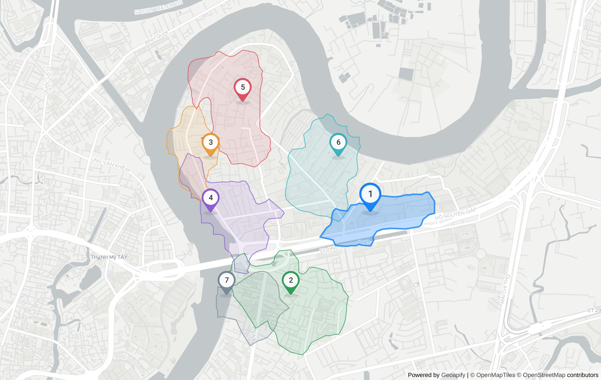

# SiteScout: coffee shop in Phường An Khánh

> **Question:** Where should I open a specialty coffee shop in Thảo Điền?
> Generated 2026-10-22T12:34:26.161Z · 57 Geoapify API calls · ~79 credits · 36.4 s · sitescout-engine@1.0.0 · weights `1.0.0-isoline` · planner: heuristic

## Plan

- Business: **coffee shop** · competitors `catering.cafe` · demand `office`, `sport.fitness`, `commercial.clothing`
- Area: "Xuân Thủy, Thảo Điền, Thủ Đức, Hồ Chí Minh" → Phở Bùi Gia Thảo Điền, 56, Xuân Thủy, Phường An Khánh, Thành phố Hồ Chí Minh, 71108, Việt Nam (amenity, confidence 0) [T0]
- Administrative unit (Geoapify Boundaries): **Phường An Khánh** — Khu phố 18 ⊂ Phường An Khánh ⊂ Thành phố Hồ Chí Minh ⊂ Việt Nam [T1]
- Catchment: **10-minute walking isochrone** per candidate (Geoapify Isoline API)
- 7 candidates generated on a hex lattice inside the study area, pre-scored on an area POI sample [T2]

## Ranked shortlist

| # | Candidate | Score | Demand POIs (10-min walk) | Competitors | Walk area | Mean drive | Evidence |
|---|---|---|---|---|---|---|---|
| 1 | 159, Võ Nguyên Giáp | **0.66** | 4 | 4 | 0.31 km² | 33.6 min | [T12] [T13] [T14] [T15] [T16] [T17] [T53] [T54] [T55] |
| 2 | Trường Mầm Non Yêu Con, Đường Số 3 | **0.56** | 2 | 6 | 0.69 km² | 31.3 min | [T30] [T31] [T32] [T33] [T34] [T35] [T53] |
| 3 | 112/11 - 112/13, Nguyễn Văn Hưởng | **0.52** | 2 | 0 | 0.27 km² | 35.5 min | [T6] [T7] [T8] [T9] [T10] [T11] [T53] |
| 4 | 16, Nguyễn Văn Hưởng | **0.46** | 3 | 9 | 0.45 km² | 32.2 min | [T42] [T43] [T44] [T45] [T46] [T47] [T53] |
| 5 | 216/3/16, Nguyễn Văn Hưởng | **0.45** | 3 | 2 | 0.56 km² | 37.2 min | [T24] [T25] [T26] [T27] [T28] [T29] [T53] |
| 6 | 23, Orchid | **0.42** | 3 | 6 | 0.48 km² | 35.2 min | [T18] [T19] [T20] [T21] [T22] [T23] [T53] |
| 7 | Léa Beauty Spa, Đường số 20 | **0.40** | 0 | 3 | 0.28 km² | 31.8 min | [T36] [T37] [T38] [T39] [T40] [T41] [T53] |

Score = 0.35·demand density + 0.25·(1 − competition) + 0.25·access + 0.15·walk reach, each min-max normalised across these 7 candidates.

## Why each site ranks where it does

### 1. 159, Võ Nguyên Giáp — 0.66

10-min walk reaches 0.31 km² with 3 commercial.clothing, 1 sport.fitness and 4 competing catering.cafe; 34 min average drive from 3 origin(s). [T12] [T13] [T14] [T15] [T16] [T17] [T53] [T54] [T55]

- Sub-scores: demand 1.00 · competition 0.56 · access 0.62 · reach 0.10
- Demand mix: office 0, sport.fitness 1, commercial.clothing 3
- Drive time by origin: Chợ Bến Thành 34.2 min · Bến xe Miền Đông 23.6 min · Crescent Mall 42.9 min
- Coordinates: 10.803087, 106.740537

### 2. Trường Mầm Non Yêu Con, Đường Số 3 — 0.56

10-min walk reaches 0.69 km² with 2 office and 6 competing catering.cafe; 31 min average drive from 3 origin(s). [T30] [T31] [T32] [T33] [T34] [T35] [T53]

- Sub-scores: demand 0.23 · competition 0.33 · access 1.00 · reach 1.00
- Demand mix: office 2, sport.fitness 0, commercial.clothing 0
- Drive time by origin: Chợ Bến Thành 28.3 min · Bến xe Miền Đông 20.5 min · Crescent Mall 45.3 min
- Coordinates: 10.796078, 106.73367

### 3. 112/11 - 112/13, Nguyễn Văn Hưởng — 0.52

10-min walk reaches 0.27 km² with 2 office and 0 competing catering.cafe; 35 min average drive from 3 origin(s). [T6] [T7] [T8] [T9] [T10] [T11] [T53]

- Sub-scores: demand 0.57 · competition 1.00 · access 0.29 · reach 0.00
- Demand mix: office 2, sport.fitness 0, commercial.clothing 0
- Drive time by origin: Chợ Bến Thành 34.2 min · Bến xe Miền Đông 23.6 min · Crescent Mall 48.6 min
- Coordinates: 10.80776, 106.726804

### 4. 16, Nguyễn Văn Hưởng — 0.46

10-min walk reaches 0.45 km² with 2 commercial.clothing, 1 office and 9 competing catering.cafe; 32 min average drive from 3 origin(s). [T42] [T43] [T44] [T45] [T46] [T47] [T53]

- Sub-scores: demand 0.53 · competition 0.00 · access 0.86 · reach 0.41
- Demand mix: office 1, sport.fitness 0, commercial.clothing 2
- Drive time by origin: Chợ Bến Thành 30.9 min · Bến xe Miền Đông 20.2 min · Crescent Mall 45.3 min
- Coordinates: 10.803087, 106.726804

### 5. 216/3/16, Nguyễn Văn Hưởng — 0.45

10-min walk reaches 0.56 km² with 3 office and 2 competing catering.cafe; 37 min average drive from 3 origin(s). [T24] [T25] [T26] [T27] [T28] [T29] [T53]

- Sub-scores: demand 0.42 · competition 0.78 · access 0.00 · reach 0.69
- Demand mix: office 3, sport.fitness 0, commercial.clothing 0
- Drive time by origin: Chợ Bến Thành 36.6 min · Bến xe Miền Đông 25.9 min · Crescent Mall 49 min
- Coordinates: 10.812433, 106.729551

### 6. 23, Orchid — 0.42

10-min walk reaches 0.48 km² with 2 sport.fitness, 1 office and 6 competing catering.cafe; 35 min average drive from 3 origin(s). [T18] [T19] [T20] [T21] [T22] [T23] [T53]

- Sub-scores: demand 0.49 · competition 0.33 · access 0.34 · reach 0.50
- Demand mix: office 1, sport.fitness 2, commercial.clothing 0
- Drive time by origin: Chợ Bến Thành 35.8 min · Bến xe Miền Đông 25.1 min · Crescent Mall 44.6 min
- Coordinates: 10.80776, 106.73779

### 7. Léa Beauty Spa, Đường số 20 — 0.40

10-min walk reaches 0.28 km² with no demand POIs and 3 competing catering.cafe; 32 min average drive from 3 origin(s). [T36] [T37] [T38] [T39] [T40] [T41] [T53]

- Sub-scores: demand 0.00 · competition 0.67 · access 0.92 · reach 0.02
- Demand mix: office 0, sport.fitness 0, commercial.clothing 0
- Drive time by origin: Chợ Bến Thành 29.1 min · Bến xe Miền Đông 19.8 min · Crescent Mall 46.5 min
- Coordinates: 10.796078, 106.728177

**Route to #1:** from Chợ Bến Thành, Quận 1, Hồ Chí Minh, 34 min / 10.1 km by car [T54].

**5-minute drive zone around #1** (Place Details `drive_5`): 10.77 km² [T55].

## Limitations

- POI counts come from Geoapify Places (OpenStreetMap-based); coverage of small Vietnamese shops is incomplete, so counts are relative signals, not market sizes.
- Drive times use Geoapify's approximated traffic at query time, not a specific hour.
- Weights (1.0.0-isoline) are heuristic and not calibrated against real store outcomes.
- Decision support only — visit the site before signing a lease.

## Evidence trace

Every `[Tn]` above is one real Geoapify request. The key is sent as a header, so these endpoints are reproducible as-is with your own key.

| T | API | Request | Status | ms | Result | Credits≈ |
|---|---|---|---|---|---|---|
| T0 | autocomplete | `GET /v1/geocode/autocomplete?text=Xu%C3%A2n+Th%E1%BB%A7y%2C+Th%E1%BA%A3o+%C4%90i%E1%BB%81n&…` | 200 | 1221 | {"count":5,"top":"Phở Bùi Gia Thảo Điền, 56, Xuân Thủy, Phường An Khánh, Thành p | 1 |
| T1 | boundaries | `GET /v1/boundaries/part-of?lat=10.8030828&lon=106.7318264&lang=vi&geometry=geometry_1000` | 200 | 1307 | {"levels":"Khu phố 18 ⊂ Phường An Khánh ⊂ Thành phố Hồ Chí Minh ⊂ Việt Nam"} | 1 |
| T2 | places | `GET /v2/places?categories=catering.cafe&filter=rect%3A106.719938%2C10.814761%2C106.743715%2…` | 200 | 1011 | {"count":51,"categories":"catering.cafe"} | 3 |
| T3 | places | `GET /v2/places?categories=office&filter=rect%3A106.719938%2C10.814761%2C106.743715%2C10.791…` | 200 | 771 | {"count":14,"categories":"office"} | 1 |
| T4 | places | `GET /v2/places?categories=sport.fitness&filter=rect%3A106.719938%2C10.814761%2C106.743715%2…` | 200 | 630 | {"count":8,"categories":"sport.fitness"} | 1 |
| T5 | places | `GET /v2/places?categories=commercial.clothing&filter=rect%3A106.719938%2C10.814761%2C106.74…` | 200 | 595 | {"count":7,"categories":"commercial.clothing"} | 1 |
| T6 | reverse-geocoding | `GET /v1/geocode/reverse?lat=10.80776&lon=106.726804&lang=vi&format=json` | 200 | 583 | {"top":"112/11 - 112/13, Nguyễn Văn Hưởng, Thành phố Hồ Chí Minh, HC 700000, Việ | 1 |
| T7 | isoline | `GET /v1/isoline?lat=10.80776&lon=106.726804&type=time&mode=walk&range=600` | 200 | 361 | {"mode":"walk","range":600,"type":"time","id":"1a1bc3459f63dc85fb9c17076047cb7f" | 1 |
| T8 | places | `GET /v2/places?categories=catering.cafe&filter=geometry%3A1a1bc3459f63dc85fb9c17076047cb7f&…` | 200 | 286 | {"count":0,"categories":"catering.cafe"} | 1 |
| T9 | places | `GET /v2/places?categories=office&filter=geometry%3A1a1bc3459f63dc85fb9c17076047cb7f&limit=1…` | 200 | 480 | {"count":2,"categories":"office"} | 1 |
| T10 | places | `GET /v2/places?categories=sport.fitness&filter=geometry%3A1a1bc3459f63dc85fb9c17076047cb7f&…` | 200 | 437 | {"count":0,"categories":"sport.fitness"} | 1 |
| T11 | places | `GET /v2/places?categories=commercial.clothing&filter=geometry%3A1a1bc3459f63dc85fb9c1707604…` | 200 | 291 | {"count":0,"categories":"commercial.clothing"} | 1 |
| T12 | reverse-geocoding | `GET /v1/geocode/reverse?lat=10.803087&lon=106.740537&lang=vi&format=json` | 200 | 682 | {"top":"159, Võ Nguyên Giáp, Phường An Khánh, Thành phố Thủ Đức, HC 70000, Việt  | 1 |
| T13 | isoline | `GET /v1/isoline?lat=10.803087&lon=106.740537&type=time&mode=walk&range=600` | 200 | 443 | {"mode":"walk","range":600,"type":"time","id":"c93124e19ee56ba2619edca5dd044567" | 1 |
| T14 | places | `GET /v2/places?categories=catering.cafe&filter=geometry%3Ac93124e19ee56ba2619edca5dd044567&…` | 200 | 551 | {"count":4,"categories":"catering.cafe"} | 1 |
| T15 | places | `GET /v2/places?categories=office&filter=geometry%3Ac93124e19ee56ba2619edca5dd044567&limit=1…` | 200 | 351 | {"count":0,"categories":"office"} | 1 |
| T16 | places | `GET /v2/places?categories=sport.fitness&filter=geometry%3Ac93124e19ee56ba2619edca5dd044567&…` | 200 | 503 | {"count":1,"categories":"sport.fitness"} | 1 |
| T17 | places | `GET /v2/places?categories=commercial.clothing&filter=geometry%3Ac93124e19ee56ba2619edca5dd0…` | 200 | 548 | {"count":3,"categories":"commercial.clothing"} | 1 |
| T18 | reverse-geocoding | `GET /v1/geocode/reverse?lat=10.80776&lon=106.73779&lang=vi&format=json` | 200 | 928 | {"top":"23, Orchid, Phường An Khánh, Thành phố Thủ Đức, HC 71108, Việt Nam","typ | 1 |
| T19 | isoline | `GET /v1/isoline?lat=10.80776&lon=106.73779&type=time&mode=walk&range=600` | 200 | 432 | {"mode":"walk","range":600,"type":"time","id":"7a43dba62f73e1c37cc00c09b475e887" | 1 |
| T20 | places | `GET /v2/places?categories=catering.cafe&filter=geometry%3A7a43dba62f73e1c37cc00c09b475e887&…` | 200 | 370 | {"count":6,"categories":"catering.cafe"} | 1 |
| T21 | places | `GET /v2/places?categories=office&filter=geometry%3A7a43dba62f73e1c37cc00c09b475e887&limit=1…` | 200 | 630 | {"count":1,"categories":"office"} | 1 |
| T22 | places | `GET /v2/places?categories=sport.fitness&filter=geometry%3A7a43dba62f73e1c37cc00c09b475e887&…` | 200 | 805 | {"count":2,"categories":"sport.fitness"} | 1 |
| T23 | places | `GET /v2/places?categories=commercial.clothing&filter=geometry%3A7a43dba62f73e1c37cc00c09b47…` | 200 | 464 | {"count":0,"categories":"commercial.clothing"} | 1 |
| T24 | reverse-geocoding | `GET /v1/geocode/reverse?lat=10.812433&lon=106.729551&lang=vi&format=json` | 200 | 625 | {"top":"216/3/16, Nguyễn Văn Hưởng, Phường An Khánh, Thành phố Thủ Đức, HC 71107 | 1 |
| T25 | isoline | `GET /v1/isoline?lat=10.812433&lon=106.729551&type=time&mode=walk&range=600` | 200 | 390 | {"mode":"walk","range":600,"type":"time","id":"861c13fbd8211098cd35e9469747fb55" | 1 |
| T26 | places | `GET /v2/places?categories=catering.cafe&filter=geometry%3A861c13fbd8211098cd35e9469747fb55&…` | 200 | 523 | {"count":2,"categories":"catering.cafe"} | 1 |
| T27 | places | `GET /v2/places?categories=office&filter=geometry%3A861c13fbd8211098cd35e9469747fb55&limit=1…` | 200 | 505 | {"count":3,"categories":"office"} | 1 |
| T28 | places | `GET /v2/places?categories=sport.fitness&filter=geometry%3A861c13fbd8211098cd35e9469747fb55&…` | 200 | 372 | {"count":0,"categories":"sport.fitness"} | 1 |
| T29 | places | `GET /v2/places?categories=commercial.clothing&filter=geometry%3A861c13fbd8211098cd35e946974…` | 200 | 362 | {"count":0,"categories":"commercial.clothing"} | 1 |
| T30 | reverse-geocoding | `GET /v1/geocode/reverse?lat=10.796078&lon=106.73367&lang=vi&format=json` | 200 | 488 | {"top":"Trường Mầm Non Yêu Con, 19, Đường Số 3, Phường An Khánh, Thành phố Thủ Đ | 1 |
| T31 | isoline | `GET /v1/isoline?lat=10.796078&lon=106.73367&type=time&mode=walk&range=600` | 200 | 330 | {"mode":"walk","range":600,"type":"time","id":"f8a80eebf6848d7c6317ec29de3fab61" | 1 |
| T32 | places | `GET /v2/places?categories=catering.cafe&filter=geometry%3Af8a80eebf6848d7c6317ec29de3fab61&…` | 200 | 385 | {"count":6,"categories":"catering.cafe"} | 1 |
| T33 | places | `GET /v2/places?categories=office&filter=geometry%3Af8a80eebf6848d7c6317ec29de3fab61&limit=1…` | 200 | 667 | {"count":2,"categories":"office"} | 1 |
| T34 | places | `GET /v2/places?categories=sport.fitness&filter=geometry%3Af8a80eebf6848d7c6317ec29de3fab61&…` | 200 | 444 | {"count":0,"categories":"sport.fitness"} | 1 |
| T35 | places | `GET /v2/places?categories=commercial.clothing&filter=geometry%3Af8a80eebf6848d7c6317ec29de3…` | 200 | 479 | {"count":0,"categories":"commercial.clothing"} | 1 |
| T36 | reverse-geocoding | `GET /v1/geocode/reverse?lat=10.796078&lon=106.728177&lang=vi&format=json` | 200 | 560 | {"top":"Léa Beauty Spa, 37, Đường số 20, Phường An Khánh, Thành phố Thủ Đức, HC  | 1 |
| T37 | isoline | `GET /v1/isoline?lat=10.796078&lon=106.728177&type=time&mode=walk&range=600` | 200 | 369 | {"mode":"walk","range":600,"type":"time","id":"441c7faa2c33bdf41187de51ea00f1d6" | 1 |
| T38 | places | `GET /v2/places?categories=catering.cafe&filter=geometry%3A441c7faa2c33bdf41187de51ea00f1d6&…` | 200 | 437 | {"count":3,"categories":"catering.cafe"} | 1 |
| T39 | places | `GET /v2/places?categories=office&filter=geometry%3A441c7faa2c33bdf41187de51ea00f1d6&limit=1…` | 200 | 546 | {"count":0,"categories":"office"} | 1 |
| T40 | places | `GET /v2/places?categories=sport.fitness&filter=geometry%3A441c7faa2c33bdf41187de51ea00f1d6&…` | 200 | 601 | {"count":0,"categories":"sport.fitness"} | 1 |
| T41 | places | `GET /v2/places?categories=commercial.clothing&filter=geometry%3A441c7faa2c33bdf41187de51ea0…` | 200 | 429 | {"count":0,"categories":"commercial.clothing"} | 1 |
| T42 | reverse-geocoding | `GET /v1/geocode/reverse?lat=10.803087&lon=106.726804&lang=vi&format=json` | 200 | 654 | {"top":"16, Nguyễn Văn Hưởng, Phường An Khánh, Thành phố Thủ Đức, HC 71108, Việt | 1 |
| T43 | isoline | `GET /v1/isoline?lat=10.803087&lon=106.726804&type=time&mode=walk&range=600` | 200 | 445 | {"mode":"walk","range":600,"type":"time","id":"6d3d67ae48c2acad802abe5610854cfa" | 1 |
| T44 | places | `GET /v2/places?categories=catering.cafe&filter=geometry%3A6d3d67ae48c2acad802abe5610854cfa&…` | 200 | 521 | {"count":9,"categories":"catering.cafe"} | 1 |
| T45 | places | `GET /v2/places?categories=office&filter=geometry%3A6d3d67ae48c2acad802abe5610854cfa&limit=1…` | 200 | 410 | {"count":1,"categories":"office"} | 1 |
| T46 | places | `GET /v2/places?categories=sport.fitness&filter=geometry%3A6d3d67ae48c2acad802abe5610854cfa&…` | 200 | 510 | {"count":0,"categories":"sport.fitness"} | 1 |
| T47 | places | `GET /v2/places?categories=commercial.clothing&filter=geometry%3A6d3d67ae48c2acad802abe56108…` | 200 | 469 | {"count":2,"categories":"commercial.clothing"} | 1 |
| T48 | autocomplete | `GET /v1/geocode/autocomplete?text=Ch%E1%BB%A3+B%E1%BA%BFn+Th%C3%A0nh%2C+Qu%E1%BA%ADn+1&lang…` | 200 | 2472 | {"count":5,"top":"bưu điện quận 1, 65, Lê Lợi, Phường Sài Gòn, Thành phố Thủ Đức | 1 |
| T49 | geocoding | `GET /v1/geocode/search?text=Ch%E1%BB%A3+B%E1%BA%BFn+Th%C3%A0nh%2C+Qu%E1%BA%ADn+1%2C+H%E1%BB…` | 200 | 2438 | {"count":5,"top":"Tòa nhà Đức Thành phố Hồ Chí Minh, 33, Lê Duẩn, Phường Sài Gòn | 1 |
| T50 | autocomplete | `GET /v1/geocode/autocomplete?text=Ch%E1%BB%A3+B%E1%BA%BFn+Th%C3%A0nh&lang=vi&limit=5&filter…` | 200 | 695 | {"count":5,"top":"Chợ Bến Thành, Lê Lợi, Phường Bến Thành, Thành phố Thủ Đức, 71 | 1 |
| T51 | autocomplete | `GET /v1/geocode/autocomplete?text=B%E1%BA%BFn+xe+Mi%E1%BB%81n+%C4%90%C3%B4ng%2C+B%C3%ACnh+T…` | 200 | 982 | {"count":5,"top":"Bến xe Miền Đông, 292, Dinh Bo Linh, Phường Bình Thạnh, Ho Chi | 1 |
| T52 | autocomplete | `GET /v1/geocode/autocomplete?text=Crescent+Mall%2C+Qu%E1%BA%ADn+7&lang=vi&limit=5&filter=co…` | 200 | 1076 | {"count":5,"top":"Trạm Y Tế Phường 7 Quận Phú Nhuận, Phan Đăng Lưu, Phường Cầu K | 1 |
| T53 | route-matrix | `POST /v1/routematrix` | 200 | 805 | {"sources":3,"targets":7,"cells":21} | 21 |
| T54 | routing | `GET /v1/routing?waypoints=10.7726204%2C106.6992917%7C10.803087%2C106.740537&mode=drive&traf…` | 200 | 492 | {"timeS":2054.829,"distanceM":10097} | 1 |
| T55 | place-details | `GET /v2/place-details?id=51d6fb32bd69af5a405980f9bf7ee39a2540f00103f9014aa04ae902000000c002…` | 200 | 1211 | {"features":"details,drive_5"} | 1 |
| T56 | static-maps | `POST /v1/staticmap` | 200 | 4679 | {"bytes":517750,"width":1200,"height":760} | 1 |

---
Powered by [Geoapify](https://www.geoapify.com/) · © [OpenStreetMap](https://www.openstreetmap.org/copyright) contributors
